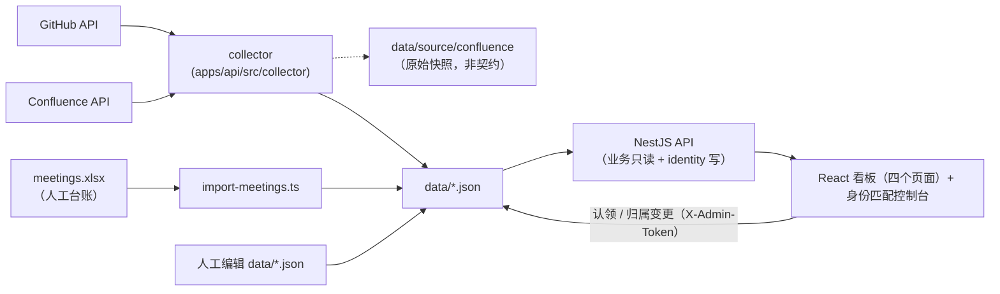

# 07 · 数据采集目录（Data Catalog）

> 依赖文档：`04-data-and-api-contract.md`、`05-integration-roadmap.md`；归属 / 贡献量 / 排序口径另见 `adr/0008`（身份两层）、`adr/0010`（认领优先的生效归属，Confluence 侧先行）、`adr/0011`（Confluence 编辑量指标）、`adr/0014`（身份认领控制台）、`adr/0016`（组织卡展示顺序）、**`adr/0017`（GitHub 生效归属读时派生 + 账号级 `repoIds`，v1.25）**
> 定位：**从数据视角**登记本看板（数据集成看板）所采集 / 展示的每一项数据——从哪来、怎么采、怎么归类、是否已实现、未实现还缺什么。
> **本文件可自由编辑**：它是登记册（registry），**不定义契约**；字段与接口的权威定义以 `04` 为唯一来源。发现不一致时直接修订本文件，或按 `04 §6.1` 发起契约变更。

## 0. 使用说明

**状态**：✅ 已实现（`data/*.json` 有真实数据且链路可跑通）｜🟡 计划中（接口/模型已预留，无采集器或数据为空）｜➖ 派生（无独立采集，由其它数据计算）

**采集方式**：人工维护（运营编辑 JSON/Excel）｜采集脚本（脚本从文件/API 生成 JSON）｜外部 API（GitHub/Confluence/Zoom）｜派生（无采集动作）

**排序约定**：§1 汇总按 **页面 → 页面内数据（自上而下）→ 平台横切** 排列，§2 详细描述沿用同一编号。

## 1. 汇总（一句话速览）

### 1.1 首页 `/`

| 编号 | 数据 | 一句话描述 | 状态 | 采集方式 |
| --- | --- | --- | --- | --- |
| H1 | 伙伴单位数 `partnerCount` | 首页卡片指标。**口径已定**：组织档案中 `type !== 'individual'` 者（= TSC 成员单位 + 参与单位 + 运营单位，**含 LFN**，运营 2026-10-26 裁定），现为 `12`（v1.24 新增参与单位 China Unicom `unicom`，ADR-0016），与组织墙实时在榜数一致 | ✅ | 人工维护（目标自动聚合） |
| H2 | 独立开发者数 `externalDeveloperCount` | **生效归属**为伪组织 `unattributed` 且**非机器人**的 GitHub 账号数（**字段名沿用旧称**，对外文案已统一为「独立开发者」）。⚠️ 自 ADR-0017 起**不再落盘** `home.json`（`schemaVersion` 1 → 2），改为每请求读时派生 | ➖ | 派生（P2 账号级 + P6 认领边 + P5 自然人） |
| H3 | 社区峰会场次 `summitCount` | 峰会与全体峰会的累计场次 | ✅ | 人工维护（目标聚合 `summits.json`） |
| H4 | 应用案例数 `useCaseCount` | 社区沉淀并通过评审的可运行案例数 | ✅ | 人工维护（**缺底层清单**） |
| H5 | 下一次峰会 `nextSummit` | 尚未结束、`endDate` 最晚的一场峰会 | ➖ | 派生（`home.nextSummitId` → `summits.json`） |
| H6 | 贡献组织卡片墙 | 全量组织按**展示顺序 `displayOrder`**（运营人工排位，ADR-0016）排列，卡片直出代码贡献量（commits）/ Confluence 贡献量（编辑量）与各维度 top3 贡献者；两项均为 0 显示「暂无贡献」。⚠️ 两项贡献量与 top3 归属**均按生效归属读时派生**（ADR-0017），top3 已排除机器账号 | ➖ | 派生（P1 组织档案 + P2/A7 账号级原子事实 + P6 认领边） |

### 1.2 社区活跃度 `/activity`

| 编号 | 数据 | 一句话描述 | 状态 | 采集方式 |
| --- | --- | --- | --- | --- |
| A1 | 组织 GitHub 贡献明细 | 各组织的已合并 PR、PR 内提交、Issue、代码量与参与仓库数。⚠️ 自 ADR-0017 起组织级**不读** `github-organizations.json`（该文件降级为基线快照），而是由账号级按**生效归属**求和读时派生，**全覆盖** 13 个组织桶 | ✅ | 外部 API（GitHub GraphQL）落账号级；组织级派生 |
| A2 | 个人贡献排行 | 以 GitHub 账号为维度、带协作指标的个人贡献者（含独立开发者）；出参追加读时派生的 `effectiveOrgId` / `orgSource` / `personId`，**机器账号不在结果中**（ADR-0017 决策 5） | ✅ | 外部 API 回填 + 生效归属派生 |
| A3 | Confluence 成果（需求 / 议题分享） | 各组织在 Confluence 的需求数（需求页 `Contacts` 列的 @）与议题分享次数（会议纪要 `Agenda` 段的 @，按期去重）；归属为**生效归属**（人工认领优先，ADR-0010） | ✅ | 外部 API（Confluence CQL + 正文） |
| A4 | 组织贡献分布（环形图） | 按组织提交数（`github.commits`）计算的占比，**列出全部参与组织**（不再并入「其他」）；Confluence 视图下按 `requirements` | ➖ | 派生（复用 A1 / A3） |
| A5 | 贡献聚合总量 | 各指标总量与数据更新时间（页头展示） | ➖ | 派生（A1 + A3） |
| A6 | 时间区间筛选 | `from` / `to` 区间过滤，阶段一接收但不生效 | 🟡 | —（阶段三由采集游标切片） |
| A7 | Confluence 账号级明细 | 账号 × 三个维度（需求 / 议题分享 / 编辑）的明细，供 Confluence 视图个人区块与候选池取数 | ✅ | 外部 API（同 A3，落后 `confluence-accounts.json`） |
| A8 | 活跃来源切换 | 顶部切换 GitHub / Confluence 两套口径，状态写入 URL `?source=` | ➖ | 派生（前端） |

### 1.3 社区参展 `/summits`

| 编号 | 数据 | 一句话描述 | 状态 | 采集方式 |
| --- | --- | --- | --- | --- |
| S1 | 峰会时间线 | 每场峰会的名称、起止时间、地点、官网与「是否未结束」 | ✅ | 人工维护 |
| S2 | 峰会详情 | 简介、主办方、参会人数、参会组织名单、议程要点、成果与纪要链接 | ✅ | 人工维护 |
| S3 | 峰会规模指标 | 峰会场次、累计参会人次、去重参会组织数、即将召开场次 | ➖ | 派生（S1 + S2） |

### 1.4 例会参会情况 `/meetings`

| 编号 | 数据 | 一句话描述 | 状态 | 采集方式 |
| --- | --- | --- | --- | --- |
| M1 | 例会参会矩阵 | 「人 × 日期」二维台账，`true=出席`、空白=缺席 | ✅ | 采集脚本（Excel 台账导入） |
| M2 | 出席率与出席人数 | 个人出席次数 / 全部场次、每场出席人数 | ➖ | 派生（前端计算） |
| M3 | 准实时参会记录 | 由会议系统（Zoom）自动回填参会名单，替代手工台账 | 🟡 | 外部 API（远期） |

### 1.5 平台与横切数据

| 编号 | 数据 | 一句话描述 | 状态 | 采集方式 |
| --- | --- | --- | --- | --- |
| P1 | 组织档案 | 全站组织主数据（主键、类型、别名、邮箱域名、Logo 等） | ✅ | 人工维护 |
| P2 | 个人贡献者档案 | 人工档案 + 采集回填的 GitHub 协作指标（按 `githubId` 归并）；`schemaVersion` **2** 起含仓库清单 `repoIds`（组织级 `repos` 的并集来源） | ✅ | 人工维护 + 外部 API |
| P3 | 数据更新时间 | 各文件信封的 `updatedAt`，供前端展示 | ➖ | 派生（文件信封） |
| P4 | 采集运行状态 | 采集游标、配额、未归属登录名、仓库集合等运行态 | ✅ | 采集器写入（非契约） |
| P5 | 自然人档案 | 跨来源认定为同一个人的**身份根**（`personId` + 展示名 + 归属组织） | ✅ | 人工维护（身份匹配控制台） |
| P6 | 身份认领映射 | 自然人 ←→ 来源账号的**认领边**（`source` + `accountKey`） | ✅ | 人工维护（身份匹配控制台） |
| P7 | 身份候选池 | 待认领 / 已认领的来源账号池，按来源分组 | ➖ | 派生（P2 贡献者 + M1 例会列名 + Confluence 来源） |
| P8 | 组织花名册 | 各组织下的开发者清单与人数 | ➖ | 派生（P5 的 `orgId` 分组，非落盘） |

## 2. 详细描述

> 每项含：**状态 / 来源 / 采集方式 / 字段 / 归类口径 / 未实现需补**；通用归属与计分规则见 §3。

### 2.1 首页 `/`

**H1 伙伴单位数 `partnerCount`**
- 状态：✅ **口径已定**（2026-10-26 运营裁定），值已与组织墙收敛；仍为人工维护，自动聚合待补。
- 来源：`data/home.json` → `data.partnerCount`（`MetricValue`：`value`/`unit`/`delta`/`deltaDirection`）。
- 归类：`organizations.json` 中 `type !== 'individual'` 的档案数 = **12**（`tsc` ×8 + `participant` ×3 + `operation` ×1；v1.24 新增参与单位 China Unicom `unicom`，ADR-0016），与首页组织墙「共 N 家组织在榜」的实时统计**同源同值**。**含 LFN**（Linux Foundation Networking，`type = 'operation'`）——运营 2026-10-26 裁定其计入组织；同日另裁定其归类由 `tsc` 改为 `operation`，但**口径只排除伪组织 `individual`、与业务类别无关**，故归类变化不影响计数结论（v1.21 时为 `11`，v1.24 起为 `12`）。另一候选口径「仅 `type = 'tsc'`」未采纳（该值现为 8）。
- 历史：原定义「`type=partner` 的档案数」已随枚举迁移失效（`partner` 从来不在生效枚举内，见 04 §3.1 与 `validators.ts` 的 `ORGANIZATION_TYPES`）。`home.json` 曾长期手工填 `10`，其口径为「12 条档案 − LFN − 独立开发者」，导致首页**同一屏**上卡片写「伙伴单位 10 家」、组织墙写「共 11 家组织在榜」，两个数字直接打架。2026-10-26 判定为**手工值错、实时统计对**，已将 `value` 改为 `11` 并同步 `updatedAt`；`organizations.json` 未作任何改动。裁定过程与被作废的「移出档案」方案见 `README §9` v1.19，档案侧结论见 §2.5 P1。
- 未实现需补：① 增加聚合任务把计数自动回写 `home.json.partnerCount.value`——口径已定，**不再有前置阻塞**；② `delta`/`deltaDirection` 需基于历史快照（`data/.snapshots/`）算环比，否则只能人工填（当前 `3`/`up` 为运营手工值，本轮未调整）。
- ⚠️ **实现 ② 时的硬约束**：历史快照中仍存**已退休**的 `Organization.type` 枚举——`data/.snapshots/20260921-185138` 与 `pre-contributor-rerun` 两份 `organizations.json` 各有 10 处 `partner` / `external` / `community`。这些快照是历史备份，**刻意不改写**（改写等于伪造历史；该目录由 `JsonRepository` 写入、运行时从不回读校验，全库仅 `collector-check.mjs:112` 将其列为「跳过的备份目录」）。因此环比聚合代码**不得**用 `isOrganizationArray` 校验历史快照，否则会因退休枚举触发 `validators.ts` 的启动期 fail-fast。

**H2 独立开发者数 `externalDeveloperCount`**
- 状态：➖ **读时派生**（ADR-0017，v1.25）。⚠️ 已**不再落盘**：`home.json` 删除该字段、`schemaVersion` **1 → 2**，采集器也不再回填（连带摘掉 `HOME_REPOSITORY` 注入）；`GET /api/home/summary` 出参形状不变（仍是 `MetricValue`），仅 `value` 由服务端派生。
- 来源：`HomeService` 注入 `CONTRIBUTOR_CONTRIBUTION_PORT`（与 A2 同一份出参），按纯函数 `isIndependentDeveloper`（`common/effective-org.ts`）计数。依赖文件：`github-accounts.json`（P2）+ `identity-claims.json`（P6）+ `persons.json`（P5），任一损坏则接口报 `50001`。
- 归类：**生效归属为伪组织 `unattributed` 且非机器人**的账号（判定链见 §3.2）。⚠️ 归属到真组织 `personal`（Personal，`type = tsc`）的人**不算**独立开发者（ADR-0017 决策 14）。
- 当前值：**7**（修复前恒为 `13`）——`cnafan`(19 commits)、`qxz123456`(5)、`kuangmi-bit`(3)、`20030512`(2)、`tangzhiqiang`(2)、`hanyu0504`(2)、`zhangxltx`(0)。机器账号 `dependabot`（3 commits / 3 PRs）已从**人物口径**排除，其量仍计入 `unattributed` 桶（决策 5 / 11）。
- ⚠️ 与 `.sync-state.json` 的 `unattributedLogins`（13 个登录名）**自此不再相等**：后者语义收敛为「未经认领 / 别名归属的**采集待办清单**」（同 ADR-0010 决策 6），其中 5 个账号已被人工认领到**有归属**的自然人（`wrathwolf` → `lfn`；`eiedty` / `wangyanlin1996` / `wangyonglong12111` / `kweveen` → `huawei`），另 1 个是机器人。
- 生效时机：**改完即生效**——认领 / 解除 / 改 `Person.orgId` 后**下一个请求即变**，无需重跑 `collect:github`、无需重启进程（`JsonRepository` 按文件 mtime 失效缓存，决策 3 / 12）。
- 口径边界（重要）：统计的是**参与过贡献**（本轮采集带 `github` 指标）的独立开发者，不等于「注册的独立开发者总数」。
- 环比：**恒不带 `delta` / `deltaDirection`**——须基于 `data/.snapshots/` 历史快照计算（见 H1 待办 ②），不得由「当前值 − 上次值」伪造；`StatCard` 对 `delta` 判空，趋势药丸自动隐藏。
- 术语：对外一律称「独立开发者」（与 `Badge.tsx` 的 `TYPE_LABEL.individual`、组织墙文案一致）；字段名 `externalDeveloperCount` 为历史遗留，保留不改（改名会波及契约 / 校验 / 前端引用）。
- 未实现需补：① 如需统计「仅注册未贡献」者，需要新增独立的人才/会员数据源；② `GET /api/home/summary` 的 `updatedAt` 仍取 `home.json` 的**文件**时间，与本指标的真实新鲜度来源（账号级 + 认领边）不同步——运营认领后**数字立刻变、首页「数据更新于 X」却不动**（ADR-0017 遗留债 7，待裁定：要么各指标自带时间戳，要么首页时间戳取各来源最大值）。

**H3 社区峰会场次 `summitCount`**
- 状态：✅（人工维护）；目标口径 = `summits.json` 条目数。
- 来源：`data/home.json` → `data.summitCount`。
- 未实现需补：改为由 `summits.json` 长度自动聚合，避免与 S1 时间线不一致。

**H4 应用案例数 `useCaseCount`**
- 状态：✅ 数字已展示，但**缺底层数据**（仅手工数字，无案例清单）。
- 来源：`data/home.json` → `data.useCaseCount`；口径写作「年度案例登记表中通过评审的案例数」，但当前**不存在**对应数据文件。
- 未实现需补：① 新建 `data/use-cases.json`（名称、`orgId`、年份、链接、评审状态、是否可运行）；② 新增 `GET /api/use-cases`，首页聚合「评审通过」案例数；③ 若登记在 Confluence，可复用 A3 采集器（按结构选择器或标签统计）。

**H5 下一次峰会 `nextSummit`**
- 状态：➖ 派生。
- 来源：`home.json` 只存引用 `nextSummitId`，不存峰会本体（避免双份维护）。
- 推导规则：优先取 `nextSummitId` 指向的峰会；若未配置、指向不存在或已结束，回退为「未结束峰会中 `endDate` 最晚的一场」；仍无则 `null`。
- 归类：`isUpcoming` 一律按 `endDate >= 当前时间` **动态重算**，即「未结束」而非「未开始」。
- 未实现需补：无需；只需运营保证 `summits.json` 持续录入未来峰会。

**H6 贡献组织卡片墙**
- 状态：➖ 派生。
- 来源：`organizations.json`（P1，全量档案，含展示顺序字段 `displayOrder`）+ **账号级原子事实** `github-accounts.json`（P2）/ `confluence-accounts.json`（A7）+ 认领边 `identity-claims.json`（P6）+ 自然人 `persons.json`（P5）。⚠️ 自 ADR-0017 起**不再读**组织级落盘文件（`github-organizations.json` / `confluence-organizations.json` 均已降级为基线快照）：两项贡献量按**生效归属**求和读时派生，top3 同样按 `effectiveOrgId` 分桶。
- 口径（v1.24 修订，ADR-0016；v1.25 归属口径修订，ADR-0017）：展示**全部**组织（含零贡献），按运营人工指定的**展示顺序 `displayOrder`** 升序排列，同值/缺失者排最后并按名称升序（单一实现 `common/org-order.ts` 的 `byDisplayOrder` / `sortOrganizations`，组织列表与两侧派生投影共用）；卡片直出**代码贡献量**（`github.commits`）与 **Confluence 贡献量**（`confluence.edits` 编辑量）及**各维度 top3 贡献者**（GitHub 按 `commits`、Confluence 按 `edits` 降序，服务端聚合随 `GET /api/organizations?scope=contributing` 一次下发）；两项指标均为 0 的组织渲染为「暂无贡献」。原「综合贡献分」降序、高/中/低活跃徽章与 `computeScore` 已退役（见 §3.3 存档）。
- **全覆盖派生的直接收益**（ADR-0017 决策 9 / 10）：组织级投影覆盖档案全部 13 个桶（未命中记 0），故「组织级 ≡ 账号级按生效归属求和」由**函数形状**保证，`lfn` 卡片不可能再出现「`commits = 0` 但 top3 有人」的自相矛盾（修复前 `lfn` 根本不在落盘文件的 4 个桶里）。实测：`huawei` **1086** commits、`cmcc` **148**、`unattributed` **36**、`lfn` **25**、`zte` **1**，其余 **8** 个桶为 0，合计恒为 **1296**。
- 独立开发者卡片：未归属贡献者以伪组织 `unattributed`（`type=individual`）参与展示，人数取 H2（读时派生，**7** 人），top3 取该桶内前三（已排除机器账号，故不再出现 `dependabot`）；该伪组织**不计入** H1 伙伴单位数——组织墙「共 N 家组织在榜」按 `type !== 'individual'` 实时统计（`HomePage.tsx`）。
- 未实现需补：① `displayOrder` 为人工维护字段，新增档案未填即落末位（按名称升序），排位变更无审计痕迹（依赖 git 历史）；② ~~top3 未排除机器账号~~ → **已于 ADR-0017 关闭**：`isBotAccount` 纯函数三信号并集（`githubId === 0` / 头像含 `avatars.githubusercontent.com/in/` / login 匹配 `/bot/i`），无需配置名单；但判定是**启发式**，若出现误判仍需落 `data/bot-accounts.json`（ADR-0017 遗留债 3）。实测存量 35 个带指标账号中**只有 `dependabot` 命中**（`githubId = 0`、头像 `avatars.githubusercontent.com/in/29110`、login 含 `bot`，三信号同时命中）；启发式的残余风险是「人类账号 login 含 bot」或「App 头像但应计入」会误判，届时才落名单。

### 2.2 社区活跃度 `/activity`

**A1 组织 GitHub 贡献明细**
- 状态：➖ **读时派生**（ADR-0017，v1.25）。来源：**账号级** `data/github-accounts.json`（P2）+ 认领边 `identity-claims.json`（P6）+ 自然人 `persons.json`（P5）+ 组织档案 `organizations.json`（P1），由 `deriveOrganizationContributions`（`common/effective-org.ts`）按**生效归属**聚合；接口 `GET /api/contributions`。⚠️ **不再读** `data/github-organizations.json`——该文件仍由采集器写入，但已降级为**基线快照**（漂移告警 / 审计用，只有 4 个桶、与账号级实测差 21 commits）。
- 采集：外部 API —— `apps/api/src/collector`（`GithubCollectorService` + `GithubGraphqlSource`），`npm run collect:github`（增量）/ `npm run collect:github:full`（全量）。
  - 全量：逐仓库遍历 `repository.pullRequests(states: MERGED)` + `repository.issues`，**规避搜索接口单查询 1000 条上限**；
  - 增量：`search` 限定 `is:pr is:merged merged:>lastSyncAt` 与 `is:issue created:>lastSyncAt`，以 `total_count ≥ 1000` 作截断告警。
- 字段与口径：

  | 字段 | 含义 | 口径要点 |
  | --- | --- | --- |
  | `github.pullRequests` | PR 数 | **仅已合并**（merged），不含 open / closed-unmerged |
  | `github.commits` | 提交数 | **已合并 PR 内**的提交总数（逐 PR 累加 `commits.totalCount`），不含直推提交 |
  | `github.issues` | Issue 数 | 提出或参与（含评论 / 被指派） |
  | `github.linesChanged` | 代码量 | **PR 级** `additions + deletions` 累加，**不过滤文件类型** |
  | `github.repos` | 参与仓库数 | **去重数**：组织级 = 该生效归属桶内所有账号 `github.repoIds` 的**并集大小**；账号级 = `repoIds.length`（ADR-0017 决策 15）。⚠️ 它是「组织级 ≡ 账号级求和」恒等式的**唯一例外**——求和会把跨账号共用的仓库重复计数（实测 `huawei` 曾显示 51，而采集范围内仓库总数只有 13） |

- 派生规则（ADR-0017 决策 2 / 9 / 10 / 11 / 15）：`pullRequests` / `commits` / `issues` / `linesChanged` **按生效归属求和**，`repos` **取并集**；桶**全覆盖**组织档案（现 13 个，未命中记 0，故 `orgCount` 恒为档案条数）；桶序 = `displayOrder`（`common/org-order.ts`，派生层不二次排序）；`updatedAt` 取 `github-accounts.json` 的**文件**时间戳（记录级无该字段）；机器账号的**量计入**其生效归属桶（仅人物口径排除），总量恒 **1296**。
- 落盘策略（基线快照）：`github-organizations.json` 以 `orgId` 为唯一键；`full` 整体替换、`incremental` 在既有基线上叠加（仓库集合由 `.sync-state.json` 的 `orgRepos` 求并集，集合缺失时退化到已入库计数 `repoFloor`），保证幂等、不清零。⚠️ **账号级**自 v2 起仓库集合随业务文件自持（`github.repoIds`），增量基线由 `buildContributorSeed` 直接从中恢复，**不再依赖** `personRepos`。
- 统计范围：限定 `GITHUB_ORGS` 下公开仓库，可再用 `GITHUB_REPOS` 白名单收窄。
- 未实现需补：① 范围配置目前依赖 `.env`；若需多环境共享口径，建议纳入受版本管理的配置；② 基线快照与账号级派生的**漂移告警尚未实现**（ADR-0017 遗留债 2），当前只能靠 `collector-check.mjs` 离线比对。

**A2 个人贡献排行**
- 状态：✅ 已实现（出参为**生效归属视图** `ContributorContributionView`）。来源：`data/github-accounts.json`（`schemaVersion` **2**，同时服务 P2 与个人排行）+ P6 认领边 + P5 自然人；接口 `GET /api/contributor-contributions`。
- 采集：外部 API —— 采集器以 `githubId`/`contributorId`（GitHub login）归并个人 PR/Issue/提交后写入 `github` 指标；自 v2 起同时落**仓库清单** `github.repoIds`（排序后的仓库全名，`repos ≡ repoIds.length`，ADR-0017 决策 15）。
- 口径：计数字段与 A1 同源同义（账号级是原子事实，组织级由其派生）；出参**追加**读时派生的 `personId` / `effectiveOrgId` / `orgSource`（`claim` / `collection` / `unattributed`）；**机器账号不在结果中**（`isBotAccount` 三信号并集，决策 5——但其 commits / PRs 等**量**仍计入 A1 的归属桶）；**个人之和 = 组织之和**（含伪组织 `unattributed`）可互相核对，`repos` 除外（组织级取并集，见 A1）。
- 筛选/排序：`orgIds` 按 **`effectiveOrgId`** 匹配（认领优先；无认领且采集口径为空者落 `unattributed`），不再看账号级 `orgId`；默认按 `commits` 降序，前端二次排序取 Top 8。
- 未实现需补：① `from`/`to` 阶段一接受但不生效（采集侧无个人级时间切片），如需区间排行须按时间维度保留明细；② `orgSource` 只有三值，无法说明采集口径命中的是 `alias` 还是 `emailDomain`（账号级无落盘 `orgSource`，Confluence 侧有；ADR-0017 遗留债 5）。

**A3 Confluence 成果（需求 / 议题分享 / 编辑）**
- 状态：✅ 已实现（三个维度均取真实值）。来源：`data/confluence-organizations.json`；接口 `GET /api/wiki`。执行 `npm run collect:wiki`（详见 `docs/05` §3、`docs/adr/0009` 与 `docs/adr/0011`）。
- 采集：外部 API —— 三段式：① Confluence REST v1 `/search` + CQL（`space in (...) and type=page`，`expand=space,version,history,metadata.labels,ancestors`）列举目标空间全部页面，分页用 `_links.next` 游标（`limit=100`）；② 对**空间内全部页面**逐页 `GET /wiki/api/v2/pages/{id}/versions`（`limit=200`，按 `_links.next` 游标翻页，上限 20 页）取版本历史，按**版本作者**累计编辑量（ADR-0011；v2 端点只给 `authorId`，展示名仍从正文渲染视图换出）；③ 对**结构选择器命中页**、并上「尚无名字来源的作者所编辑的页」（补名差集，避免为换展示名多跑一轮全量正文）逐页 `GET /rest/api/content/{id}?expand=body.storage,body.view` 取正文并解析（`body.view` 用于取展示名，不额外发请求）。串行 + 固定间隔，单页失败只降级该页。**全量重算**：每轮整体替换 `confluence-organizations.json`（唯一键 `orgId`），不做增量（增量需逐页台账，风险大于收益）。
- 粒度（ADR-0008 / ADR-0010 / ADR-0011）：同轮落**账号级** `data/confluence-accounts.json`（`ConfluenceAccount`，主体是平台账号而非自然人；`schemaVersion` 已升至 **4**：v3 新增 `orgSource`、v4 在 `confluence` 下新增 `edits`）。接口对外按**生效归属** `effectiveOrgId` **读时派生**（`GET /api/wiki` 不再读组织级文件，见 04 §5.3.4 / §5.3.16）；`confluence-organizations.json` 仍由采集器写入，但降级为**基线快照**（非读路径来源）。组织级同名文件 `schemaVersion` 为 **3**（v2 字段改名、v3 新增 `edits`）。
- 字段：`confluence.requirements`（需求条数）、`confluence.topicShares`（议题分享次数）、`confluence.edits`（编辑量：页面版本作者条数，含创建那次，见 ADR-0011）。账号级另含 `orgId`（采集口径）、`orgSource`（`alias`/`space`/`unattributed`）、`personId`。
- 口径（ADR-0009）：
  - **需求** = `Requirement Proposal` 页（须位于 `Release Planning` 之下，排除 `Releases` 下的同名模板页）需求表格 `Contacts` 列里**每个 @ 提及各算 1 条**（一行两位联系人则两位各 1 条，故条数 = 提及数，不等于页数/行数；只取该列，表外 @ 不计）。
  - **议题分享** = 会议纪要页（标题匹配 `^\d{4}-\d{2}-\d{2} TSC Minutes$` 且父页匹配 `^\d{4} - TSC Minutes$`）`Agenda` 段**内**的全部 @（段落与表格行都算），**同一期同一账号最多 1 次**（同页 `Attendees & Representation` 段的 @ 是出席签到，不计入）。首次真实采集（2026-09-28 复核）：16 期会议 / 21 次分享 / 12 个分享账号（段内原始 @ 25 处，同期重复去重 4 处）。
  - **编辑**（ADR-0011）= 空间内**全部页面**的版本历史中，该账号作为**版本作者**出现的次数（**含页面创建那一次**，一页多版本、多人共编各计 1 条，**不做单页封顶**）。取数走 v2 `GET /pages/{id}/versions`（`limit=200` + `_links.next` 游标，上限 20 页），只认 `authorId`；作者展示名不由该端点提供，仍从正文渲染视图换出。
  - 选页用**结构选择器**（标题 + 祖先链 / 正则），**不看标签、不看标题关键字**（实测空间无任何需求标签）。
  - 全部选择器与列/段名均可经 `CONFLUENCE_REQUIREMENT_*` / `CONFLUENCE_MINUTES_*` 环境变量就地校正（留空取内置默认）。
- `bestPractices` 已**移除**：best-practice 内容不在 Confluence wiki 内，第二维改为真实可得的 `topicShares`（见 ADR-0009）。
- 归类（**生效归属**，ADR-0010）：**被 @ 或作为页面版本作者的账号**归属（优先级从高到低）——① **身份认领边**（P6 `identity-claims.json` 中 `source=confluence` 且 `accountKey=accountId` → `Person.orgId`，**人工优先**）；② `Organization.aliases.confluence` 精确匹配（accountId / 展示名 / 空间 key）；③ 空间兜底；④ 伪组织 `unattributed`。其中 ②③④ 为**采集口径**（写入账号级 `orgId` + `orgSource`），① 为**读时派生覆写**。未命中账号写入独立状态文件 `unattributedAccounts[]`（语义为「未经认领 / 别名归属的待办清单」）；正文里写成纯文本 `@人`（解析不出 accountId）写入 `unresolvedContacts[]`，均供运营补录（补录后**认领即生效**，无需重跑采集器；补别名仍需重跑）。
- 展示名（只影响可读性，不参与计数与归属）：兜底顺序为**渲染视图 `body.view`**（随正文一并取回，零额外请求）→ 正文 `ri:username` → 页面创建者展示名 → `GET /rest/api/user` → accountId。实测正文只有 `ri:account-id`、`/rest/api/user` 返回 403，但渲染视图已带出展示名；引入编辑量后，正文取页范围额外并入「尚无名字来源的作者所编辑的页」，故 21 个账号**全部为真名**（无一落 accountId 兜底）；日志按来源分档计数。
- 输出兜底：聚合覆盖组织档案全部组织（含 `unattributed`），未命中者记 0，保证活跃度页 join 无空洞。**需求 / 议题分享两维全为 0 视为异常，中止写入并保留旧数据**；`edits` **刻意不进入**该保护——版本接口失败只降级为「该页无编辑量」，不连带阻断既有两维落盘，仅在「本轮编辑量全为 0 而既有数据非 0」时告警（见 ADR-0011）。
- 状态与快照：独立状态文件 `data/.sync-state.confluence.json`（不复用 GitHub 的 `.sync-state.json`，避免覆盖其游标）；原始页面快照落 `data/source/confluence/`（非契约、接口与前端不可见）。
- 未实现需补：① `aliases.confluence` 仍全部为空，故**组织归属**整体落 `unattributed`（`source=confluence` 认领边已有 4 条，账号级 `personId` 快照已部分落盘）；最新一轮真实采集为 **21 个账号 / 三个维度**，合计需求 **38** / 议题分享 **20** / 编辑 **672**，与 `confluence-organizations.json` 的 `unattributed` 行逐字段一致——账号级落盘已能给出**具体账号 + 三个维度的量**；运营据此**补认领边后活跃页立即生效**，补别名则需重跑采集器；② 口径依赖正文结构（列名/段名/层级）与 v2 版本端点，改版即解析不到（正文选择器已做成环境变量 + 两条自检信号）；③ `from`/`to` 时间切片不适用（全量累计值）。

**A4 组织贡献分布（环形图）**
- 状态：➖ 派生。来源：复用 A1（`GET /api/contributions`）。
- 口径：前端按组织 `github.commits` 计算占比；**每个有非零计数的组织各占一个具名扇区**，不再并入「其他」（无 3% 阈值与扇区数上限，见 ADR-0013）。Confluence 视图复用同一卡片，改为按组织 `confluence` 的**三个维度**（需求 / 议题分享 / 编辑）切换占比口径（见 ADR-0011）。
- 未实现需补：无需。

**A5 贡献聚合总量**
- 状态：➖ 派生。来源：A1 + A3 的服务端聚合；接口 `GET /api/contributions/summary`。
- 口径：`totals`（`pullRequests`/`commits`/`issues`/`linesChanged`/`requirements`/`topicShares`/`edits`）+ `orgCount` + `updatedAt`（取两侧派生结果 `updatedAt` 的**较晚者**，即 `github-accounts.json` 与 `confluence-accounts.json` 两个**文件**时间戳的最大值）。
- 口径变化（ADR-0017）：GitHub 侧改为**全覆盖派生**后，`orgCount` 恒等于**组织档案条数**（现 `13`，含伪组织 `unattributed` 与 8 个 0 值桶），**不再是「有贡献的组织数」**（此前 GitHub 侧读落盘文件、部分覆盖，实测并集仅 `4`）；`totals.commits` 恒等于账号级合计（存量实测 **1296**），机器账号的量**计入**总量。
- 未实现需补：`requirements`、`topicShares` 与 `edits` 均已随 A3 落地取真实值（各组织求和，见 ADR-0011）。

**A6 时间区间筛选**
- 状态：🟡 计划中（参数已接收，阶段一不过滤）。来源：请求参数 `from`/`to`（ISO 8601）。
- 采集：阶段三由采集器在落盘时按 `lastSyncAt` 游标切片决定区间；接口恒只读落盘结果。
- 未实现需补：采集侧需保留时间维度明细（当前落盘为累计值），否则区间筛选无法真正生效；接口与前端无需改动。

**A7 Confluence 账号级明细**
- 状态：✅ 已实现。来源：`data/confluence-accounts.json`（账号级 `schemaVersion` = **4**）；接口 `GET /api/confluence-accounts`（生效口径）。
- 采集：与 A3 同轮同源，账号级落盘（含 `edits`，见 ADR-0011）。
- 用途：活跃度页 Confluence 视图的账号榜（`useConfluenceAccounts` → `ConfluenceAccountRankCard`）、身份控制台候选池（P7）取数；每条记录**至少满足一项**：在需求表格被 @、在会议纪要 `Agenda` 段被 @、或是页面版本作者（故三个指标可同时为 0）。
- 未实现需补：无。

**A8 活跃来源切换**
- 状态：➖ 派生（前端）。来源：URL query `?source=github|confluence`。
- 口径：切换只改变渲染的数据源与列（GitHub 指标 / Confluence 指标），筛选条件保留；默认 `github`。
- 未实现需补：无。

### 2.3 社区参展 `/summits`

**S1 峰会时间线**
- 状态：✅ 已实现。来源：`data/summits.json`。采集方式：**人工维护**（手动录入）。
- 字段：`id`、`name`、`startDate`、`endDate`、`location`、`websiteUrl`、`isUpcoming`。
- 归类：`isUpcoming` 由服务端按 `endDate` 动态重算（「未结束」）；列表默认按 `startDate` 降序，前端按年份分组。
- 未实现需补（可选自动化）：目前无自动来源。若想减少人工，可从活动官网 / LF 事件页 / Event API 采集基础信息；但 `id` 与展示口径仍需人工兜底，**短期建议维持人工维护**。

**S2 峰会详情**
- 状态：✅ 已实现。来源：`data/summits.json`（在 S1 基础上扩展字段）。采集方式：人工维护。
- 字段：`description`、`hostOrgId`、`host`、`attendeeCount`、`attendingOrganizations`、`agendaHighlights`、`outcomes`、`minutesUrl`。
- 归类：① `hostOrgId` 关联组织档案，缺失时以 `host` 文本兜底；② `attendingOrganizations` **存组织名称字符串**（便于人工维护），前端/服务层按 `name`/`aliases` 反查 `orgId`；③ `minutesUrl` 缺失时前端展示 `—`。
- 未实现需补：① `attendeeCount` 当前真实数据为 `0`（示例），需人工补录或从票务/报名系统采集；② 真实数据中的 `attendingOrganizations` 含大量尚未登记在 `organizations.json` 的单位（如 TELUS、Airtel、NTT DOCOMO 等），反查 `orgId` 会落空——需运营按需补充档案，或明确「峰会组织名允许不建档案」。

**S3 峰会规模指标**
- 状态：➖ 派生。来源：S1 + S2。
- 口径：峰会场次 = 全量条数；累计参会人次 = 各场 `attendeeCount` 累加；参会组织 = 各场 `attendingOrganizations` 去重计数；即将召开 = `isUpcoming` 计数。

### 2.4 例会参会情况 `/meetings`

**M1 例会参会矩阵**
- 状态：✅ 已实现。来源：产物 `data/meetings.json`；**源台账** `data/source/meetings.xlsx`（台账**不是契约文件**，接口不读、前端不可见）。
- 采集：采集脚本 —— `apps/api/scripts/import-meetings.ts`，运行 `npm run collect:meetings`。
- 解析约定：读首个工作表，第 1 行为表头（`A1` 为日期列标签，`B1..` 为人名），第 2 行起每行一场例会；日期兼容 Excel 序列号与 `YYYY-MM-DD`/`YYYY/MM/DD`；出席记号宽容匹配（`√`/`✓`/`Y`/`1`/`是`/`x`/`X`/`出席` → `true`，空与其它值 → `false`）。
- 归类（**刻意不规范化**）：① 矩阵**无主键**，`columns` 是 Excel 表头**人名原文**，**不关联** `Organization`/`Contributor`；② **空白 = 缺席**，且计入出席率分母——成员加入前的历史空白同样拉低出席率（已接受的负债）；③ 行序、列序**严格保留台账原序**，接口与前端**均不重排**；新增成员追加末尾，离场成员保留列；④ 不含会议元信息（时长/主持人/议程/地点），不含聚合字段。
- 未实现需补（见 `05 §10.4`）：① 拿到真实台账后按实际记号校准出席判定映射；② 台账列名一致性由运营保证（改名/重名/空格会产生重复列，静默算错出席率）；③ 接 Zoom 前需先补稳定人员标识 `personId`（见 M3）。

**M2 出席率与出席人数**
- 状态：➖ 派生。来源：M1。采集方式：无，**由前端计算**（`present / rows.length` 与每场出席人数），接口不返回聚合值。
- 未实现需补：若需「按组织统计出席率」，需先把 M1 人名映射到组织（当前无关联）——与 M3 的 `personId` 需求合并处理。

**M3 准实时参会记录**
- 状态：🟡 计划中（远期）。来源（目标）：会议系统（Zoom）参会报告。
- 采集（计划）：外部 API，自动回填参会名单，替代手工 Excel 台账。
- 未实现需补：① 引入稳定人员标识 `personId`，建立 `personId ↔ 人名原文 ↔ 组织` 映射（当前列名是人名原文，改名/重名会静默错算）；② 明确参会判定规则（入会时长阈值等），避免「登录即算出席」；③ 先完成 M1 列名规范化，再接 Zoom。

### 2.5 平台与横切数据

**P1 组织档案**
- 状态：✅ 已实现（人工维护）。来源：`data/organizations.json`，由 `repositories.module.ts:71` 以**只读仓库**加载——采集器不会写回（`confluence-collector.service.ts:1130`「档案即真相」），故人工编辑不会被下轮采集覆盖。
- 字段：`orgId`（主键）、`name`、`logoUrl`、`homepageUrl`、`type`、`tags`、`aliases`、`emailDomains`、`joinedAt`、`displayOrder`（v1.24 新增，展示顺序，见 04 §3.1 与 ADR-0016）、`description`。
- 归类：`type ∈ {tsc, participant, operation, individual}`——`tsc` = TSC 成员单位、`participant` = 参与单位、`operation` = 运营单位（v1.21 新增，当前仅 `lfn`）、`individual` 仅供伪组织 `unattributed` 使用（哨兵值，非业务类别）。详见 §3.1 与 04 §3.1。`aliases`（多源别名）与 `emailDomains` 是 §3.2 归属判定的核心输入。
- 当前分布（13 条）：`tsc` ×8 = `cmcc` / `huawei` / `orange` / `zte` / `ais` / `infosys` / `asiainfo` / `personal`；`participant` ×3 = `zain` / `inspur` / **`unicom`（China Unicom，v1.24 按运营排位名单新增，ADR-0016；`logoUrl` 暂为空、前端首字母色块降级）**；`operation` ×1 = `lfn`；`individual` ×1 = `unattributed`。
- **档案全部在册，无待移除项**（v1.19 裁定时 12 条；v1.24 起 13 条，含新增 `unicom`）：`lfn`（Linux Foundation Networking）与伪组织 `unattributed` 均**保留**。运营于 2026-10-26 裁定 `lfn` **计入组织**，据此 H1 `partnerCount` 的手工值由 `10` 修正为 **`11`**，与组织墙在榜数收敛。原拟「将 `lfn` 与 `unattributed` 一并**移出组织档案**」的方案**作废**：自然人 `casey-cain` 的 `orgId = "lfn"` 与 2 条认领边继续有效，无需另行指定归属；`unattributed` 撑起的独立开发者瓷砖（`OrganizationWall.tsx:188`）与「另有 N 位独立开发者」文案（`HomePage.tsx:121`）也无需改造。裁定过程见 `README §9` v1.19。
- **`lfn` 归类变更（v1.21，同日）**：`type` 由 `tsc` 改为新增类别 **`operation`（运营单位）**，即 `lfn` **不再计为 TSC 成员单位**。此变更**不推翻** v1.19 的结论——`partnerCount` 口径是 `type !== 'individual'`，`operation` 同样计入，故仍为 **`11`**；`casey-cain` 的归属、2 条认领边、指派校验（`person.service.ts:257` 仅拒绝 `individual`）与组织花名册（`org-roster.service.ts:44` 同口径）全部不受影响。v1.19 当时以「其 `type` 本就是 `tsc`」作为计入理由，该**理由已被本条取代**（结论不变）。实际影响仅展示层**两处**：徽章文案「TSC 成员单位」→「运营单位」、配色紫 → 中性灰。`TYPE_WEIGHT` 中 `lfn` 的梯队虽由 0 降为 2，但**首页组织墙走 `scope=contributing`（当时按 `contributionScore` 降序，ADR-0001）不经过该权重表**，且当前前端无 `scope=all` 调用方，故**卡片顺序完全不变**。（⚠️ 本句的前提已随 **ADR-0016（v1.24）** 失效：`TYPE_WEIGHT` 与 `contributionScore` 双双退役，两个 scope 统一按 `displayOrder` 升序（单一实现 `common/org-order.ts`），`lfn` 现排 `displayOrder = 120`；结论「归类变更不影响顺序」仍成立，但理由换成「顺序只看 `displayOrder`」。）
- 已知缺口（登记于 `06`，该文档只保留未解决项）：
  - **`aliases` 覆盖率为 0**：13 条档案的 `aliases.github` / `aliases.confluence` **全部为空**，归属判定的第一优先级信号完全空转，当前 100% 依赖 `emailDomains` 兜底（12/13 条已配，仅 `unattributed` 为空，符合预期；v1.24 新增的 `unicom` 已配 `chinaunicom.cn` / `chinaunicom.com`）。**运营决定暂不处理**——该缺口不会静默失真：`confluence-collector.service.ts:879` 每轮采集都会打印告警「`aliases.confluence` 全部为空：本轮全部计数将归入『独立开发者』」。

**P2 个人贡献者档案**
- 状态：✅ 已实现（混合实体）。来源：`data/github-accounts.json`（信封 `schemaVersion` **2**；v1 → v2 的变更是 `github` 下新增**必填** `repoIds`，ADR-0017 决策 15）。
- 字段：`contributorId`（主键，对齐 GitHub login）、`githubId`（去重/归并键，同时是 P6 认领边的 `accountKey`）、`name`、`orgId`（可空）、`avatarUrl`、`joinedAt`、`description`、`github`（采集回填，类型 `AccountGithubMetrics` = `pullRequests` / `commits` / `issues` / `linesChanged` / `repos` / **`repoIds`**，其中 `repos ≡ repoIds.length`）。⚠️ 记录级**没有** `updatedAt` 字段，组织级投影的时间戳只能取文件信封值。
- 归类：**人工维护字段**（`joinedAt`/`description`，以及人工写入的 `name`/`orgId`）与**采集字段**（`github` 指标、`name`/`avatarUrl`/`orgId` 回填）分离；采集按 `existing.orgId ?? author.orgId`、`existing.name || author.name` 合并（`github-collector.service.ts:610-619`），故**不会覆盖**人工已指定的归属与已填名称。⚠️ 自 ADR-0017 起账号级 `orgId` 降为**采集口径兜底**（每轮按 `aliases.github` → `emailDomains` → `null` 重算），**不再直接决定展示归属**：生效归属 = 认领边派生的 `Person.orgId`（P5）?? 账号级 `orgId` ?? `unattributed`。人工归属请写在 P5 `Person.orgId` + P6 认领边上，改完**下一个请求即生效**，无需重跑采集器。
- 未实现需补：① `joinedAt`/`description` 无采集来源，需运营手工补；若希望自动获取加入时间，可用其首个贡献时间回填（当前未实现）；② v1 → v2 的存量迁移由一次性脚本 `npm run backfill:github-repo-ids` 完成（从 `.sync-state.json.personRepos` 回填，**已执行**，脚本保留只为可复现）；③ 账号级仍无落盘 `orgSource`（遗留债 5）。

**P3 数据更新时间**
- 状态：➖ 派生。来源：各文件信封字段 `updatedAt`（及 A5 的聚合最新时间）；由写入方（人工/采集器）落盘时写入。
- 未实现需补：采集失败时后端会附加 `X-Data-Stale: true`；若前端需显式提示「数据陈旧」，需补充该响应头的展示逻辑。

**P4 采集运行状态**
- 状态：✅ 已实现（**非契约**，前端不可见，可随时删除）。来源：`data/.sync-state.json`，采集器写入。
- 字段：`lastSyncAt`/`lastRunAt`/`lastMode`/`status`、`rateLimitRemaining`、`unattributedLogins`（未归属登录名清单）、`orgRepos`/`personRepos`（仓库集合）、`recordCount`。
- 归类：仅存采集元信息，**不污染业务数据文件**；删除后 `lastSyncAt` 丢失 ⇒ 下轮触发全量采集。历史快照位于 `data/.snapshots/`（保留最近 7 份，用于回滚）。
- ⚠️ 两个字段自 ADR-0017（v1.25）起语义收敛：
  - `personRepos`（login → 仓库全名集合）降级为**审计 / 一次性回填来源**——账号级仓库集合已随业务文件自持（`github.repoIds`，`schemaVersion` 2），增量基线不再读它，故**删掉状态文件也不会让个人 `repos` 退化**；回填脚本 `backfill-github-repo-ids.mjs` 用它补齐存量 v1 数据（决策 15）。
  - `unattributedLogins` 是「未经认领 / 别名归属的**采集待办清单**」，其条数（现 13）**不等于**首页独立开发者人数（H2，现 **7**）——后者按**生效归属**判定，其中 5 个账号已被认领到有归属的自然人、1 个是机器账号（见 H2）。
- 组织维度的 `orgRepos` 仍是**增量并集的唯一来源**（`github-organizations.json` 只存计数，集合缺失时退化到 `repoFloor`），未随决策 15 改变。
- 未实现需补（可选）：`unattributedLogins` 目前只落盘、无界面；建议在运营侧建立「未归属登录名 → 组织」补录流程，闭环提高归属率。

**P5 自然人档案**
- 状态：✅ 已实现（人工维护，**写侧**）。来源：`data/persons.json`（信封包裹 `Person[]`，初始为 `[]`）。
- 字段：`personId`（主键，slug，创建后不可变）、`displayName`、`orgId`（可空，归属组织）、`avatarUrl`（可选）、`createdAt`/`updatedAt`。档案一经创建仅可改名与调整归属，删除为不可逆物理删除（仅限误建）。
- 归类：**自然人 = 跨来源身份根**，是 P6 认领边的唯一锚点，不复用 P2 `Contributor`（后者是 GitHub 账号维度档案）。`orgId` 是**自然人级**归属，且为**展示口径的唯一真相**：经 P6 认领边命中后，它**压过**账号级采集口径（GitHub 侧 ADR-0017、Confluence 侧 ADR-0010）；§3.2 的 `Contributor.orgId` 降为**兜底**（认领边缺失或认领到无归属自然人时回落），二者不再是「并存、互不覆盖」。改这里的 `orgId` 会让该自然人**全部**已认领账号的生效归属立即改变（下一个请求即生效）。
- 未实现需补：自然人与 P2 `Contributor`、M1 例会列名、Confluence 账号之间**目前仅靠人工认领**，无自动归并规则（如 login 与人名相似度）；`avatarUrl` 需人工或认领后回填。

**P6 身份认领映射**
- 状态：✅ 已实现（人工维护，**写侧**）。来源：`data/identity-claims.json`（信封包裹 `IdentityClaim[]`，初始为 `[]`）。
- 字段：`claimId`（主键）、`personId`（外键 → P5）、`source`（`github`/`confluence`/`meeting`）、`accountKey`（来源内稳定标识：`githubId`／`accountId`／人名原文）、`displayName`（快照，可选）、`createdAt`、`createdBy`（可选）。
- 归类：**点边分离**——认领边与自然人分文件存放，认领 / 解除可独立发生，避免每次绑定重写整个自然人档案。解除匹配 = **物理删除该边**；**未认领池**定义为「没有被任何边引用的来源账号」，因此池无需维护状态位。
- 口径：**不做唯一性校验**（同一账号可被多人认领，前端提示冲突）；认领**不改变**任何历史贡献数据（贡献挂在 `githubId` 与列名原文上）。
- 未实现需补：无一键「按 login / 人名相似度推荐认领」；未来新增来源（如 Zoom 参会账号）只需扩展 `source` 枚举，`Person` 不动。

**P7 身份候选池**
- 状态：➖ 派生（不落盘、无数据文件）。
- 来源：`github` ← P2 `github-accounts.json`（`accountKey = githubId`）；`confluence` ← **数据已就绪、服务端尚未接线**（账号级 `data/confluence-accounts.json` 已随 ADR-0008 落地，`accountKey = accountId`，但 `CandidateService` 仍只读组织级 `confluence-organizations.json`：为空时提示「暂无数据」、非空时提示「账号级候选尚未接入」，两种情形都返回空数组且不报错）；`meeting` ← M1 `meetings.json` 的 `columns` 去重（`accountKey = 人名原文`）。
- 字段（`IdentityCandidate`）：`source`、`accountKey`、`displayName`、`avatarUrl`（仅 github）、`claimedBy[]`（空数组 = 待认领；长度 > 1 = 冲突）。
- 归类：候选池随来源采集自动同步，**零维护**；响应**不含邮箱等敏感身份字段**；单一来源缺失时仅降级为空数组并在 `warnings` 中说明。
- 未实现需补：无分页（当前量级数十～数百，全量返回）；**Confluence 分组尚未接线**——账号级来源 `data/confluence-accounts.json` 已就绪，待 `CandidateService` 改读该文件（并复用 `aliases.confluence` / 认领边判定已认领）后，候选池 `confluence` 分组即可产出数据。

**P8 组织花名册**
- 状态：➖ 派生（不落盘、无数据文件）。
- 来源：P5 `persons.json` 按 `orgId` 分组 + P1 组织档案（只读）。
- 字段（`OrgRosterEntry`）：`organization`（组织档案原文）、`memberCount`（**活跃**自然人数）、`members[]`（`personId`/`displayName`/`avatarUrl`/`status`）。
- 归类：归属**只存 `Person.orgId` 一处**，组织档案上**不存成员清单**（避免两份真相）；排除伪组织 `unattributed`，未归属者进 `unassigned`。归属写入唯一入口是 `PATCH /api/identity/persons/:personId`。
- 未实现需补：无「按组织导出花名册」；`memberCount` 与 P1 组织的贡献归属人数（来自 P2）**口径不同**，不可直接相减。

## 3. 归类与派生总则

### 3.1 组织类型（`Organization.type`）

| `type` | 含义 | 是否计入组织计数 |
| --- | --- | --- |
| `tsc` | TSC 成员单位（进入技术指导委员会的单位） | ✅（H1） |
| `participant` | 参与单位（参与社区共建、未进入 TSC 的单位） | ✅（H1） |
| `operation` | 运营单位（v1.21 新增；当前仅 `lfn`） | ✅（H1） |
| `individual` | **伪组织** `unattributed` 专用的哨兵值，非业务类别；不参与任何组织计数 | ❌ |

> 当前档案分布（`data/organizations.json`，13 条）：`tsc` ×8、`participant` ×3（v1.24 新增 `unicom`）、`operation` ×1、`individual` ×1。前端 Badge 文案见 `apps/web/src/components/ui/Badge.tsx` 的 `TYPE_LABEL`（仅 `tsc` 用紫色强调，其余中性灰）；**v1.24 起组织类型不再参与排序**——全站按 `displayOrder` 展示顺序排列（ADR-0016，原 `TYPE_WEIGHT` 权重表已删除）。
> 前三类为真实组织类别，在**所有计数口径上完全等价**（各处一律写作 `type !== 'individual'`）；差异仅体现在徽章文案与配色。
> ⚠️ 枚举受 `apps/api/src/repositories/validators.ts` 的 `ORGANIZATION_TYPES` **启动期 fail-fast 校验**：写入表外取值会导致后端拒绝加载**整份**组织档案。**扩展枚举须同步 5 处**（含 `TYPE_LABEL` 全覆盖映射，漏改即 TS 编译失败；v1.23 及以前的第 6 处 `TYPE_WEIGHT` 已随 ADR-0016 删除），完整清单见 04 §3.1 `type` 行。

### 3.2 贡献归属判定（优先级从高到低）

GitHub 归属自 ADR-0017（v1.25）起与 Confluence 侧同构，也是**两层**：**采集口径**写入账号级 `github-accounts.json` 的 `orgId`（每轮采集重算）；**生效归属** `effectiveOrgId`（接口对外值、组织级分桶键、独立开发者判据）在其上叠加认领边，**每请求读时派生**（`resolveGithubEffectiveOrg`）。生效归属优先级从高到低：

0. **身份认领边**（**人工优先**，读时派生）：`identity-claims.json` 中 `source=github` 且 `accountKey = String(githubId)` 的边 → `Person.orgId`；命中则 `orgSource='claim'`。同一账号多边 → 取**首条**并记 `WARN`；认领到**无 `orgId` 的自然人** → **回落**采集口径（不清零）。⚠️ 匹配键是 **`githubId`**（数字账号 ID，稳定）而**非 login**（可改名）；**不做展示名模糊匹配**（同名会静默错归）。

以下 1–3 为**采集口径**（命中即 `orgSource='collection'`，无法再区分是别名还是邮箱命中——账号级无落盘 `orgSource`，ADR-0017 遗留债 5）：

1. **登录名别名**：`Organization.aliases.github` 与贡献者 login（小写）精确匹配（⚠️ 当前 13 条档案的 `aliases.github` **全为空**，该级空转，见 P1 已知缺口）；
2. **邮箱域名**：命中 `Organization.emailDomains`（精确匹配优先，其次按 `.域名` 后缀匹配子域，如 `mail.huawei.com` → `huawei.com`）。邮箱信号优先取 **PR 首个提交的作者邮箱**，缺失时退化为账户**公开资料邮箱**；
3. **独立开发者兜底**：以上均未命中 → 账号级 `orgId = null`，生效归属落伪组织 `unattributed`（`orgSource='unattributed'`）。

补充：邮箱**仅用于内存判定，不写入任何数据文件**（`@users.noreply.github.com` 等自然不命中）；人工在 `github-accounts.json` 已指定的 `orgId` **不会被采集自动覆盖**，但它只是**兜底**——该账号一旦被认领到有归属的自然人，展示归属以认领边为准；多组织配置相同域名时按组织档案顺序取第一个。

> **生效时机**：改认领边 / 改 `Person.orgId` → **下一个请求即生效**（`JsonRepository` 按文件 mtime 失效缓存，无需重跑采集器或重启进程）；改 `aliases.github` / `emailDomains` → 需重跑 `collect:github`。
> `Person.orgId`（自然人级归属，P5/P8）**不被采集器改写**，且是展示口径的**唯一真相**；账号级 `Contributor.orgId` 是其缺失时的兜底。二者**不再是「并存、互不覆盖」**——ADR-0017 已取代 ADR-0008 决策 3 在 GitHub 侧的效力。

### 3.2.1 Confluence 归属（A3，ADR-0009）

Confluence 归属是**两层**：**采集口径**写入账号级 `confluence-accounts.json` 的 `orgId`（+ `orgSource`）；**生效归属** `effectiveOrgId`（接口对外值）在其上叠加认领边（ADR-0010）。与 3.2 的 GitHub 口径**相互独立**。生效归属优先级从高到低：

1. **身份认领边**（**人工优先**，读时派生）：`identity-claims.json` 中 `source=confluence` 且 `accountKey=accountId`（小写归一）的认领边 → `Person.orgId`；命中则 `orgSource='claim'`；
2. **空间别名**（采集口径）：`Organization.aliases.confluence` 与**被 @ 的账号** `accountId` / 展示名 / 空间 key 精确匹配（大小写不敏感）；命中 `orgSource='alias'`；
3. **空间兜底**（采集口径）：账号所属空间命中某组织映射；命中 `orgSource='space'`；
4. **独立开发者兜底**：以上均未命中 → `unattributed`（`orgSource='unattributed'`），并把账号写入独立状态文件 `unattributedAccounts[]`。

> 关于「页面显式归属字段」：Confluence 侧登记的组织标识在当前空间未启用，采集器**未实现**该路径，故不列入优先级。

说明：**按「被 @ 或作为页面版本作者」的账号归属**（需求取 `Contacts` 列、议题分享取 `Agenda` 段内 @、编辑取页面版本历史作者），账号到组织的归属不按页面创建者推断、也不逐页继承父页面组织；`requirements` / `topicShares` / `edits` 三个计数**共用同一套账号级归属结果**（同一账号一律落到同一 `effectiveOrgId`）。**采集口径每轮全量重算**（整体替换 `confluence-accounts.json`），**生效归属每请求读时派生**——故**补认领边后活跃页立即生效**（无需重跑采集器），补 `aliases.confluence` 则需重跑采集器。组织级 `confluence-organizations.json` 由账号级求和派生，但**已非读路径来源**（`GET /api/wiki` 读时按 `effectiveOrgId` 求和）。

### 3.3 组织卡片墙指标与排序（H6）

- **排序（v1.24，ADR-0016）**：按人工排位 `displayOrder` 升序（越小越靠前）；同值或缺失者排最后并按 `name` 升序（`localeCompare(…, 'zh-Hans-CN')`）兜底。类型与贡献量均不参与排序；**单一实现** `common/org-order.ts`（`byDisplayOrder` / `sortOrganizations`），组织列表两个 scope 与 GitHub / Confluence 两侧派生投影共用（ADR-0017 顺带收口：`json-wiki.provider.ts` 原按文件顺序出行，与组织墙不一致，已修正）。
- **代码贡献量**：账号级 `github-accounts.json` 的 `github.commits`（已合并 PR 内提交总数，不含无 PR 直推提交）按 **`effectiveOrgId`** 求和的读时派生值（ADR-0017；**不再读** `github-organizations.json`）；缺失视为 `0`。
- **Confluence 贡献量**：账号级 `confluence.edits` 按 `effectiveOrgId` 求和的读时派生值（页面版本作者条数、含创建那次，ADR-0010 / ADR-0011）；缺失视为 `0`。
- **各维度 top3**：GitHub 按账号级 `commits` 降序、Confluence 按 `edits` 降序，**两侧归属分组统一按 `effectiveOrgId`**（ADR-0017 修订 ADR-0016 决策 3：GitHub 侧原为 `orgId ?? 'unattributed'`），各取前 3，并列稳定排序；**机器账号已排除**（`isBotAccount` 三信号并集，实测存量只有 `dependabot` 命中——原「排除名单可配置化」待办已关闭，转 ADR-0017 遗留债 3）；服务端聚合随 `GET /api/organizations?scope=contributing` 一次下发。
- **综合贡献分（已退役，仅存档）**：v1.23 及以前卡片墙按 `score = (PR + Issue + 需求 + 议题分享 + 编辑量) + linesChanged / 10000` 降序（ADR-0001），等级阈值 `high ≥ 600` / `medium ≥ 100`（ADR-0011 决策 7 重标定）；v1.24 起 `computeScore`、`contributionScore` / `contributionLevel` 字段与高/中/低活跃徽章全部删除（ADR-0016）。

### 3.4 派生的共同原则

- 派生一律发生在**服务层或前端**，不新增数据文件、不引入额外主键；
- 派生数据不得反向写回业务 JSON——✅ v1.25 起**已无例外**：原「采集器把 `externalDeveloperCount` 写入 `home.json`」的例外随 ADR-0017 消失（停写并删字段、`schemaVersion` 1 → 2，连带摘掉 `HOME_REPOSITORY` 注入）；
- 组织级投影一律**全覆盖**组织档案（未命中记 0），使「组织级 ≡ 账号级按生效归属求和」由**函数形状**保证而不依赖重算时机；**唯一例外是 `repos`**——其语义是去重数，取桶内账号级 `repoIds` 的**并集大小**（ADR-0017 决策 15）；
- 派生**每请求重算、不缓存派生结果**（35 个带指标账号 × 13 个组织桶，量级可忽略）；被缓存的只有原子事实文件，`JsonRepository` 按文件 mtime 失效 ⇒ 人工改归属 / 补认领边后**下一个请求即生效**；
- 展示口径（排序、占比、去重、阈值）集中在本节与 `04`，改动需同步两处。

## 4. 待办汇总（未实现 / 待补齐）

| 优先级 | 编号 | 待办 | 依赖 / 前置 |
| --- | --- | --- | --- |
| 高 | H4 | 新建 `data/use-cases.json` + `GET /api/use-cases`，让「应用案例数」可追溯 | 运营确认案例字段 |
| 高 | M1 | 按真实台账校准出席记号映射，确认列名规范 | 真实 `meetings.xlsx` |
| 中 | H1/H3 | 由组织档案 / `summits.json` 自动聚合 `partnerCount`、`summitCount` | 无（Service 层即可） |
| 中 | P1 | 补齐组织 `aliases`，提升归属准确率 | 运营录入 |
| 中 | S2 | 补录峰会 `attendeeCount`；补齐参会组织档案 | 运营录入 / 报名系统 |
| 低 | A6 | 采集侧保留时间维度，使 `from`/`to` 生效 | 采集器改造（阶段三）|
| 中 | A3 | Confluence 归属回归：运营补 `source=confluence` 认领边（**认领后活跃页立即生效**）或 `aliases.confluence`（需重跑采集器）、修正正文纯文本 `@人`（当前真实数据全部落 `unattributed`，见状态文件 `unattributedAccounts` / `unresolvedContacts`） | 运营录入（采集器已就绪） |
| 中 | A9 | 消除 GitHub 组织级 / 账号级**双写落盘**（`github-organizations.json` 已降级为基线快照，但仍是第二份真相）。~~让人工认领同样影响 GitHub 展示口径~~ **已由 ADR-0017（v1.25）完成** | 需另立 ADR（ADR-0017 遗留债 1） |
| 中 | A1 | 采集器侧**漂移告警**：每轮比对基线快照与「按采集口径聚合的账号级」，漂移即 `WARN`（`huawei` 21 commits 的漂移正因无人比对而存活至今） | 无（ADR-0017 遗留债 2） |
| 中 | P6 | 自动匹配建议（按 GitHub login / 人名相似度推荐认领对象） | P5/P6 数据积累后 |
| 低 | M3 | 接 Zoom API 自动采集参会，并把参会账号认领到 P5 自然人 | P5 已就绪；依赖 M1 列名规范化 |
| 低 | H6 | `displayOrder` 排位变更审计。（原「贡献分权重可配置化」已随 ADR-0016 退役作废；「top3 机器账号排除名单可配置化」**已关闭**——改由 `isBotAccount` 启发式自动识别，残留风险转 ADR-0017 遗留债 3） | 配置项设计 |
| 低 | H2 | 首页「数据更新于 X」与各派生指标新鲜度不同步：时间戳仍取 `home.json`，而独立开发者数取决于 `github-accounts.json` + 认领边（后者刚变时页面会「数字新、时间旧」） | 需裁定时间戳语义（ADR-0017 遗留债 7） |
| 低 | A9 | 派生层的 WARN 两侧不对称：GitHub 侧记「未知 orgId」与「认领冲突」，Confluence 侧（`JsonWikiProvider`）无 `Logger`、`toConfluenceAccountViews` 返回的 warnings 被丢弃、未知 `orgIds` 静默过滤 | 无（06 已登记） |
| 低 | P4 | 「未归属登录名 → 组织」补录流程（首选路径已明确：身份控制台补认领边 / 补 `aliases.github` / 补 `emailDomains`，改完下一请求即生效，无需重跑采集器） | 运营流程 |

## 5. 维护约定

- 本文件为**登记册**：新增 / 调整数据时同步更新 §1 汇总与 §2 对应条目；
- 若某项状态由 🟡 变为 ✅，请同时勾掉 §4 待办中的对应行；
- 与 `04-data-and-api-contract.md` 冲突时**以 `04` 为准**，并在此记录差异；
- 本文件不参与 CI 校验（属「可自由编辑」文档）。
