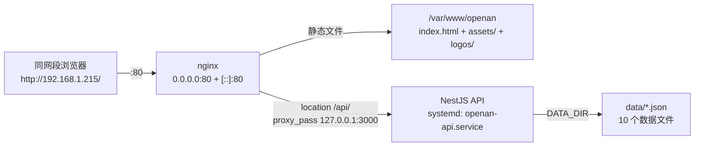

# 08 局域网部署指南（Linux · nginx + systemd）

**文档版本**：v1.0 ｜ **最后更新**：2026-10-15
**适用场景**：把本项目部署到一台 Linux 服务器上，绑定指定内网 IP，让同网段其他机器通过浏览器直接访问。
**主要读者**：运维、后端工程师、需要复现部署的任何人。

> 本文是一次**真实部署的完整复盘**。所有命令均在目标机器上执行通过，所有"实测证据"均来自真实输出。
> 每一步拆成 **命令 / 知识点 / 验收判据** 三段，既是操作手册，也是原理说明。

---

## 目录

1. [部署目标与最终形态](#1-部署目标与最终形态)
2. [本次部署的环境事实](#2-本次部署的环境事实)
3. [部署步骤（含知识点）](#3-部署步骤含知识点)
4. [知识点汇总（按主题归类）](#4-知识点汇总按主题归类)
5. [完整命令速查](#5-完整命令速查)
6. [日常运维](#6-日常运维)
7. [故障排查速查表](#7-故障排查速查表)
8. [安全加固建议（本次未实施）](#8-安全加固建议本次未实施)
9. [待确认与遗留事项](#9-待确认与遗留事项)

---

## 1. 部署目标与最终形态

### 1.1 目标

| 项 | 值 |
| --- | --- |
| 服务器 | `linux-openan-test-0002`，Debian GNU/Linux 12 (bookworm) |
| 目标 IP | `192.168.1.215` |
| 对外端口 | **仅 80**（HTTP） |
| 访问方式 | 同网段任意机器浏览器打开 `http://192.168.1.215/` |
| 持久化 | 开机自启、崩溃自动重启 |
| 仓库路径 | `/home/y00879326/openan-operation-insights` |
| 运行用户 | `y00879326`（项目就在其 home 下，**不额外建系统用户**） |

### 1.2 最终架构：同域反向代理（Single Origin）



**为什么选同域，而不是前后端各开一个端口？**

| 维度 | 同域反代（本方案） | 双端口跨域 |
| --- | --- | --- |
| 对外暴露端口 | 1 个（80） | 2 个（80 + 3000） |
| CORS 配置 | **完全不需要** | 必须精确维护 `CORS_ORIGINS` |
| 前端 API 地址 | 相对路径 `/api`，换 IP 零改动 | 需把 IP 烧进构建产物 |
| 防火墙放行 | 1 个端口 | 2 个端口 |
| 后端暴露面 | 可收敛到回环 | 必然全网卡 |

同域方案在**每一个维度**上都更优，唯一代价是多装一个 nginx。

### 1.3 请求路径与端口分配

| 路径 | 由谁处理 | 说明 |
| --- | --- | --- |
| `/` | nginx → `/var/www/openan/index.html` | SPA 入口 |
| `/assets/*` | nginx 直接吐文件 | Vite 带内容指纹，长缓存 7 天 |
| `/logos/*` | nginx 直接吐文件 | 来自 `apps/web/public/logos` |
| `/summits`、`/activity` 等前端路由 | nginx `try_files` 回退 `index.html` | **磁盘上没有这些文件**，必须回退 |
| `/api/*` | nginx 反代 → `127.0.0.1:3000` | 前缀原样透传，不剥离 |
| `:3000` | NestJS | 当前绑全网卡，建议收敛（见第 8 章） |

---

## 2. 本次部署的环境事实

以下全部为**实测结果**，不是推测。

### 2.1 系统与软件

```text
PRETTY_NAME="Debian GNU/Linux 12 (bookworm)"
node    -> /usr/bin/node（apt / NodeSource 安装，非 nvm）
nginx   -> 已预装，sites-available / sites-enabled 布局
sudo    -> y00879326 有 sudo 权限（密码认证）
```

### 2.2 防火墙：本机零包过滤（重要事实）

```bash
$ command -v ufw firewall-cmd nft iptables
（一个都没有）
$ systemctl is-active firewalld nftables iptables
inactive
inactive
inactive
```

**四个防火墙二进制全都不存在**，三个 unit 全部 `inactive`，`nft list ruleset` 无输出。

> **推论一**：这台机器操作系统层面**没有任何包过滤**，所有监听端口对网络直接敞开。因此本次部署**不需要也无法配置本机防火墙**。不要为此去装 ufw —— 装完默认策略反而可能把自己锁在门外。
>
> **推论二**：任何监听在非回环地址上的端口都是真实暴露的（见第 8 章加固建议）。
>
> **推论三**：若从外部仍连不上，问题一定在**机器之外**（云平台安全组 / 宿主机 iptables / 网络 ACL），需找运维开通入站。

### 2.3 部署成果验证记录

| 检查项 | 实测输出 | 判定 |
| --- | --- | --- |
| 依赖安装 | `added 469 packages, and audited 471 packages in 12s` | 通过 |
| 后端构建 | `dist/` 含 `main.js`、`modules/`、`config/` | 通过 |
| 前端构建 | `apps/web/dist/` 含 `index.html`、`assets/`、`logos/` | 通过 |
| systemd 服务 | `active (running)`，稳定 3min49s，`Tasks: 11`，`Memory: 26.3M` | 通过 |
| 启动耗时 | `后端就绪，耗时约 1s` | 通过 |
| 数据目录解析 | `数据目录：/home/y00879326/openan-operation-insights/data` | 通过 |
| 数据自检 | `DataBootstrapService` 通过，10 个 JSON 全部载入 | 通过 |
| 端口监听 | `0.0.0.0:80` + `[::]:80`（nginx）、`*:3000`（node） | 通过 |
| www-data 可读性 | `sudo -u www-data cat /var/www/openan/index.html` 输出 doctype | 通过 |
| nginx 配置语法 | `syntax is ok` / `test is successful` | 通过 |
| 接口响应 | `{"code":0,"message":"ok","data":{...}}` | 通过 |

### 2.4 实际载入的数据文件与记录数

来自 `journalctl` 的 `JsonRepository` 启动日志：

| 文件 | 记录数 | 文件 | 记录数 |
| --- | --- | --- | --- |
| `home.json` | 1 | `confluence-accounts.json` | 23 |
| `organizations.json` | 12 | `github-accounts.json` | 35 |
| `github-organizations.json` | 4 | `summits.json` | 1 |
| `confluence-organizations.json` | 12 | `meetings.json` | 1 |
| `persons.json` | 30 | `identity-claims.json` | 48 |

### 2.5 实际注册的路由（来自 `RouterExplorer` 日志）

**只读接口（看板全部数据来源）**

```text
GET /api/home/summary                  首页四项指标 + 下一次峰会
GET /api/organizations                 组织卡片墙
GET /api/contributions                 GitHub 组织贡献明细
GET /api/contributor-contributions     个人贡献明细
GET /api/contributions/summary         汇总指标
GET /api/wiki                          Confluence 工作量明细
GET /api/confluence-accounts           Confluence 账号级明细
GET /api/summits                       峰会列表
GET /api/summits/:id                   峰会详情
GET /api/meetings                      例会参会矩阵
GET /api/identity/persons              自然人列表
GET /api/identity/claims               认领映射列表
GET /api/identity/candidates           候选池（派生）
GET /api/identity/org-roster           组织花名册（派生）
```

**写接口（身份匹配控制台，需 `X-Admin-Token`）**

```text
POST   /api/identity/persons
PATCH  /api/identity/persons/:personId
DELETE /api/identity/persons/:personId
POST   /api/identity/claims
DELETE /api/identity/claims/:claimId
```

> **注意：不存在 `GET /api/home`。** `HomeController` 只注册了 `@Get('summary')`。
> 访问 `/api/home` 会得到 `{"code":40400,"message":"Cannot GET /api/home","data":null}`，**这是正常的**。
> 顺带说明：连 404 都被包成统一格式，恰好证明 `ResponseInterceptor` 与异常过滤器链路是通的。

---

## 3. 部署步骤（含知识点）

### 步骤 1 · 安装依赖

```bash
cd /home/y00879326/openan-operation-insights/apps/api
npm ci
```

#### 知识点 ①：npm workspaces 单仓与依赖提升

根 `package.json` 声明了 `"workspaces": ["apps/api", "apps/web"]`。npm 会：

- 把**所有** workspace 的依赖统一装到**仓库根**的 `node_modules/`；
- 执行**扁平化提升（hoisting）**：能共用的包提到顶层，版本冲突的才留在子包内。

由此推出三个容易误判的现象：

| 现象 | 是否正常 |
| --- | --- |
| 在 `apps/api` 下执行 `npm ci`，装的却是仓库根的 `node_modules` | 正常，npm 会向上找 workspace 根 |
| `apps/api/` 目录下**没有** `node_modules` | 正常，已提升到根 |
| 只装了 api，却连 `vite`、`tailwindcss` 也一起装好了 | 正常，两个 workspace 一次性装完 |

验证：

```bash
ls -d ~/openan-operation-insights/node_modules
ls ~/openan-operation-insights/apps/api/node_modules 2>/dev/null || echo "无（正常，已提升到根）"
```

#### 知识点 ②：`npm ci` vs `npm install`

| | `npm ci` | `npm install` |
| --- | --- | --- |
| 依据 | **严格**按 `package-lock.json` | 按 `package.json` 语义化范围重新解析 |
| 是否改写 lock | 从不 | 可能会 |
| 安装前 | **先删掉整个 `node_modules`** | 增量 |
| lock 与 package.json 冲突时 | **直接报错退出** | 静默修正 lock |
| 适用 | CI / 生产部署 | 本地开发 |

生产环境一律用 `npm ci`：它保证装出来的依赖树与锁定文件**逐字节一致**，可复现。

#### 知识点 ③：输出解读

```text
npm warn deprecated inflight@1.0.6 ...
npm warn deprecated rimraf@2.7.1 ...
npm warn deprecated glob@7.2.3 ...
added 469 packages, and audited 471 packages in 12s      <- 成功标志
80 packages are looking for funding
26 vulnerabilities (4 low, 11 moderate, 11 high)
```

- `warn deprecated`：**依赖的依赖**（`exceljs`、`unzipper` 等）传递引入的老包发的弃用通告。`warn` 不等于 `error`，不影响运行。
- `added N packages`：**出现这一行就说明装成功了**。
- `26 vulnerabilities`：`npm audit` 的静态告警，绝大多数来自构建期传递依赖。

> **禁止执行 `npm audit fix --force`**
>
> 它会强制升级 major 版本（`uuid@8` → `uuid@11`、`glob@7` → `glob@11`），**直接改坏 `package-lock.json`**，极可能让 `exceljs` 与 NestJS 编译崩掉。
> 本项目是内网只读看板，攻击面接近零，这些告警记账不动即可。

**验收判据**：出现 `added N packages`，退出码 0。

---

### 步骤 2 · 构建后端

```bash
cd /home/y00879326/openan-operation-insights/apps/api
npm run build          # = nest build
ls dist                # 应看到 main.js、modules/、config/、common/ ...
```

#### 知识点

- **TypeScript 不能直接被 node 执行**。`nest build` 把 `src/*.ts` 编译成 `dist/*.js`，生产环境跑的是 `dist/main.js`，**与 `src` 完全无关**。改了 `src` 不重新 build，重启服务也不会有任何变化 —— 这是最常见的"我明明改了代码怎么没生效"的原因。
- `dist/tsconfig.build.tsbuildinfo` 是**增量编译缓存**，不是产物，可以忽略。

**验收判据**：`ls dist` 能看到 `main.js`。

---

### 步骤 3 · 配置后端环境变量 `.env`

```bash
cd /home/y00879326/openan-operation-insights/apps/api
ls -a | grep env       # 必须用 -a，.env.example 是隐藏文件
cp .env.example .env
nano .env
```

内容：

```ini
NODE_ENV=production
PORT=3000

# 必须绝对路径
DATA_DIR=/home/y00879326/openan-operation-insights/data

# 必须留空（同域部署不需要 CORS）
CORS_ORIGINS=

CACHE_TTL_SECONDS=300
LOG_LEVEL=log

# 留空 = 写接口整体禁用（40301）；填写则必须 >= 8 字符
ADMIN_TOKEN=

# 只读看板全部留空
GITHUB_TOKEN=
GITHUB_ORGS=
GITHUB_REPOS=
CONFLUENCE_BASE_URL=
CONFLUENCE_TOKEN=
CONFLUENCE_SPACES=
```

#### 知识点 ①：`.env` 是隐藏文件

`ls` 默认不显示以点开头的文件，必须用 `ls -a`。本次部署时 `ls` 看不到 `.env.example`，一度以为文件缺失，实际只是被隐藏了。

#### 知识点 ②：`DATA_DIR` 为什么必须写绝对路径

`DATA_DIR` 的默认值是相对路径 `../../data`，它按 **`process.cwd()`（进程当前工作目录）** 解析，**不是**按代码文件所在位置解析。

| cwd | `../../data` 解析结果 |
| --- | --- |
| `/home/y00879326/openan-operation-insights/apps/api` | `/home/y00879326/openan-operation-insights/data` 正确 |
| systemd `WorkingDirectory` 写错成仓库根 | `/home/data` 错误 |

写绝对路径可彻底摆脱对 cwd 的依赖。同理，`ConfigModule` 加载 `.env` 用的也是相对路径，所以 cwd 必须是 `apps/api`。

#### 知识点 ③：`CORS_ORIGINS` 为什么必须留空

`main.ts` 是**条件启用**：

```ts
const corsOrigins = config.get<string[]>('corsOrigins') ?? [];
if (corsOrigins.length > 0) {
  app.enableCors({ origin: corsOrigins, credentials: false });
}
```

留空 = **根本不挂 CORS 中间件**。同域部署下浏览器发的都是同源请求，不触发 CORS 预检；配了纯属多余，还多一个出错点（域名写错就全线 403）。

#### 知识点 ④：fail-fast 环境变量校验

`env.validation.ts` 在启动期校验，不合法直接抛异常终止进程。**要么全填，要么全空**：

| 规则 | 后果 |
| --- | --- |
| `ADMIN_TOKEN` 填了但少于 8 字符 | 启动失败 |
| 填了 `GITHUB_TOKEN` 但 `GITHUB_ORGS` 和 `GITHUB_REPOS` 都空 | 启动失败 |
| 填了 `CONFLUENCE_TOKEN` 但缺 `CONFLUENCE_BASE_URL` | 启动失败 |
| 填了 `CONFLUENCE_TOKEN` 但 `CONFLUENCE_SPACES` 空 | 启动失败 |

校验器是**手写白名单式**的，未列出的变量直接忽略（不是"拒绝未知变量"）。所以后续新增 `HOST` 之类变量是安全的。

#### 知识点 ⑤：`ADMIN_TOKEN` 留空的语义

不是"没有密码"，而是**整个 `/api/identity/*` 写通道被禁用**，请求返回 `40301`。只读看板的 14 个 GET 接口完全不受影响。这是有意的安全默认值（secure by default）。

**验收判据**：`.env` 存在，且三处关键项（`DATA_DIR` 绝对路径、`CORS_ORIGINS` 空、`ADMIN_TOKEN` 空或 >= 8 字符）符合要求。

---

### 步骤 4 · 构建前端

```bash
cd /home/y00879326/openan-operation-insights
npm run build:web      # = npm run build -w @openan/web = tsc -b && vite build
ls -la apps/web/dist   # 应看到 index.html、assets/、logos/
```

#### 知识点 ①：根 `package.json` 的脚本编排

```json
"build":     "npm run build -w @openan/api && npm run build -w @openan/web",
"build:api": "npm run build -w @openan/api",
"build:web": "npm run build -w @openan/web",
"start":     "npm run start:prod -w @openan/api"
```

`-w` = `--workspace`，在 monorepo 里指定对哪个子包执行脚本。后端已单独构建过，所以只需 `build:web`。

#### 知识点 ②：`tsc -b && vite build` 是两段

- `tsc -b`：TypeScript **project references 模式**，做类型检查与增量构建；
- `vite build`：真正的打包（底层是 Rollup）。

**类型错误会让 `tsc -b` 失败，从而整个 build 失败** —— 这是有意设置的前置门禁，不是障碍。

#### 知识点 ③：前端不需要建 `.env`

`apps/web` 下没有 `.env` 时，`VITE_API_BASE_URL` 回退为**相对路径 `/api`**，正好命中同域 nginx。

反过来：**千万不要**在构建时注入 `VITE_API_BASE_URL=http://127.0.0.1:3000` 之类的值。Vite 的环境变量是**构建期烧进产物**的，一旦写死，换机器 / 换 IP 就必须重新构建。相对路径 `/api` 才是正确做法 —— 这也是选择同域架构的核心收益之一。

#### 知识点 ④：`public/` 原样拷贝 vs `assets/` 带指纹

| 来源 | 产物 | 是否带指纹 | nginx 缓存策略 |
| --- | --- | --- | --- |
| `apps/web/public/logos/*` | `dist/logos/*` | 否，原样复制 | 短缓存或不缓存 |
| `src/` 里 import 的 JS/CSS | `dist/assets/index-a1b2c3d4.js` | **是**，哈希由内容决定 | `expires 7d` 长缓存 |
| `index.html` | `dist/index.html` | 否 | **绝不能长缓存** |

`index.html` 不能长缓存的原因：它内部引用了带哈希的 JS/CSS 文件名。用户若拿到旧的 `index.html`，就会去请求已经不存在的旧哈希文件，直接白屏。这就是"发版后用户必须强制刷新"问题的根源。

接口返回的 `logoUrl: "/logos/huawei.png"` 指向 `public/logos`，由 nginx 直接吐文件，不经过后端。

**验收判据**：`apps/web/dist/` 下同时存在 `index.html`、`assets/`、`logos/`。

---

### 步骤 5 · 手动验证后端（上 systemd 之前）

```bash
cd /home/y00879326/openan-operation-insights/apps/api    # cwd 必须是 apps/api
node dist/main.js
```

启动日志里必须出现：

```text
[DataBootstrapService] 数据自检通过：home.json, organizations.json, ...
[NestApplication] Nest application successfully started
[Bootstrap] OpenAN 运营洞察 API 已启动：http://localhost:3000/api
[Bootstrap] 数据目录：/home/y00879326/openan-operation-insights/data
```

另开终端：

```bash
curl -sS http://127.0.0.1:3000/api/home/summary | head -c 200 ; echo
curl -sS http://127.0.0.1:3000/api/wiki         | head -c 200 ; echo
```

批量探活所有只读接口：

```bash
for p in /api/home/summary /api/organizations /api/summits /api/meetings \
         /api/contributions /api/contributor-contributions /api/contributions/summary \
         /api/wiki /api/confluence-accounts /api/identity/persons; do
  printf '%-38s %s\n' "$p" "$(curl -sS -o /dev/null -w '%{http_code}' http://127.0.0.1:3000$p)"
done
```

#### 知识点 ①：为什么要先手动前台跑一遍

systemd 会把 stdout 收进 journal，排障要多绕一层 `journalctl`。手动前台运行时错误**直接打在屏幕上**，定位速度快一个数量级。生产部署的铁律：先前台验证，再交给服务管理器。

#### 知识点 ②：`curl -sS` 而不是 `curl -s`（本次真实踩坑）

| 参数 | 行为 |
| --- | --- |
| `-s` (silent) | 关掉进度条，**同时也关掉错误信息** |
| `-sS` (silent + show-error) | 关掉进度条，**保留错误信息** |

用 `-s` 时，如果连接被拒绝，屏幕上**什么都不打印**，极易误判成"接口返回了空"。本次部署就因此产生过一次误判。**排障一律用 `-sS`。**

#### 知识点 ③：统一响应格式

所有响应（包括 404）都被 `ResponseInterceptor` + 异常过滤器包成 `{ code, message, data }`：

```json
{"code":40400,"message":"Cannot GET /api/home","data":null}
{"code":0,"message":"ok","data":{}}
```

`code:0` 表示成功。看到这个包装格式本身就证明拦截器链路是通的。

**验收判据**：数据目录日志路径正确 + 接口返回 `code:0`。验证完 `Ctrl+C` 停掉。

---

### 步骤 6 · 发布前端产物到 nginx 可读位置

```bash
sudo mkdir -p /var/www/openan
sudo rm -rf /var/www/openan/*
sudo cp -a /home/y00879326/openan-operation-insights/apps/web/dist/. /var/www/openan/
sudo chown -R www-data:www-data /var/www/openan
sudo chmod -R a+rX /var/www/openan

# 关键验证：以 nginx 的身份去读
sudo -u www-data cat /var/www/openan/index.html | head -c 80 ; echo
```

封装成可复用脚本：

```bash
cat > /home/y00879326/openan-operation-insights/publish-web.sh <<'SCRIPT'
#!/usr/bin/env bash
set -euo pipefail
REPO=/home/y00879326/openan-operation-insights
cd "$REPO"
npm run build:web
sudo rm -rf /var/www/openan/*
sudo cp -a "$REPO/apps/web/dist/." /var/www/openan/
sudo chown -R www-data:www-data /var/www/openan
echo "已发布到 /var/www/openan"
SCRIPT
chmod +x /home/y00879326/openan-operation-insights/publish-web.sh
```

#### 知识点 ①：为什么不能让 nginx 直接读 home 下的 dist（本次最重要的坑）

项目在**用户 home 目录**下。Debian/Ubuntu 的 `/home/<user>` 默认权限是 **`750`**：

```text
drwxr-x---  y00879326  y00879326  /home/y00879326
     ^^^
  other 位是 ---，没有任何权限
```

nginx 的 worker 进程以 **`www-data`** 身份运行。`www-data` 既不是 owner 也不在 group 里，落到 other 位，**连"进入这个目录"的 `x` 权限都没有**。

Linux 路径解析是**逐级穿越**的：要读 `/home/y00879326/openan-operation-insights/apps/web/dist/index.html`，必须先能 `x` 穿过 `/home/y00879326`。穿不过去，nginx 返回 **403 Forbidden**，错误日志里是 `Permission denied`。

两种解法对比：

| 方案 | 做法 | 评价 |
| --- | --- | --- |
| A. 开放 home 穿越权限 | `chmod o+x /home/y00879326` + 逐级 `o+rX` | 不推荐：把整个 home 暴露给所有本地用户 |
| **B. 发布到 `/var/www`** | 构建产物拷到 `/var/www/openan` | **本方案采用**：标准做法，权限模型干净 |

方案 B 的代价只是"每次构建后多一步拷贝"，已封装成 `publish-web.sh`。

#### 知识点 ②：`www-data` 是 nginx 的运行身份

`/etc/nginx/nginx.conf` 顶部的 `user www-data;` 决定 worker 进程身份。master 进程是 root（用于绑定 80 这类特权端口），随后 fork 出降权的 worker。

RHEL / CentOS 系上这个用户叫 `nginx`，不叫 `www-data`。

#### 知识点 ③：`sudo -u www-data cat ...` 是最有效的权限验证法

不要靠"我是 y00879326，我 cat 得到"来判断 nginx 能不能读 —— **两者身份完全不同，权限判定也完全不同**。直接以 `www-data` 身份去读，一次就能确认。这条命令通过，403 风险彻底排除。

#### 知识点 ④：`cp -a src/. dst/` 里那个 `/.`

| 写法 | 结果 |
| --- | --- |
| `cp -a src dst` | 把 `src` **这个目录本身**拷进去，得到 `dst/src/...` |
| `cp -a src/. dst` | 把 `src` **里面的内容**拷进去，得到 `dst/...` |

`-a`（archive）= 递归 + 保留权限 / 时间戳 / 软链接。

#### 知识点 ⑤：`chmod a+rX` 里大写 `X` 的含义

| 写法 | 行为 |
| --- | --- |
| `x`（小写） | 给**所有**文件加执行位，会让 `.html`、`.js` 变成"可执行"，不合适 |
| `X`（大写） | **只给目录、以及本来就有执行位的文件**加执行位 |

目录需要 `x` 才能进入，普通静态文件只需要 `r`。大写 `X` 正好精准表达这个意图。

**验收判据**：`sudo -u www-data cat /var/www/openan/index.html` 能输出 `<!doctype html>`。

---

### 步骤 7 · systemd 常驻后端

**前置动作：先停掉手动跑的进程**，否则端口冲突（`EADDRINUSE`）导致服务反复重启失败：

```bash
ss -ltnp | grep ':3000'              # 看谁占着
pkill -f 'node dist/main.js'
sleep 1 && (ss -ltn | grep ':3000' || echo "3000 已释放")
```

创建 unit 文件：

```bash
sudo tee /etc/systemd/system/openan-api.service > /dev/null <<'UNIT'
[Unit]
Description=OpenAN Operation Insights API (NestJS)
After=network-online.target
Wants=network-online.target

[Service]
Type=simple
User=y00879326
Group=y00879326
WorkingDirectory=/home/y00879326/openan-operation-insights/apps/api
ExecStart=/usr/bin/node dist/main.js
Restart=on-failure
RestartSec=3
KillSignal=SIGINT
StandardOutput=journal
StandardError=journal
SyslogIdentifier=openan-api

[Install]
WantedBy=multi-user.target
UNIT

which node                            # 核对 node 真实路径，必须与 ExecStart 一致
sudo systemctl daemon-reload
sudo systemctl enable --now openan-api
```

#### 知识点 ①：逐字段解释 unit 文件

| 字段 | 作用 | 为什么这么写 |
| --- | --- | --- |
| `After=` + `Wants=`<br>`network-online.target` | 等网络真正就绪后再启动 | `After` 只管**启动顺序**，`Wants` 才**拉起**目标。两者必须配对，只写 `After` 无效 |
| `Type=simple` | 主进程即服务进程 | node 不会 fork 后台化。写成 `forking` 会让 systemd 误判服务已退出 |
| `User` / `Group` | 降权运行 | 项目就在 `y00879326` 的 home 下，直接用这个账号，**省掉全部 chown**。不用 root 跑业务进程是最小权限原则 |
| **`WorkingDirectory`** | 设置进程 cwd | **决定 `.env` 能否被读到**（`ConfigModule` 用相对路径）。必须是 `apps/api` |
| `ExecStart` | 启动命令 | **必须绝对路径** `/usr/bin/node`，systemd 不查 `$PATH`。若用 nvm 装 node，这里要换成 `which node` 的实际输出 |
| `Restart=on-failure` | 非 0 退出才重启 | 比 `always` 合理：手动 `stop` 不会被误拉起 |
| `RestartSec=3` | 重启间隔 | 防止崩溃循环把 CPU 打满 |
| `KillSignal=SIGINT` | 停止时发的信号 | 配合 `app.enableShutdownHooks()` 优雅退出（NestJS 默认监听 SIGINT/SIGTERM） |
| `StandardOutput/Error=journal` | 日志进 journald | 于是 `journalctl -u openan-api` 可查，且自动轮转、带时间戳 |
| `SyslogIdentifier=openan-api` | 日志前缀 | 输出显示为 `openan-api[PID]:`，便于 grep |
| `WantedBy=multi-user.target` | 开机自启挂载点 | 多用户文本模式，服务器标准 target |

#### 知识点 ②：为什么 `ExecStart` 直接调 node，而不是 `npm run start`

`apps/api/package.json` 里 `start:prod` 的内容就是 `node dist/main.js`。直接调 node 的好处：

1. **少一层进程**。`npm run` 会 fork 一个 npm 进程再 fork node，进程树变成 `systemd -> npm -> node`；
2. **信号传递更可靠**。`systemctl stop` 把 SIGTERM 发给 npm，npm 是否正确转发给子进程取决于版本行为，历史上出过"服务显示已停但 node 还在跑"的问题；
3. **不依赖 npm 在 PATH 里**。

#### 知识点 ③：`enable --now` 与 `preset: enabled`

| 命令 | 作用范围 |
| --- | --- |
| `systemctl enable` | 建软链，**只管下次开机**，不影响当前运行状态 |
| `systemctl start` | **只管当前**，重启后失效 |
| `systemctl enable --now` | 两件一起做 |

执行后会看到：

```text
Created symlink /etc/systemd/system/multi-user.target.wants/openan-api.service
  -> /etc/systemd/system/openan-api.service
```

`preset: enabled` 表示该 unit 符合发行版预设策略（systemd 250+ 才显示这一项）。

#### 知识点 ④：启动时序陷阱（本次真实踩坑）

`systemctl enable --now` 返回时，**进程刚 fork 出来，应用还没启动完**。本次实测：

```text
Active: active (running) since Thu 2026-10-15 08:35:58 CST; 9ms ago
Tasks: 1        Memory: 1.0M        CPU: 5ms
```

`9ms` / `CPU: 5ms` 说明 NestJS 连模块都还没开始加载（完整启动约需 1 秒）。

**如果把 status / journalctl / curl 三条命令连续粘贴执行，会同时看到三个"假故障"：**

| 假故障现象 | 真实原因 |
| --- | --- |
| `status` 显示 `active` 但资源占用极低 | 快照太早，应用还在启动中 |
| `journalctl` 只有一行 `Started ...`，**没有任何应用日志** | 日志还没产生 |
| `curl -s` **完全无输出** | 端口还没监听，连接被拒，而 `-s` 把错误吞了，只剩 `; echo` 打的空行 |

**正确做法 —— 用轮询等待就绪，再验证：**

```bash
for i in $(seq 1 20); do
  if curl -s -o /dev/null http://127.0.0.1:3000/api/home/summary; then
    echo "后端就绪，耗时约 ${i}s"; break
  fi
  sleep 1
done
```

本次实测：`后端就绪，耗时约 1s`。等待之后再查 status / journal，才能看到完整的路由映射表与数据自检日志。

> **通用教训**：`systemctl start` 是**异步返回**的，它只保证"进程已 fork"，不保证"应用已就绪"。任何紧跟其后的健康检查都必须带重试。

**验收判据**

```bash
systemctl status openan-api --no-pager -l | head -15
sudo journalctl -u openan-api -n 40 --no-pager
sudo ss -ltnp | grep ':3000'
curl -sS http://127.0.0.1:3000/api/home/summary | head -c 150 ; echo
```

日志中必须能看到 `数据目录：/home/y00879326/openan-operation-insights/data` 与 `数据自检通过`。

---

### 步骤 8 · nginx 站点配置

```bash
sudo tee /etc/nginx/sites-available/openan > /dev/null <<'NGINX'
server {
    listen 80;
    listen [::]:80;
    server_name 192.168.1.215;

    root  /var/www/openan;
    index index.html;

    # Vite 带内容指纹的产物，可长缓存
    location /assets/ {
        expires 7d;
        add_header Cache-Control "public";
    }

    # SPA 回退：BrowserRouter 刷新子页面必需
    location / {
        try_files $uri $uri/ /index.html;
    }

    # proxy_pass 不带 URI 部分 -> 原样透传 /api/xxx
    location /api/ {
        proxy_pass http://127.0.0.1:3000;
        proxy_http_version 1.1;
        proxy_set_header Host              $host;
        proxy_set_header X-Real-IP         $remote_addr;
        proxy_set_header X-Forwarded-For   $proxy_add_x_forwarded_for;
        proxy_set_header X-Forwarded-Proto $scheme;
        proxy_read_timeout 60s;
    }
}
NGINX

sudo ln -sf /etc/nginx/sites-available/openan /etc/nginx/sites-enabled/openan
sudo nginx -t && sudo systemctl reload nginx

# 若访问 IP 出来的是 nginx 欢迎页，或 nginx -t 报 duplicate default server
sudo rm -f /etc/nginx/sites-enabled/default
sudo nginx -t && sudo systemctl reload nginx
```

#### 知识点 ①：`sites-available` / `sites-enabled` 的软链机制

Debian 系 nginx 的约定：

- `sites-available/` 存放**所有**站点配置（包括未启用的）；
- `sites-enabled/` 存放**指向 available 的软链接**；
- `nginx.conf` 里 `include /etc/nginx/sites-enabled/*;` 只加载软链目录。

于是"启用 / 停用站点"变成"建 / 删软链"，配置文件本身不用动，也不用复制粘贴。`ln -sf` 的 `-f` 保证重复执行幂等。

#### 知识点 ②：`server_name` 与 default server

nginx 收到请求后，用 `Host` 头去匹配 `server_name`。**匹配不到时，会交给该端口的 default server**（第一个定义的、或显式标了 `default_server` 的 server 块）。

本站点是 80 端口上唯一的 server 块，所以自动成为 default server。这带来一个实用结论：

> **`server_name` 写错也不影响通过 IP 访问** —— 它只是个匹配标签，不决定监听哪个地址。真正决定监听范围的是 `listen`。

但发行版自带的 `sites-enabled/default` 会抢占 default server 位置，导致访问 IP 出来的是 nginx 欢迎页。删掉它的软链即可（不删配置文件本体，随时可恢复）。

#### 知识点 ③：`listen 80;` + `listen [::]:80;` 双栈

- `listen 80;` 监听 IPv4 `0.0.0.0:80`；
- `listen [::]:80;` 监听 IPv6 `[::]:80`。

两条都写，`ss` 里就能看到双栈监听（本次实测确实两行都有）。只写 IPv4 那条，IPv6 客户端会连不上。

#### 知识点 ④：`try_files` 与 SPA 回退（最容易被忽略的一行）

本项目前端用 React Router 的 **`BrowserRouter`**（HTML5 History API），`/summits`、`/activity` 这些路由**只存在于前端 JS 里，磁盘上没有对应文件**。

| 场景 | 无 `try_files` | 有 `try_files` |
| --- | --- | --- |
| 从首页点击导航到 `/summits` | 正常（前端 JS 内部路由跳转，不发 HTTP 请求） | 正常 |
| **在 `/summits` 页面按 F5 刷新** | **404**（浏览器真的向服务器请求 `/summits`） | 正常（回退到 `index.html`，前端接管路由） |
| 直接把 `/summits` 链接发给别人 | **404** | 正常 |

```nginx
location / {
    try_files $uri $uri/ /index.html;
}
```

按顺序尝试：① 当作文件找 `$uri` → ② 当作目录找 `$uri/` → ③ 都失败则内部重写到 `/index.html`。

这就是所谓的 **SPA fallback / history mode 回退**。

#### 知识点 ⑤：`proxy_pass` 有无尾斜杠的差异（反代配置第一坑）

后端 `main.ts` 里有 `app.setGlobalPrefix('api')`，所以后端期望收到的路径**必须带 `/api` 前缀**。

| 写法 | 请求 `/api/home/summary` 时转发给后端的路径 | 结果 |
| --- | --- | --- |
| `proxy_pass http://127.0.0.1:3000;`（**无尾斜杠，本方案**） | `/api/home/summary` | 正确 |
| `proxy_pass http://127.0.0.1:3000/;`（有尾斜杠） | `/home/summary`（`/api/` 被替换掉了） | **404** |

规则：`proxy_pass` 后面**带 URI 部分**（哪怕只是一个 `/`）时，nginx 会用该 URI **替换**掉 `location` 匹配到的前缀；**不带 URI 部分**时，原始请求 URI **原样透传**。

#### 知识点 ⑥：反向代理必须转发的请求头

nginx 反代时默认**不会**把客户端真实信息传给后端，后端看到的 `remoteAddress` 永远是 `127.0.0.1`。需要显式设置：

| 头 | 作用 |
| --- | --- |
| `Host $host` | 保留客户端请求的原始 Host（后端拼绝对 URL、做虚拟主机判断时需要） |
| `X-Real-IP $remote_addr` | 客户端真实 IP |
| `X-Forwarded-For $proxy_add_x_forwarded_for` | 代理链上的 IP 列表（在已有值后追加，而非覆盖） |
| `X-Forwarded-Proto $scheme` | 原始协议 http/https（将来上 HTTPS 后，后端据此判断是否重定向） |
| `proxy_http_version 1.1` | 默认是 1.0，不支持 keep-alive 与 WebSocket，显式升到 1.1 |
| `proxy_read_timeout 60s` | 后端读超时。默认 60s，采集类慢接口需按需调大 |

本项目有审计流水（`data/.identity-audit.jsonl`），记录操作者 IP 时就依赖 `X-Real-IP` / `X-Forwarded-For`。

**验收判据**：`nginx -t` 输出 `syntax is ok` + `test is successful`。

---

### 步骤 9 · 防火墙

```bash
sudo ufw status verbose
```

**本次实测结果：`sudo: ufw: command not found`**，进一步排查确认这台 Debian 12 上 `ufw`、`firewall-cmd`、`nft`、`iptables` **四个二进制全都不存在**，三个防火墙 unit 全部 `inactive`。

#### 知识点 ①：探测真实防火墙状态的通用命令

```bash
head -3 /etc/os-release                                  # 确认发行版
command -v ufw firewall-cmd nft iptables 2>/dev/null     # 有哪些工具
systemctl is-active firewalld nftables iptables          # 服务是否运行
sudo nft list ruleset 2>/dev/null | head -20             # nftables 实际规则
sudo iptables -S 2>/dev/null | head -20                  # legacy 实际规则
```

判读方式：

| 探测结果 | 处置 |
| --- | --- |
| 规则集为空 / 只有默认 `ACCEPT` 策略 | **本机无过滤，整步跳过，不要装防火墙** |
| `firewalld` 是 active | `sudo firewall-cmd --permanent --add-service=http && sudo firewall-cmd --reload` |
| `ufw` 存在且 active | `sudo ufw allow OpenSSH && sudo ufw allow 80/tcp && sudo ufw reload` |
| 有 nftables/iptables 规则且默认 DROP | 按现有规则风格追加放行 |

> **`ufw` 不存在 ≠ 需要安装 ufw。** 本机零过滤时端口天然可达，装防火墙只会引入把自己锁在外面的风险（尤其忘了先 `allow OpenSSH`）。

#### 知识点 ②：ufw 操作顺序的铁律

如果确实要在启用了 ufw 的机器上放行，**必须先放 SSH 再放业务端口**：

```bash
sudo ufw allow OpenSSH     # 先放 SSH，否则下一步 reload 就把自己踢出去
sudo ufw allow 80/tcp      # 只开这一个业务端口
sudo ufw reload
sudo ufw status numbered
```

**不要 `ufw allow 3000`** —— 后端只服务本机回环，少一个暴露面。

#### 知识点 ③：网络访问控制的三层模型

即使本机防火墙全开，外部访问仍可能被拦截。排查连通性问题时要按层定位：

```text
第 1 层  应用是否监听         -> ss -ltnp | grep ':80'
第 2 层  本机防火墙           -> nft list ruleset / iptables -S
第 3 层  机器之外的网络策略    -> 云平台安全组、宿主机 iptables、企业网络 ACL、VLAN 隔离
```

第 3 层**从机器内部完全看不到**，只能通过"本机自测通、外部不通"这个组合现象反推，需找运维开通。本次目标机名为 `linux-openan-test-0002`，属企业测试环境，第 3 层存在的可能性较高。

**验收判据**：明确知道本机防火墙处于哪种状态，并据此决定跳过或放行。

---

### 步骤 10 · 端到端验收

**服务器本机（验证 nginx 配置正确性）**

```bash
curl -sSI http://127.0.0.1/                                          | head -1
curl -sS  http://127.0.0.1/api/home/summary                          | head -c 150 ; echo
curl -sSI http://127.0.0.1/logos/huawei.png                          | head -1
curl -sS -o /dev/null -w 'SPA 回退 /summits       -> %{http_code}\n'  http://127.0.0.1/summits
curl -sS -o /dev/null -w 'SPA 回退 /organizations -> %{http_code}\n'  http://127.0.0.1/organizations
```

| 命令 | 期望 | 验证的是什么 |
| --- | --- | --- |
| `/` | `200 OK` | 静态根目录、`index` 指令 |
| `/api/home/summary` | JSON | **反代链路 + 前缀透传** |
| `/logos/huawei.png` | `200 OK` | `public/` 资源已随产物发布 |
| `/summits` | `200` | **`try_files` SPA 回退** |
| `/organizations` | `200` | 同上，多验一条前端路由 |

第 4、5 条最能验证 `try_files`：`/summits` 在磁盘上不存在，必须回落到 `index.html` 返回 200。若是 404，浏览器里刷新任何子页面都会白屏。

**从 Windows 客户端**

```powershell
Test-NetConnection 192.168.1.215 -Port 80
curl.exe -sS http://192.168.1.215/api/home/summary
```

浏览器打开 `http://192.168.1.215/`，逐页点一遍：首页、社区活跃度、社区参展、例会参会情况。

#### 知识点：为什么要同时验"本机 curl"和"外部访问"

两者的失败原因完全不同，必须分开定位：

| 本机 curl 通、外部不通 | 本机 curl 就不通 |
| --- | --- |
| 防火墙 / 安全组 / 网络 ACL 问题 | nginx 或后端配置问题 |
| `listen` 绑到了 `127.0.0.1` 而非 `0.0.0.0` | 看 nginx `error.log` 与 `journalctl -u openan-api` |
| 目标 IP 根本不是这台机器（见第 9 章） | 服务没起来 / 端口冲突 |

**验收判据**：五条 curl 全部符合期望 + Windows 浏览器能正常浏览全部页面。

---

## 4. 知识点汇总（按主题归类）

第 3 章按"执行顺序"组织，本章按"知识主题"重新归类，便于查阅与学习。

### 4.1 npm 与 monorepo

| 知识点 | 要点 |
| --- | --- |
| npm workspaces | 根 `package.json` 声明 `workspaces`，依赖统一装到**仓库根** `node_modules` |
| 依赖扁平化提升（hoisting） | 共用包提到顶层，子包目录下没有 `node_modules` 是正常现象 |
| `-w` / `--workspace` | 在 monorepo 里指定对哪个子包执行脚本 |
| `npm ci` vs `npm install` | ci 严格按 lock、先删 `node_modules`、冲突即报错；生产/CI 专用 |
| `warn deprecated` | 传递依赖的弃用通告，不影响运行 |
| `npm audit fix --force` | **禁用**：会强升 major 版本、改坏 lock |

### 4.2 构建产物

| 知识点 | 要点 |
| --- | --- |
| TS 需编译 | 生产跑 `dist/main.js`，改 `src` 不 build 则重启无效 |
| `tsc -b && vite build` | 前者是类型门禁，后者才真正打包 |
| 内容指纹 | `assets/index-a1b2c3d4.js`，内容变则名变，可长缓存 |
| `index.html` 不可长缓存 | 它引用带哈希的文件名，缓存旧 HTML 会导致白屏 |
| `public/` 原样拷贝 | `public/logos/*` → `dist/logos/*`，不打包不加指纹 |
| 前端环境变量是构建期烧入 | `VITE_API_BASE_URL` 一旦写死 IP，换环境必须重新构建 |

### 4.3 NestJS 运行时

| 知识点 | 要点 |
| --- | --- |
| `setGlobalPrefix('api')` | 所有路由前缀 `/api`，反代时**必须保留**该前缀 |
| `ConfigModule` 用相对路径读 `.env` | 因此 cwd 必须是 `apps/api` |
| `process.cwd()` 决定相对路径 | `DATA_DIR` 默认值 `../../data` 按 cwd 解析，**生产必须写绝对路径** |
| fail-fast 环境校验 | 启动期即抛错终止，避免带病运行 |
| 条件启用 CORS | `corsOrigins` 为空数组则不挂中间件；同域部署应留空 |
| 统一响应拦截器 | 一切响应（含 404）都是 `{code, message, data}` |
| `enableShutdownHooks()` | 监听 SIGINT/SIGTERM 做优雅退出，与 systemd `KillSignal` 配对 |
| `app.listen(port)` 无 host 参数 | **绑定所有网卡**（`*:3000`），需显式传 host 才能收敛到回环 |

### 4.4 nginx

| 知识点 | 要点 |
| --- | --- |
| `sites-available` / `sites-enabled` | 配置本体 + 软链启用，`ln -sf` 幂等 |
| default server | `Host` 匹配不到 `server_name` 时落到默认站点；自带 `default` 站点需删软链 |
| `server_name` 只是匹配标签 | 不决定监听地址，写错也不影响 IP 直连 |
| `listen 80` + `listen [::]:80` | IPv4 / IPv6 双栈 |
| **`try_files $uri $uri/ /index.html`** | SPA history 模式回退，缺失则刷新子页面 404 |
| **`proxy_pass` 尾斜杠** | 带 URI 部分则替换前缀，不带则原样透传。本项目必须**不带** |
| `proxy_set_header` | `Host` / `X-Real-IP` / `X-Forwarded-For` / `X-Forwarded-Proto` 都要显式转发 |
| `proxy_http_version 1.1` | 默认 1.0，不支持 keep-alive / WebSocket |
| master/worker 权限模型 | master 是 root（绑特权端口），worker 降权为 `www-data` |

### 4.5 Linux 权限

| 知识点 | 要点 |
| --- | --- |
| 权限三位 `rwx` | owner / group / other 各三位 |
| 目录的 `x` = 可进入 | 无 `x` 则无法穿越该目录，即使知道完整路径 |
| `/home/<user>` 默认 `750` | other 无任何权限 → `www-data` 穿不过去 → nginx **403** |
| 路径逐级穿越 | 读深层文件需要对**路径上每一级目录**都有 `x` |
| `chmod a+rX`（大写 X） | 只给目录和已有执行位的文件加 `x`，静态文件不加 |
| `cp -a src/. dst` | 拷"内容"而非"目录本身"；`-a` 保留属性 |
| `sudo -u www-data cat ...` | 以服务身份验证可读性，**唯一可靠**的权限验证法 |

### 4.6 systemd

| 知识点 | 要点 |
| --- | --- |
| `After` vs `Wants` | 前者管顺序，后者管拉起，需配对 |
| `Type=simple` vs `forking` | 不后台化的进程用 `simple` |
| `WorkingDirectory` | 设置 cwd，本项目中它决定 `.env` 能否被读到 |
| `ExecStart` 必须绝对路径 | systemd 不查 `$PATH` |
| 直接调二进制而非 `npm run` | 少一层进程，信号传递可靠 |
| `Restart=on-failure` + `RestartSec` | 崩溃自愈且防循环 |
| `KillSignal=SIGINT` | 与应用优雅退出钩子配对 |
| `StandardOutput=journal` | 日志入 journald，自动轮转 |
| `enable` / `start` / `enable --now` | 分别管开机、管当前、两者都管 |
| **`start` 是异步返回** | 只保证进程已 fork，**不保证应用就绪**，健康检查必须带重试 |

### 4.7 网络与防火墙

| 知识点 | 要点 |
| --- | --- |
| `ss -ltnp` | 查监听端口及所属进程（`-p` 需 root 才显示他人进程） |
| `0.0.0.0` vs `127.0.0.1` vs `*` | 全网卡 / 仅回环 / 双栈全网卡 |
| ufw 缺失 ≠ 需要安装 | 本机零过滤时端口天然可达 |
| ufw 操作顺序 | 先 `allow OpenSSH` 再放业务端口 |
| 访问控制三层模型 | 应用监听 → 本机防火墙 → 机器外网络策略（安全组/ACL） |
| 第 3 层从内部不可见 | 只能靠"本机通、外部不通"反推 |

### 4.8 排障方法论（本次真实教训）

| 教训 | 说明 |
| --- | --- |
| **`curl -s` 会吞掉错误** | 连接失败时静默无输出，极易误判。排障一律 `-sS` |
| **命令连续粘贴 ≠ 依次生效** | 6 条命令 200ms 跑完，而应用启动要 1s，导致三个"假故障" |
| **`systemctl status` 的 `since Xms ago`** | 看到毫秒级 uptime 就说明快照太早，需等待后重测 |
| **`ls` 看不到点开头文件** | 用 `ls -a`，别急着断定文件缺失 |
| **以自己的身份测服务权限是无效的** | 必须 `sudo -u <服务用户>` |
| **404 不一定是故障** | `/api/home` 本就不存在，只有 `/api/home/summary`；要先查源码路由表 |
| **先本机分层验证，再测外部** | nginx 静态 → 反代 → 外部连通，逐层缩小范围 |

---

## 5. 完整命令速查

从零到可访问的完整命令序列（复制即用）。**注意步骤之间的等待与验证，不要一次性全部粘贴。**

```bash
# ========== 0. 变量 ==========
REPO=/home/y00879326/openan-operation-insights

# ========== 1. 安装依赖 ==========
cd $REPO/apps/api && npm ci

# ========== 2. 构建后端 ==========
npm run build && ls dist/main.js

# ========== 3. 配置环境变量 ==========
cp .env.example .env && nano .env
#   DATA_DIR=$REPO/data        （绝对路径）
#   CORS_ORIGINS=              （留空）
#   ADMIN_TOKEN=               （留空，或 >= 8 字符）

# ========== 4. 构建前端 ==========
cd $REPO && npm run build:web && ls apps/web/dist

# ========== 5. 手动验证后端 ==========
cd $REPO/apps/api && node dist/main.js
#   另开终端： curl -sS http://127.0.0.1:3000/api/home/summary
#   确认后 Ctrl+C

# ========== 6. 发布前端产物 ==========
sudo mkdir -p /var/www/openan
sudo rm -rf /var/www/openan/*
sudo cp -a $REPO/apps/web/dist/. /var/www/openan/
sudo chown -R www-data:www-data /var/www/openan
sudo chmod -R a+rX /var/www/openan
sudo -u www-data cat /var/www/openan/index.html | head -c 80 ; echo

# ========== 7. systemd（先确保 3000 未被占用）==========
pkill -f 'node dist/main.js' ; sleep 1
sudo tee /etc/systemd/system/openan-api.service > /dev/null <<'UNIT'
[Unit]
Description=OpenAN Operation Insights API (NestJS)
After=network-online.target
Wants=network-online.target

[Service]
Type=simple
User=y00879326
Group=y00879326
WorkingDirectory=/home/y00879326/openan-operation-insights/apps/api
ExecStart=/usr/bin/node dist/main.js
Restart=on-failure
RestartSec=3
KillSignal=SIGINT
StandardOutput=journal
StandardError=journal
SyslogIdentifier=openan-api

[Install]
WantedBy=multi-user.target
UNIT
which node
sudo systemctl daemon-reload
sudo systemctl enable --now openan-api

# ---- 等待就绪（不要跳过）----
for i in $(seq 1 20); do
  curl -s -o /dev/null http://127.0.0.1:3000/api/home/summary && { echo "就绪 ${i}s"; break; }
  sleep 1
done
systemctl status openan-api --no-pager -l | head -15
sudo journalctl -u openan-api -n 40 --no-pager

# ========== 8. nginx ==========
sudo tee /etc/nginx/sites-available/openan > /dev/null <<'NGINX'
server {
    listen 80;
    listen [::]:80;
    server_name 192.168.1.215;

    root  /var/www/openan;
    index index.html;

    location /assets/ {
        expires 7d;
        add_header Cache-Control "public";
    }

    location / {
        try_files $uri $uri/ /index.html;
    }

    location /api/ {
        proxy_pass http://127.0.0.1:3000;
        proxy_http_version 1.1;
        proxy_set_header Host              $host;
        proxy_set_header X-Real-IP         $remote_addr;
        proxy_set_header X-Forwarded-For   $proxy_add_x_forwarded_for;
        proxy_set_header X-Forwarded-Proto $scheme;
        proxy_read_timeout 60s;
    }
}
NGINX
sudo ln -sf /etc/nginx/sites-available/openan /etc/nginx/sites-enabled/openan
sudo rm -f /etc/nginx/sites-enabled/default
sudo nginx -t && sudo systemctl reload nginx

# ========== 9. 防火墙 ==========
command -v ufw firewall-cmd nft iptables 2>/dev/null || echo "无防火墙工具，跳过本步"
systemctl is-active firewalld nftables iptables 2>/dev/null

# ========== 10. 验收 ==========
curl -sSI http://127.0.0.1/                                         | head -1
curl -sS  http://127.0.0.1/api/home/summary                         | head -c 150 ; echo
curl -sSI http://127.0.0.1/logos/huawei.png                         | head -1
curl -sS -o /dev/null -w 'SPA /summits -> %{http_code}\n'           http://127.0.0.1/summits
hostname -I
```

Windows 客户端：

```powershell
Test-NetConnection 192.168.1.215 -Port 80
curl.exe -sS http://192.168.1.215/api/home/summary
```

---

## 6. 日常运维

### 6.1 服务启停与状态

```bash
sudo systemctl start   openan-api          # 启动
sudo systemctl stop    openan-api          # 停止
sudo systemctl restart openan-api          # 重启（发 SIGINT 优雅退出）
sudo systemctl reload  openan-api          # 本项目不适用（node 不支持热重载）
systemctl status       openan-api --no-pager -l
sudo systemctl disable --now openan-api    # 取消开机自启并停止
```

### 6.2 查日志

```bash
sudo journalctl -u openan-api -f                    # 实时跟踪
sudo journalctl -u openan-api -n 100 --no-pager     # 最近 100 行
sudo journalctl -u openan-api --since "10 min ago"  # 按时间
sudo journalctl -u openan-api -p err                # 只看错误级
sudo tail -f /var/log/nginx/error.log               # nginx 错误
sudo tail -f /var/log/nginx/access.log              # nginx 访问
```

日志标识：后端日志前缀是 `openan-api[PID]:`，NestJS 内部还带 `[RoutesResolver]`、`[JsonRepository/xxx.json]`、`[Bootstrap]` 等 context 标签，可按 context grep。

### 6.3 更新数据（不改代码）

数据是 `data/*.json`，由 `JsonRepository` 读入。更新流程：

```bash
# 1. 替换 / 编辑 data 下的 JSON
# 2. 重启后端让其重新载入
sudo systemctl restart openan-api
sleep 2 && curl -sS http://127.0.0.1/api/home/summary | head -c 100 ; echo
```

例会台账走采集脚本（Excel → JSON）：

```bash
cd /home/y00879326/openan-operation-insights
npm run collect:meetings -w @openan/api
```

> 注意：`CACHE_TTL_SECONDS=300` 表示接口层有 5 分钟内存缓存，改完数据若不重启，最多要等 5 分钟才生效。重启可立即生效。

### 6.4 代码变更后的重新发布

| 改了什么 | 需要执行 |
| --- | --- |
| 只改 `data/*.json` | `sudo systemctl restart openan-api` |
| 改了 `apps/api/src/**` | `cd apps/api && npm run build && sudo systemctl restart openan-api` |
| 改了 `apps/web/src/**` | `$REPO/publish-web.sh`（含 build + 拷贝 + chown，无需动 nginx） |
| 改了 `apps/*/package.json` 依赖 | `npm ci` 后按上面两行分别处理 |
| 改了 nginx 配置 | `sudo nginx -t && sudo systemctl reload nginx`（reload 不断连接） |
| 改了 systemd unit | `sudo systemctl daemon-reload && sudo systemctl restart openan-api` |
| 改了 `apps/api/.env` | `sudo systemctl restart openan-api` |

前端一键重发布：

```bash
/home/y00879326/openan-operation-insights/publish-web.sh
```

> **改 unit 文件后必须 `daemon-reload`**，否则 systemd 用的还是内存里的旧定义。这是最常见的"我改了配置怎么没生效"。

---

## 7. 故障排查速查表

| 症状 | 根因 | 处置 |
| --- | --- | --- |
| nginx **403**，`error.log` 有 `Permission denied` | `/home/<user>` 是 750，`www-data` 无法穿越 | 用 `/var/www/openan` 发布方案（步骤 6） |
| nginx **404**，且只在刷新子页面时出现 | 缺 `try_files` SPA 回退 | 补 `location / { try_files $uri $uri/ /index.html; }` |
| `/api/*` 返回 **502** | 后端没起 / `ExecStart` node 路径错 / 端口不对 | `sudo journalctl -u openan-api -n 50`；`which node` 核对 |
| `/api/*` 返回 **404** | `proxy_pass` 末尾多了 `/`，`/api` 前缀被剥掉 | 必须是 `proxy_pass http://127.0.0.1:3000;`（**无尾斜杠**） |
| 访问 IP 出来的是 **nginx 欢迎页** | 自带 `default` 站点抢了 default server | `sudo rm -f /etc/nginx/sites-enabled/default` 后 reload |
| `nginx -t` 报 `duplicate default server` | 两个 server 块都声明了 `default_server` | 只保留一个，或删掉自带站点软链 |
| 页面白屏，控制台报 `/api` 404 | 构建时注入了错误的 `VITE_API_BASE_URL` | 确认 `apps/web/.env` **不存在**，重新 `npm run build:web` 并重新发布 |
| 发版后用户看到旧页面 | `index.html` 被缓存 | 确认没给 `/` 或 `index.html` 配长缓存；仅 `/assets/` 可长缓存 |
| 改了 `src` 重启后无变化 | 忘了重新 build，跑的还是旧 `dist` | `npm run build` 后再 restart |
| 服务启动即退出，日志报"环境变量校验失败" | `ADMIN_TOKEN` 太短，或 GitHub/Confluence 凭据只填了一半 | 见步骤 3 的校验规则：**要么全填要么全空** |
| 日志里数据目录不是预期路径 | `.env` 没被读到（cwd 不对） | 确认 `WorkingDirectory` 指向 `apps/api`，且 `.env` 就在该目录下 |
| systemd 反复重启，日志 `EADDRINUSE` | 3000 端口被手动跑的进程占着 | `pkill -f 'node dist/main.js'` 后 `systemctl restart` |
| `systemctl status` 显示 `activating (auto-restart)` | 应用启动就崩，正在重启循环 | `sudo journalctl -u openan-api -n 100` 看真实报错 |
| 改了 unit 文件但不生效 | 忘了 `daemon-reload` | `sudo systemctl daemon-reload` |
| `curl -s` 什么都不输出 | `-s` 吞掉了连接错误 | 改用 `curl -sS` |
| status/journal 看着"没日志"、curl 又不通 | 命令跑得太快，应用还没启动完 | 用轮询等待就绪（步骤 7 知识点 ④） |
| 本机 curl 全通，外部连不上 | 防火墙 / 云安全组 / 网络 ACL / IP 不是这台机器 | `hostname -I` 确认 IP；按 4.7 三层模型定位 |

---

## 8. 安全加固建议（本次未实施）

### 8.1 后端应收敛到回环地址（建议尽快处理）

**现状**：`ss` 实测显示 `*:3000`，后端绑在**所有网卡**上。根因是 `main.ts` 调用 `app.listen(port)` 时没传 host 参数：

```ts
const port = config.get<number>('port') ?? 3000;
await app.listen(port);
```

**风险**：叠加"本机完全没有防火墙"这一事实（见 2.2），**同网段任何人都能绕过 nginx 直连 `http://192.168.1.215:3000/api/identity/persons`**，把人员身份数据抓走。若将来填了 `ADMIN_TOKEN`，连 POST/PATCH/DELETE 写接口也一起敞开。

**修复**：`env.validation.ts` 是手写白名单式校验，未知变量直接忽略，所以新增 `HOST` 变量是安全的。

```bash
cd /home/y00879326/openan-operation-insights/apps/api
cp src/main.ts src/main.ts.bak
sed -i "s|await app.listen(port);|await app.listen(port, process.env.HOST ?? '127.0.0.1');|" src/main.ts
grep -n 'app.listen' src/main.ts
npm run build
sudo systemctl restart openan-api

sleep 2
sudo ss -ltnp | grep ':3000'          # 期望变成 127.0.0.1:3000，不再是 *:3000
curl -sS http://127.0.0.1/api/home/summary | head -c 100 ; echo   # 走 nginx 仍应正常
```

需要临时对外开放时在 `.env` 里写 `HOST=0.0.0.0` 即可。

> 若改动落在 Linux 副本上，记得同步回代码仓库，避免两边分叉。

### 8.2 其他建议

| 项 | 建议 | 优先级 |
| --- | --- | --- |
| `ADMIN_TOKEN` | 保持留空，直到确实需要身份匹配写功能；启用时用 `openssl rand -hex 24` 生成，不要复用开发环境的值 | 高 |
| `.env` 权限 | `chmod 600 apps/api/.env`，避免同机其他用户读到令牌 | 中 |
| `.env` 不入库 | 确认 `.gitignore` 已排除，只提交 `.env.example` | 高 |
| HTTPS | 内网可暂缓；若将来上，用 `certbot` 签内网 CA 证书，并在反代里保留 `X-Forwarded-Proto` | 低 |
| 备份 | `data/*.json` 是**唯一数据源且可写**（身份匹配控制台会改 `persons.json` / `identity-claims.json`），建议加定时备份 | 中 |
| 日志留存 | journald 默认按磁盘占比轮转，可在 `/etc/systemd/journald.conf` 调 `SystemMaxUse` | 低 |
| 端口收敛 | 除 80 外不应有其他对外监听端口；定期 `sudo ss -ltnp` 复查 | 中 |

---

## 9. 待确认与遗留事项

| # | 事项 | 状态 | 说明 |
| --- | --- | --- | --- |
| 1 | **确认本机 IP 真的是 `192.168.1.215`** | **未验证** | 整个部署过程中只在 Windows 客户端查过 IP，**从未在 Linux 上核实**。需执行 `hostname -I` 与 `ip -4 -o addr show scope global`。若不符，只需改 nginx 的 `server_name` 并 reload，其余配置一行不用动（`server_name` 只是匹配标签，不影响监听） |
| 2 | 外部连通性验收 | 未完成 | 需从 Windows 执行 `Test-NetConnection 192.168.1.215 -Port 80` 并浏览器实测。若本机自测全通而外部不通，按 4.7 三层模型定位到第 3 层，找运维开通入站 |
| 3 | nginx 侧五条验收 curl | 未完成 | 见步骤 10，尤其是 SPA 回退那两条 |
| 4 | 后端收敛到回环 | 未实施 | 见 8.1，含现成命令 |
| 5 | `data/` 备份策略 | 未规划 | 身份匹配控制台会写入 `persons.json` / `identity-claims.json`，属**不可再生的手工数据** |
| 6 | 部署配置入库 | 未做 | 建议把 `openan-api.service`、nginx 站点配置、`publish-web.sh`、`.env.production` 模板收进仓库 `deploy/` 目录，换机器 `git clone` 即可复用 |

---

## 附：本次部署涉及的文件清单

| 路径 | 说明 | 是否入库 |
| --- | --- | --- |
| `apps/api/.env` | 后端运行配置 | **否**（含令牌，必须 gitignore） |
| `apps/api/dist/` | 后端构建产物 | 否 |
| `apps/web/dist/` | 前端构建产物 | 否 |
| `/var/www/openan/` | 前端产物发布位置 | 否（服务器本地） |
| `/etc/systemd/system/openan-api.service` | systemd 单元 | 否（建议收进 `deploy/`） |
| `/etc/nginx/sites-available/openan` | nginx 站点配置 | 否（建议收进 `deploy/`） |
| `/etc/nginx/sites-enabled/openan` | 指向上面的软链 | 否 |
| `publish-web.sh` | 前端一键构建 + 发布 | 建议入库 |

---

## 变更记录

| 版本 | 日期 | 变更 |
| --- | --- | --- |
| v1.0 | 2026-10-15 | 初始版本。基于在 `linux-openan-test-0002`（Debian 12）上的一次真实部署复盘，完整记录 10 个部署步骤、每步涉及的知识点、验收判据、故障排查表与运维手册；登记本次实测的环境事实（无防火墙工具、后端绑全网卡）与 6 项遗留事项 |

