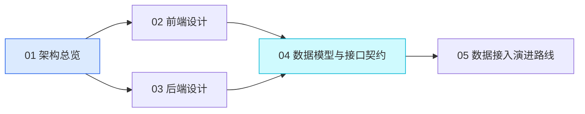

# OpenAN 社区运营洞察平台 · 架构设计文档

本目录是 **OpenAN Community Operation Insights（社区运营洞察平台）** 的架构设计文档集。

**当前状态**：设计基线已定稿并进入实现阶段。代码工程（`apps/api`、`apps/web`）与种子数据（`data/`）已落地，本目录作为设计与契约基线持续维护。
**文档版本**：v1.28 ｜ **最后更新**：2026-10-31

---

## 1. 项目说明

一个面向 OpenAN 社区运营团队的**数据看板网站**，由一个顶部导航栏、四个只读内容页与一个管理页组成，用于集中呈现社区规模指标、各成员单位的贡献度、历次峰会信息，以及例会参会情况；管理页承载**身份匹配控

制台**，把各来源账号人工认领到自然人。

| 页面 | 路由 | 核心内容 |
| --- | --- | --- |
| 首页 | `/` | 伙伴单位数量、独立开发者数量、参加的峰会、应用案例、下一次峰会、贡献的组织 |
| 社区活跃度情况 | `/activity` | 按组织汇总的 PR / Issue / 代码量，需求 / 议题分享，以及组织提交占比分布 |
| 社区参展 | `/summits` | 峰会时间线（名称、时间、地点、官网）+ 每场峰会的详情表格 |
| 例会参会情况 | `/meetings` | 例会参会矩阵（人 × 日期），行头附当次出席人数、列头附个人出席率 |
| 身份匹配控制台（管理页） | `/admin/identity` | 双模式：**自然人 ↔ 账号**（认领 / 解除认领 / 归属，默认）、**组织 ↔ 开发者**（收纳 / 移出）。是本站**唯一的写入口**，见 04 第 5.3 节 |

---

## 2. 文档索引

| 文档 | 内容 | 主要读者 |
| --- | --- | --- |
| [01-architecture-overview.md](./01-architecture-overview.md) | 系统上下文、分层架构、技术选型与理由、架构原则、部署形态、目录与命名约定、风险登记 | 所有人、评审者 |
| [02-frontend-design.md](./02-frontend-design.md) | 路由设计、四页面区块拆解与**字段级清单**、组件树、TanStack Query 缓存策略、设计系统、响应式与主题 | 前端工程师、设计师 |
| [03-backend-design.md](./03-backend-design.md) | NestJS 模块划分、分层职责、**Provider 端口接口签名**、DI Token 与绑定集中点、采集器读写分离、JSON 仓储原子写、DTO、错误码表、日志规范 | 后端工程师 |
| [04-data-and-api-contract.md](./04-data-and-api-contract.md) | **JSON 数据模型 schema**、实体字段定义、完整数据样例、**REST 接口契约**、契约治理 | 前后端工程师（必读） |
| [05-integration-roadmap.md](./05-integration-roadmap.md) | GitHub / Confluence 采集设计、增量与限流策略、调度与缓存、数据校验与回滚、里程碑与验收标准 | 后端工程师、运营负责人 |
| [06-known-issues.md](./06-known-issues.md) | **未解决 / 开放问题登记**（只记「还没修的」）：现象、影响与处置方向。已解决条目按运营约定**即时删除**，其取证与处置留痕见本文档 §9 版本记录与 [adr/](./adr/) | 所有人 |
| [07-data-catalog.md](./07-data-catalog.md) | **数据采集目录（可自由编辑）**：从数据视角登记全站采集 / 展示的数据，按页面从高到低汇总，并逐项说明来源、采集方式、归类口径、实现状态与未实现待补项 | 所有人、数据源对接人、运营负责人 |
| [08-lan-deployment-guide.md](./08-lan-deployment-guide.md) | **局域网部署指南**：Linux + nginx + systemd 同域部署的完整实操手册。10 个步骤逐条给出命令、验收判据与背后知识点（monorepo 依赖提升、`.env` 与 cwd、Vite 产物与缓存、`try_files` SPA 回退、`proxy_pass` 尾斜杠、home 目录权限与 403、systemd 单元字段、防火墙三层模型），并附命令速查、日常运维、故障排查表与遗留事项 | 运维、后端工程师 |
| [09-future-goals.md](./09-future-goals.md) | **未来目标（可自由编辑）**：登记尚未开工的中长期目标——G1 账号体系（登录 / 角色 / 权限，取代单一 `ADMIN_TOKEN`）、G2 社区与星火部内部**双视角呈现**。每条给出动机、现状盘点、可选路线、牵连面与**开工前必须先回答的待明确清单** | 所有人、运营负责人、评审者 |
| [adr/](./adr/) | 架构决策记录（ADR）：背景、决策、理由与后果 | 所有人、评审者 |

### 2.1 推荐阅读路径

```text
新加入的工程师：README → 01 → 04 → （前端）02 / （后端）03
参与评审者   ：README → 01（重点看第 6、7 章：选型理由与架构原则）
运营负责人   ：README → 01 第 2 章 → 05 第 1、7 章（演进路线与里程碑）→ 09（未来目标）
数据源对接人 ：README → 04 第 3 章（字段口径）→ 05 第 2、3 章（采集设计）→ 07（数据目录）
部署 / 运维  ：08（第 5 章命令速查可直接执行）→ 出问题时查 08 第 7 章排查表
规划 / 评审  ：README → 09（未来目标与「开工前必须回答」清单）→ 相关 ADR
```

### 2.2 依赖关系



**04 文档是唯一契约来源**：任何字段新增、改名、类型变更，都必须先改 04，再改代码。

---

## 3. 技术栈速览

| 层次 | 选型 |
| --- | --- |
| 前端 | React 18 + TypeScript + Vite 5 + React Router 6 + TanStack Query 5 + Tailwind CSS 3.4 + Recharts |
| 后端 | NestJS 10 + TypeScript + class-validator |
| 数据存储 | **JSON 文件**（`data/*.json`），通过 `JsonRepository` 抽象封装 |
| 外部数据源 | GitHub（GraphQL 采集，已实现于 `apps/api/src/collector`）、Confluence（CQL 检索，待接入） |

### 3.1 架构核心思想

**端口-适配器（Ports & Adapters）**：业务层只依赖 `Port` 接口，具体实现由 DI Token 绑定，使业务逻辑对数据来源无感知。

**但数据源的演进不走端口切换。** 按「采集写、接口读」的读写分离设计，采集器（`apps/api/src/collector`）把外部数据落盘为与种子数据**完全相同**的 JSON 结构，API 的六个端口**恒为 JSON 实现**：

```text
采集链路（写入）：GitHub API → collector/（映射、归并）→ data/*.json
请求链路（只读）：Controller → Service → Port（接口）→ Json 实现 → 读取 data/*.json
                                                  ↑
                        端口绑定集中于 ProvidersModule（换存储 / 直连上游时才动）
```

---

## 4. 本期范围（重要）

### 4.1 本期做什么

- ✅ 输出本目录下的五篇架构设计文档
- ✅ 定义完整的数据模型与接口契约，字段按**真实数据源语义**设计
- ✅ 定义 GitHub / Confluence 的接入端口与演进路线

### 4.2 本期不做什么

- ❌ 不创建前端或后端工程脚手架，不编写业务代码
- ❌ 不实现真实的 GitHub / Confluence 调用
- ❌ 不引入数据库、缓存中间件、消息队列
- ❌ 不做用户体系与登录鉴权（**唯一例外**：身份匹配控制台的写接口使用单一管理员令牌 `ADMIN_TOKEN`，见 04 §5.3.14）
- ❌ 不做通用后台管理界面（**唯一例外**：身份匹配控制台 `/admin/identity`，见 02 文档）
- ❌ 不做国际化多语言

### 4.3 「硬编码」的实现约定

需求中提到的"暂时硬编码"，在本架构中统一落在**后端 `data/*.json` 种子文件**，而不是前端组件常量。前端从第一天起就通过 HTTP 获取所有数据。

**原因**：若一部分数据走接口（如"贡献的组织"）、一部分写死在前端，后续接入真实数据时会出现两套数据路径，前端需要全面返工。统一后置到后端，使前端代码即为最终形态。

| 数据 | 位置 | 当前来源 | 未来来源 |
| --- | --- | --- | --- |
| 首页四项指标 | `data/home.json` | 人工维护 | 聚合自贡献数据 |
| 下一次峰会 | `data/home.json` → `nextSummitId` | 人工维护 | 自动推导（未结束峰会中最近一场） |
| 贡献的组织 | `data/organizations.json` | 人工维护 | 同左 |
| PR / Issue / 代码量 | **`data/github-events.json`（事件明细，唯一原子事实）** → 组织级 / 账号级 / 仓库级三段**读时派生**；`data/github-organizations.json` 已降级为基线快照（接口不读） | **GitHub API**（已接入） | 同左 |
| 需求 / 议题分享 | `data/confluence-accounts.json` → 组织级**读时派生**；`data/confluence-organizations.json` 已降级为基线快照（接口不读） | **Confluence API**（已接入） | 同左 |
| 个人贡献者档案（**账号档案**：展示名 / 头像 / 采集口径归属；指标已下沉到事件明细） | `data/github-accounts.json` | **GitHub API**（按 `githubId` 归并） | 同左 |
| 峰会时间线与详情 | `data/summits.json` | 人工维护 | 同左（人工维护） |
| 例会参会矩阵 | `data/meetings.json`（源台账 `data/source/meetings.xlsx`） | 人工维护 Excel → 采集脚本 | **Zoom API**（远期） |
| 自然人档案 | `data/persons.json` | 身份匹配控制台（人工） | 同左（人工维护） |
| 身份认领映射 | `data/identity-claims.json` | 身份匹配控制台（人工） | 同左（人工维护） |

---

## 5. 术语表

| 术语 | 英文 / 字段 | 定义 |
| --- | --- | --- |
| **TSC 成员单位** | TSC Member | 进入 OpenAN 技术指导委员会（TSC）的单位。对应 `Organization.type = 'tsc'`，Badge 文案「TSC 成员单位」 |
| **参与单位** | Participant | 参与社区共建、但未进入 TSC 的单位。对应 `Organization.type = 'participant'`，Badge 文案「参与单位」 |
| **运营单位** | Operation | 承担社区运营职能的单位。对应 `Organization.type = 'operation'`（v1.21 新增），Badge 文案「运营单位」、中性灰配色（仅 `tsc` 用紫色强调）。当前仅 LFN 一家。在**所有计数口径上与 TSC 成员单位、参与单位完全等价**（各处一律写作 `type !== 'individual'`），差异仅体现在徽章文案与配色。v1.24 起**类型不再参与排序**——全站组织列表一律按「展示顺序（`displayOrder`）」排列（ADR-0016，原 `TYPE_WEIGHT` 权重表已删除） |
| **独立开发者** | Individual / Unattributed | 以个人身份贡献、未归属任何单位的开发者。**不是真实组织**：全部未归属贡献统一记入伪组织 `orgId = 'unattributed'`（`type = 'individual'`）。对外文案已全站统一为「独立开发者」；计数字段沿用旧名 `externalDeveloperCount`（历史原因，不改，但自 v1.25 起为**读时派生**值：`effectiveOrgId === 'unattributed'` **且非机器账号**者计数，现 **10**（2026-10-30 全量事件实测；⚠️ 与 `.sync-state.json` 的 `unattributedLogins` 条数 **17** 不等，后者是采集待办清单，其中 6 个已被认领到有归属自然人、1 个是机器账号）；`home.json` 已不再落该字段）。⚠️ **人数与量是两个口径**：机器账号（如 `dependabot`）不计入人数，但其代码量**仍计入** `unattributed` 桶。该伪组织**保留在 `organizations.json` 内**——原拟「移出档案、改由读路径合成」的方案已于 2026-10-26 **作废**（见本文档 §9 v1.19）；它被 `type !== 'individual'` 排除，故不计入伙伴单位数 |
| **贡献者** | Contributor | 以 GitHub 账号为维度的个人档案（人工维护字段 + 采集回填的 `github` 指标，`schemaVersion` **2** 起含仓库清单 `repoIds`）。⚠️ 账号级 `orgId` 自 v1.25 起只是**采集口径兜底**，展示归属一律看**生效归属** `effectiveOrgId`（认领边优先），见 04 文档 3.7 节与 [ADR-0017](./adr/0017-github-effective-attribution-read-time-derivation.md) |
| **伙伴单位数** | `partnerCount` | 首页卡片指标 = TSC 成员单位 + 参与单位 + 运营单位（组织档案中 `type !== 'individual'` 者）。**口径只排除伪组织、与业务类别无关**，故新增类别不影响本值。**含 LFN**（运营 2026-10-26 裁定计入组织；同日其归类由 `tsc` 改为 `operation`，**不改变计入结论**）。现为 `12`（v1.24 新增参与单位 China Unicom `unicom`，见 ADR-0016），与组织墙在榜数同源同值；**新增 / 移除真实组织档案时必须手工同步该值与 `home.json` 的 `updatedAt`**。此前手工填 `10` 导致的同屏数字打架已修正，裁定过程见本文档 §9 v1.19，归类变更见 v1.21 |
| **应用案例** | Use Case | 基于 OpenAN 能力构建并对外发布的实践案例，计入首页 `useCaseCount` |
| **需求** | Requirement | Confluence `Requirement Proposal` 页（`Release Planning` 之下）需求表格 `Contacts` 列的 @ 提及数，**每个 @ 各计 1 条** |
| **议题分享** | Topic Share | Confluence 会议纪要页 `Agenda` 段**内**的 @ 提及数（段落里与表格行里都算；同页出席签到段不计；同一期同一账号去重）。取代原「best-practice 案例」（wiki 内无该内容，见 ADR-0009） |
| **代码量** | Lines Changed | PR 级 `additions + deletions` 累加值（含全部文件类型，不做文件级过滤） |
| **时间口径** | Time Basis | 一组数字回答的是「**全量**还是**某区间**」，**必须与数字成对读出**（v1.28 新增，[ADR-0018](./adr/0018-time-range-read-time-slicing.md)）。三档：① **全量口径**——不带 `from`/`to`，统计全部事件，是**默认**；② **区间口径**——半开 `from <= 事件时间 < to`，**仅 GitHub 侧生效**；③ **混合口径**——`GET /api/contributions/summary` 的 `totals`（GitHub 四项跟随区间、Confluence 三项恒全量，出参不带口径标记）。已知分叉：**首页与组织卡恒为累计（全量口径）**；Confluence 侧（`/api/wiki`、`/api/confluence-accounts`）**恒为全量**（无时间维度明细），前端在 Confluence 视图**禁用**区间筛选器、在 GitHub 视图给 Confluence 列打「**全历史**」角标 |
| **区间口径** | Range Basis | 带 `from`/`to` 时只统计**事件时间戳**落在半开区间内的事件，是**视图属性**而非事实属性：`github-events.json` **恒存全量**，区间是**读时切片**（唯一谓词 `filterEventsByRange`，在派生之前切一刀）。日界按 **Asia/Shanghai** 由**前端**翻成时刻（结束日取**次日**零点），后端只比 epoch 毫秒、不解析时区。`from > to` → `40002`；`from == to` **合法**（空区间命中 0）。组织级 / 账号级 / 仓库级三段共用同一谓词，故恒等式在**任意区间**下成立。⚠️ 任何新代码想按时间筛事件**必须**调该谓词——另写一份 `events.filter(...)` 会让恒等式在两个实现之间悄悄分叉，而这类分叉**不会让任何测试变红** |
| **事件时间戳** | Event Timestamp (`timestamp`) | `github-events.json` 每条事件的时间：PR 取 `mergedAt`、Issue 取 `createdAt`（ISO 8601 **时刻**）。自 `schemaVersion` **2** 起为**必填**——它是区间口径的**唯一**切片依据，可空会让同一份文件在「全量 / 区间」两种读法下给出**两个总量**。缺时间的记录在**采集期整条拒绝**（不落盘、不进聚合）+ `WARN` + `.sync-state.json` 的 `untimedEvents` 累计；真通道结构上产不出这种记录，故这是**回归护栏**（护栏必须响） |
| **下一次峰会** | Next Summit | `endDate` 最晚且尚未结束的峰会；无未来峰会时为 `null` |
| **贡献的组织** | Contributing Organizations | 首页展示的组织卡片墙：展示**全部**组织档案，按运营人工指定的**展示顺序（`displayOrder`）**升序排列（同值/缺失按名称升序居末）；卡片直出**代码贡献量**与 **Confluence 贡献量**及**各维度 top3 贡献者**（头像 + 姓名 + 数字，不可点击；某维度无人时显示「—」占位）；两项贡献量均为 0 的组织显示「暂无贡献」（ADR-0016 取代 ADR-0001 的贡献分降序与零分判据） |
| **展示顺序** | Display Order (`displayOrder`) | `organizations.json` 组织档案的**可选**整数字段（v1.24 新增，ADR-0016），运营人工指定排位，**越小越靠前**；全站组织列表（`scope=all` 与 `scope=contributing`）统一按其升序，同值/缺失者排最后并按 `name` 升序兜底。取代原「综合贡献分降序」与 `TYPE_WEIGHT` 类型梯队（两者均已删除） |
| **代码贡献量** | Code Contribution (`commits`) | 组织卡片指标 = **事件明细 `github-events.json`（P9）** 中已合并 PR 的 `commitCount` 之和，经「事件 → 账号级 → 按**生效归属**求和」**两跳读时派生**（v1.25 起不再读 `github-organizations.json`；事件明细上线后**也不再读**账号档案的 `github.commits`，两者均降级为基线快照）：**已合并 PR 内提交总数**（不含无 PR 的直推提交，口径见 04 §3.3）；无记录为 0，故「组织级 ≡ 个人级求和 ≡ 仓库级求和」三段恒成立（2026-10-30 全量实测合计 **1813**）。首页组织卡 top3 贡献者的 GitHub 维度亦按此字段排序（已排除机器账号） |
| **Confluence 贡献量** | Confluence Contribution (`confluenceEdits`) | 组织卡片指标 = `confluence.edits`：**编辑量**（页面版本作者条数、含创建那次；账号级按 `effectiveOrgId` 求和的读时派生值，ADR-0010 / ADR-0011）；无记录为 0。首页组织卡 top3 贡献者的 Confluence 维度按编辑量排序（`GET /api/confluence-accounts` 的 `sortBy` 白名单已含 `edits`） |
| **组织贡献明细** | Activity Detail | 活跃度页明细表：以组织档案为底表展示**全部**组织，无贡献记录的指标按 0 计、更新时间与仓库数显示「—」（见 ADR-0002） |
| **组织贡献分布** | Org Contribution Distribution | 活跃度页环形图：按 `github.commits` 统计各组织提交占比，**列出全部参与组织**（不再并入「其他」）；Confluence 视图复用同一卡片，按需求 / 议题分享 / 编辑切换口径（见 [ADR-0013](./adr/0013-org-distribution-lists-all-orgs.md)，修订 ADR-0003） |
| **个人贡献排行** | Contributor Leaderboard | 活跃度页右列排行卡：按所选 GitHub 指标展示前 8 位贡献者（含独立开发者），取数自 `GET /api/contributor-contributions`（见 ADR-0004）。⚠️ 归属标签与组织筛选一律按**生效归属** `effectiveOrgId` 解析（ADR-0017），**机器账号不在出参中** |
| **例会** | Meeting | 社区定期召开的例会，独立于峰会（见 ADR-0005）。本期仅记录参会情况，不记录时长 / 主持人 / 议程 |
| **例会参会矩阵** | Meeting Attendance Matrix | 例会页「人（横）× 日期（竖）」二维矩阵，直接照搬 Excel 台账，**无主键、不规范化、不可重排**（见 ADR-0005 / 04 §3.8） |
| **出席率** | Attendance Rate | 个人出席次数 / 全部例会场次。因空白计入缺席，成员加入前的历史空白亦进分母（见 ADR-0005 负债） |
| **端口 / 适配器** | Port / Adapter | 架构模式：Port 是接口定义，Adapter 是具体数据源实现 |
| **契约** | Contract | 由 04 文档定义的字段与接口规范，前后端共同遵守 |
| **自然人** | Person | 跨来源被认定为同一个人的**身份根**（`personId` + 展示名 + 归属组织），是身份认领的唯一锚点，由身份匹配控制台维护；一经创建仅可改名与调整归属（见 04 §3.9） |
| **身份认领** | Identity Claim | 「把某来源账号判定为某自然人」的单条映射**边**（`source` + `accountKey`）；解除匹配 = 物理删除该边（见 04 §3.10） |
| **候选池** | Identity Candidate | 待认领 / 已认领的来源账号集合，由 `github-accounts.json`、`meetings.json` 与 Confluence 来源**派生**，不落盘（见 04 §5.3.11）；每条带采集口径组织归属、认领人归属，认领冲突时弹窗确认（见 [ADR-0014](./adr/0014-candidate-pool-org-display-and-claim-conflict-dialog.md)） |
| **组织花名册** | Org Roster | 「组织 → 其下开发者」视图，由 `Person.orgId` **派生**；组织档案上不存成员清单，避免两份真相（见 04 §5.3.13） |
| **认领目标** | Claim Target | 自然人模式下左栏花名册中被选中的自然人，是候选池「认领」动作的唯一对象；页面级瞬时状态，不落盘、不进 URL。**与「详情抽屉」是两个独立状态**——选中不开抽屉、关抽屉不清目标（见 [ADR-0006](./adr/0006-identity-console-selection-vs-detail.md)） |
| **详情抽屉** | Person Detail Drawer | 自然人模式下由行内「详情」按钮单独打开的模态面板，用于改名 / 调整归属 / 解除认领 / 物理删除；开关不影响认领目标（见 [ADR-0006](./adr/0006-identity-console-selection-vs-detail.md)） |

---

## 6. 关键设计决策速查

| 决策 | 结论 | 一句话理由 |
| --- | --- | --- |
| 后端框架 | NestJS（非 Express） | DI 容器让实现可替换；读写分离让数据源接入不触碰业务层 |
| 存储 | JSON 文件 + Repository 抽象 | 数据量小、零依赖、可平滑替换为数据库 |
| 前端数据获取 | 全部走后端接口 | 避免后续接入真实数据源时全面返工 |
| 字段命名 | 按真实数据源语义命名 | 避免阶段三字段改名引发前后端连锁修改 |
| 响应格式 | 统一 `{ code, message, data }` | 后续加分页/错误码不破坏前端解析 |
| 读写关系 | 采集写、接口读 | GitHub 不可用时看板仍可用 |
| GitHub API | GraphQL 为主 | 消除 N+1，一次拿到 `additions`/`deletions` |
| 契约变更入口 | 先改 04 文档 | 保证文档是唯一事实来源 |
| 时间区间（ADR-0018） | **读时切片**，事件文件恒存全量 | 区间是**视图属性**不是事实属性：下沉到落盘等于为每个窗口存一份事实，或让事件文件变滚动窗口而永久丢历史 |
| 区间默认值 | **不带区间 ≡ 全量口径**，预设不硬编码年份 | 激活前后数字逐位相同（无骤变）；写死 `2026-01-01..2026-12-31` 会在跨年那天让页面静默变全 0 |
| 区间边界 | **半开** `from <= timestamp < to`；日界按 `Asia/Shanghai` 由**前端**翻成时刻 | 闭区间与「次日零点」组合会多算一天、与「当日零点」组合会整天吞掉结束日；后端认识时区就得猜用哪个时区 |
| 缺时间戳的事件 | **采集期整条拒绝** + `WARN` + 游标计数 | 读时忽略会让同一份文件在全量 / 区间两种读法下给出两个总量，且破在默认视图上最难发现 |
| Confluence 侧区间 | **接受但恒不过滤**，前端禁用筛选器 + 打「全历史」角标 | 该侧无时间维度明细；摆一个不生效的日期框等于撒谎，而报错 / 隐藏列会毁掉跨来源对比 |
| 首页 vs 活跃度页 | 首页**恒为累计**，活跃度页 GitHub 侧可按区间 | 首页没有筛选器，「累计」是它唯一说得清的口径；两者对不上是**刻意**的，不是 bug |

---

## 7. 后续待办

| # | 事项 | 负责方 | 关联文档 |
| --- | --- | --- | --- |
| 1 | 按 04 文档创建 `data/*.json` 种子数据 | 后端 + 运营 | 04 第 4 章 |
| 2 | 搭建前端工程并按 02 文档实现四个页面 | 前端 | 02 |
| 3 | 搭建后端工程并按 03 文档实现模块与端口 | 后端 | 03 |
| 4 | 产出 GitHub 作者 ↔ 组织映射（**v1.25 起首选**：在身份匹配控制台补认领边，或补 `aliases.github` / `emailDomains`——改完**下一个请求即生效**，无需重跑采集器；账号级 `orgId` 仅为兜底） | 运营 | 05 第 2.6 节、[ADR-0017](./adr/0017-github-effective-attribution-read-time-derivation.md) |
| 5 | 规范 Confluence 标签与"所属组织"字段 | 运营 | 05 第 3 章 |
| 6 | 确认部署形态与 `data/` 持久化方案 | 运维 | 01 第 8 章 |
| 7 | 维护例会 Excel 台账并执行 `npm run collect:meetings` 生成 `data/meetings.json` | 运营 | 05 第 10 节 |
| 8 | 在身份匹配控制台维护「自然人 ↔ 各来源账号」认领关系与组织归属 | 运营 | 04 第 5.3 节 |

> 上表只列**本期可执行**的待办。中长期目标（账号体系、社区 / 星火部内部双视角呈现）登记在 [09-future-goals.md](./09-future-goals.md)；其「开工前必须回答」的待明确清单未闭合前，不进入本表。

---

## 8. 文档维护约定

- 本目录文档与代码**同仓库、同评审**，遵循"文档先行"原则。
- 修改契约（字段、接口、错误码）时，必须同步更新 04 文档，并在 **§9 版本记录**中登记。
- 凡改动**枚举取值**、**对外术语**或**指标口径**，必须按 [04 §6.1.1 跨文档同步矩阵](./04-data-and-api-contract.md) 逐处核对——04 是契约的唯一真相，但不是唯一*提到*契约的地方。提交前过一遍 04 §6.3 契约自检清单。
- **本文档 §5 术语表是对外术语的唯一来源**；其余文档与前端文案（含卡片 `label` / `hint`）均应与其一致。
- 文档内所有 Mermaid 图与表格若与实际实现不一致，以**文档为准**发起修正讨论，不允许实现单方面偏离。

## 9. 版本记录

> **编号映射（2026-10-26 重编号，见 v1.22）**：`08-data-catalog.md` → **`07-data-catalog.md`**（数据采集目录）、`09-lan-deployment-guide.md` → **`08-lan-deployment-guide.md`**（局域网部署指南），新增 `09-future-goals.md`（未来目标）排末位。**本表 v1.22 之前的条目按留痕原则不改写**，故其中出现的 `08` 一律指数据采集目录（现 `07`）、`09` 一律指局域网部署指南（现 `08`）；v1.7 / v1.10 提到的 `07-feature-registry.md` 是已撤销的另一份文件，与现 `07-data-catalog.md` 无关。

| 版本 | 日期 | 变更 |
| --- | --- | --- |
| v1.0 | 2026-09-18 | 初始版本：五篇文档建立，覆盖架构、前端、后端、契约与接入演进 |
| v1.1 | 2026-09-21 | 修正数据源接入机制表述：明确「采集器写、接口读」的读写分离，API 五个端口恒为 JSON 实现；移除 `providers/github`、`providers/confluence` 占位设计相关描述；技术栈更正为原生 `fetch`（未引入 `@octokit`）；补全 `collector/` 目录说明 |
| v1.2 | 2026-09-21 | 首页组织墙改为全量组织按综合贡献分降序（[ADR-0001](./adr/0001-homepage-org-wall-shows-all-orgs.md)）：04 §5.3.2 `scope=contributing` 语义更新并补充 `contributionScore`/`contributionLevel` 响应字段说明；03 §4.1 端口签名移除未使用的 `scope` 字段、时序图修正；02 §3.1/3.2 字段清单与零分卡片描述更新；README 术语表「贡献的组织」重定义 |
| v1.3 | 2026-09-21 | 活跃度明细表纳入全部组织（[ADR-0002](./adr/0002-activity-table-includes-all-orgs.md)）：02 §4.1/4.2 数据源更新为三源合并（组织档案为底表），补充零值行与排行榜过滤描述；README 术语表新增「组织贡献明细」 |
| v1.4 | 2026-09-21 | 活跃度环形图改为按组织提交数统计（[ADR-0003](./adr/0003-activity-donut-by-org-commits.md)）：02 §4.1/4.2 环形图口径改为组织维度 `github.commits`、占比低于 3% 并入「其他」；04 §5.2/5.3.5 `/contributions/summary` 用途收窄（环形图改用 `/contributions`）；01/03 相关表述同步；README 术语表新增「组织贡献分布」 |
| v1.5 | 2026-09-21 | 活跃度页排行榜由组织维度改为个人维度（[ADR-0004](./adr/0004-activity-rank-by-contributor.md)）：04 §3.7 补充 `github` 字段并改写定位说明、§4.5 样例补 `github`、§5.2 新增 `GET /api/contributor-contributions`、新增 §5.3.8 详细定义；02 §2.1/4.1/4.2/4.3 更新为个人贡献排行（含独立开发者、头像降级、独立错误态）；README 术语表新增「个人贡献排行」并修订「贡献者」 |
| v1.7 | 2026-09-24 | ~~新增 07-feature-registry.md「功能清单」~~（**已撤销**：该文件已按作者本意删除，见 v1.10）。原文留档：以功能为单位的登记册（已实现 / 开发中 / 计划中 / 已否决四态），5 个一级分组、稳定 slug ID、按状态差异化的字段模板；索引补入 06 / 07 两篇。**该文件为可自由编辑的登记册，不定义契约**（契约仍以 04 为唯一来源）；其中 §0.6 登记了 5 处既有文档—代码漂移，待决策处置 |
| v1.6 | 2026-09-23 | 新增「例会参会情况」独立实体（[ADR-0005](./adr/0005-meeting-attendance-matrix.md)）：新增 `data/meetings.json`（人 × 日期矩阵）与源台账 `data/source/meetings.xlsx`、采集脚本 `apps/api/scripts/import-meetings.ts`；04 新增 §3.8 实体、§4.7 样例、§5.3.9 `GET /api/meetings`；02 新增 §6 页面设计（原 §6–§12 顺延为 §7–§13）、路由与组件树补入 `/meetings`；01 页面 / 数据文件 / 目录 / 风险同步；05 新增 §10 例会接入设计；术语表新增「例会 / 例会参会矩阵 / 出席率」 |
| v1.8 | 2026-09-27 | 新增**身份匹配控制台**（`/admin/identity`）与身份映射数据模型：`data/persons.json`（自然人＝**点**）、`data/identity-claims.json`（认领映射＝**边**）、`data/.identity-audit.jsonl`（审计流水，非契约）。04 新增 §3.9 `Person`、§3.10 `IdentityClaim`、§4.8/§4.9 样例、§5.3.10～§5.3.15（persons / claims / candidates / org-roster 只读接口 + `/api/identity/*` 写接口 + 审计），修订 §5.1「全部 GET」与新增鉴权约定、§2 主键表、§6.2 语义速查；08 登记 P5 自然人档案 / P6 身份认领映射 / P7 候选池（派生）/ P8 组织花名册（派生）；README §1 页面表、§4.2 范围、§4.3 数据来源表、术语表、后续待办同步修订。**归属唯一真相为 `Person.orgId`**（组织档案不存成员清单，花名册派生）；写接口仅存在于 `/api/identity/*` 且需 `X-Admin-Token`；**既有看板接口与取数口径不变** |
| v1.9 | 2026-09-27 | 修复身份匹配控制台「账号认领」完全不可达（[ADR-0006](./adr/0006-identity-console-selection-vs-detail.md)）：`PersonRoster` 整行点击与行内「详情」按钮由同一个 `selectedPersonId` 驱动 `PersonDetailDrawer`，而该抽屉是全屏模态遮罩，导致候选池被覆盖、「认领」按钮恒为 disabled。把「认领目标」（行点击写入）与「详情抽屉」（详情按钮写入）拆为两个独立状态，关抽屉不清目标、认领成功后保持选中、新建即成为目标、「详情」按钮改常驻可见并补 `pointer-events` 与 `aria-pressed`；README 术语表新增「认领目标 / 详情抽屉」，06 补记该问题。**接口契约与数据文件不变** |
| v1.10 | 2026-09-27 | 撤销 `07-feature-registry.md`「功能清单」登记册：该文件已按作者本意删除（偏离文档集本意），故本索引移除其条目、v1.7 条目标记为已撤销、`08-data-catalog.md` 脚注不再引用。**其余文档、接口契约与数据文件不变** |
| v1.12 | 2026-09-28 | 接入 Confluence **账号级**数据契约与读接口（[ADR-0008](./adr/0008-org-person-data-grain-and-attribution.md)）：新增 `data/confluence-accounts.json`（`ConfluenceAccount`，主体是平台账号的**原子事实**），组织级 `confluence-organizations.json` 改为由其按 `orgId` 求和**派生**（不再独立计算，消除双写漂移）；数据文件命名收敛为 `<source>-<粒度>.json`（`contributions.json`→`github-organizations.json`、`wiki.json`→`confluence-organizations.json`、`contributors.json`→`github-accounts.json`）；新增只读接口 `GET /api/confluence-accounts`（04 §5.3.16，**暂未对接前端**）。04 补 §1.2 ER 与关联规则、§2 主键表、§3.11 实体、§4.10 样例、§5.2 清单；08 同步 A3 粒度说明与 P7 待办。**现有看板接口、取数口径与前端均不变** |
| v1.11 | 2026-09-28 | 修复身份匹配控制台「新建」自然人点击无反应：该按钮的"失效"实为**禁用态无视觉反馈**——空名即 `disabled`，而 `Button` 没有任何 `disabled:` 样式，外观与可用态完全一致；且原实现先清空输入再提交，提交被拒（如标签页未配置令牌 → `40101`）后输入已空、按钮回到禁用态，表现为「点过一次后彻底没反应」。现改为：`Button` 补禁用态样式；空名点击返回「提示 + 聚焦」而非静默；仅在成功后清空输入；`TextInput` 支持 `ref` 转发；未配置令牌时直接打开令牌弹窗并说明原因。06 补记该问题。**接口契约与数据文件不变** |
| v1.13 | 2026-09-28 | Confluence 两个维度改为「结构选页 + 正文按人计数」（[ADR-0009](./adr/0009-confluence-two-dimension-extraction-from-page-body.md)，**取代** ADR-0007 的决策 1 / 决策 5）：`confluence.requirements` 改为 `Requirement Proposal` 页（`Release Planning` 之下）需求表格 `Contacts` 列的 **@ 提及数**（每个 @ 各 1 条，含一行多联系人）；第二维 `confluence.bestPractices` **更名为** `confluence.topicShares`（会议纪要页 `Agenda` 段表格行 @，同一期去重）；选页改用**结构选择器**（标题 + 祖先链 / 正则），不再看标签或标题关键字。`data/confluence-organizations.json` 与 `data/confluence-accounts.json` 的 `schemaVersion` **1→2**（不兼容字段改名，读侧 fail-fast）。04 §1.2/§3.3/§3.11/§4.4/§4.10/§5.3.3/§5.3.16、02 §4.1、03 §5 环境变量表、05 §3 / §5.3、08 A3、README 术语表与 `CONTEXT.md` 同步；前端活跃度列「最佳实践」→「议题分享」，贡献分公式同步。新增 ADR-0009，ADR-0001 / 0007 / 0008 加注。**API 路由与前端结构不变** |
| v1.14 | 2026-09-28 | 议题分享取数范围**修订**为「`Agenda` 段**内**全部 @」（[ADR-0009](./adr/0009-confluence-two-dimension-extraction-from-page-body.md)「后续修订」，**取代** v1.13 的"段内表格行"）：实测该段只有一张布局表格、分享人写在「议题标题 + @分享人」的**段落**里，故原口径恒 0。解析改为段内全取 + 按期去重，段外（出席签到 / 行动项）仍不计；`Agenda` 段内写成纯文本的 `@人` 与需求行一样记入状态文件 `unresolvedContacts`（新增 `source` 字段区分 `requirements` / `minutes`）；新增「有纪要页却解析出 0 个分享人」中止写入自检。首次真实采集：53 页 / 16 期会议 / 需求 38 条 · 议题分享 20 次 / 15 个账号（段内原始 @ 24 处，同期重复去重 4 处），**全部仍落「独立开发者」**（归属待补）；展示名实测 `/rest/api/user` 返回 403，15 个账号只有 4 个有真名。04 §3.11、02 §4.1、03 §5、05 §3.2/§5.1/§5.3/§5.4、08 A3、README 术语表与 `CONTEXT.md` 同步。**API 路由与前端结构不变** |
| v1.15 | 2026-09-28 | 展示名改从**渲染视图**解析（[ADR-0009](./adr/0009-confluence-two-dimension-extraction-from-page-body.md)「后续修订之二」）：采集令牌读用户资料恒 **403**、正文 mention 只有 `ri:account-id`，故此前 15 个账号仅 4 个有真名、其余呈现 accountId；现改为 `?expand=body.storage,body.view` 随正文一并取回渲染视图（**零额外请求**），从中取 `<a class="…user-mention" data-account-id="…">FeiGuo</a>` 的展示名，兜底顺序定为「**渲染视图** → 正文 `ri:username` → 创建者展示名 → `/rest/api/user` → accountId」，日志按来源分档计数（`展示名来源：渲染视图 N｜正文 username N｜创建者 N｜账号查询 N｜降级 accountId N`）。重跑后 15 个账号**全部为真名**；同日复核取数与首采同量级（53 页 / 16 期会议 / 需求 38 条 · 议题分享 **21** 次 / 段内原始 @ **25** 处；待修正纯文本 `@人` **4** 处）。离线自检 **70 项**（新增渲染视图抽取单元断言与兜底顺序断言）。04 §3.11、05 §3.1/§3.2/§5.4、08 A3、ADR-0009 同步。**计数口径、契约结构、API 路由与前端不变** |
| v1.16 | 2026-09-29 | 组织构成环形图改为**列出全部参与组织**（[ADR-0013](./adr/0013-org-distribution-lists-all-orgs.md)，**修订** ADR-0003 的决策 3 / 4）：取消 3% 阈值与 6 个具名扇区上限，不再并入「其他」；`CHART_PALETTE` 由 6 色扩至 12 色；02 §4.1/4.2、04 §5.2、08 A4、README 术语表同步。**接口契约与数据文件不变** |
| v1.17 | 2026-10-15 | 新增 [09-lan-deployment-guide.md](./08-lan-deployment-guide.md)「局域网部署指南」（该文件已于 v1.22 重编号为 `08-lan-deployment-guide.md`，此处只修链接目标以免断链，条目文字按留痕原则不改写）：基于在 `linux-openan-test-0002`（Debian 12）上的一次真实部署复盘，记录 nginx 同域反向代理 + systemd 常驻的完整 10 步流程，每步给出命令、验收判据与背后知识点（monorepo 依赖提升与 `npm ci` 语义、`.env` 相对路径与 `process.cwd()`、Vite 产物指纹与缓存边界、`try_files` SPA 回退、`proxy_pass` 尾斜杠的前缀替换规则、home 目录 `750` 导致 `www-data` 403、systemd 单元逐字段解释、`systemctl start` 异步返回导致的时序误判、`curl -s` 吞错误、防火墙三层模型）。附命令速查、日常运维矩阵、24 项故障排查表、安全加固建议（后端当前绑 `*:3000` 应收敛回环）与 6 项遗留事项（首要为**尚未核实本机 IP 是否真为 `192.168.1.215`**）。README §2 索引补入本篇。**部署形态落地，接口契约与数据文件不变** |
| v1.18 | 2026-10-16 | **文档—代码漂移专项修正 + 契约治理补强**。取证定位根因：`Organization.type` 曾于 2026-09-21 之后发生一次**真实枚举迁移**（`data/.snapshots/20260921-185138/organizations.json` 存 `partner` ×4 / `external` ×5 / `community` ×1 / `individual` ×1，当前档案为 `tsc` ×9 / `participant` ×2 / `individual` ×1），代码与数据均已改，而 `01` / `02` / `03` / `04` / `08` / `README` 六篇文档集体滞留。本轮按**文档错、代码对**修正：08 §3.1 类型表整表重写（删 3 行幻影值，补 fail-fast 说明与实测分布）；`01:63-64`、`02:85-86`、`03:241-242`、`04:13 / 238-239 / 687 / 1519`、`08:36 / 97 / 102 / 127`、`README:16` 的旧枚举、旧术语与失效口径全部更正；`04 §5.3.2` 中教调用方按 `type=partner/external/community` 传参的示例改为合法取值（原示例实际会拿到 400）。**对外术语经运营决定统一为「独立开发者」**：计数字段名 `externalDeveloperCount` **保留不改**（改名波及契约 / 校验 / 采集回填 / `home.json`，收益不抵风险），仅在 `entities.ts`、`types/contract.ts`、`03:242` 三处补注释说明历史原因；`HomePage.tsx` 卡片 `label` / `hint` 更正，口径说明中**重复定义同一个数**的两条术语条目合并为一条，并补上原本只被引用却从未定义的「综合贡献分」；测试夹具同步清除 3 条 `participant` 档案误挂的「外部开发者」标签与 `openan-labs` 误挂的「社区组织」标签。**治理规则补强（防复发）**：04 §6.1 变更流程新增第 4 步「同步其余文档」并增设 §6.1.1 跨文档同步矩阵（枚举 / 术语 / 口径三类改动各列出必须同步的全部落点），§6.3 自检清单新增 4 条跨文档一致性检查项；README §8 修正「第 2 节」的错误自指、确立 §5 术语表为对外术语唯一来源、明示 **07 编号刻意留空**（承接 v1.10）。另撤回上一轮对 `personal` 档案的误判——Personal 系阿根廷运营商（Telecom Argentina 旗下品牌），`type='tsc'` 与 `emailDomains` 均正确，非脏数据。`partnerCount` 的「10 vs 11」冲突根因已定位为**组织墙多计 `lfn`**（`12 − lfn − unattributed = 10`），运营决定本轮**暂不执行**数据迁移，阻塞点与三套候选方案见 06 遗留 1。历史快照 `data/.snapshots/**` 中的旧枚举**刻意保留不改**（运行时从不回读校验，改写等于伪造历史）。删除 `docs/OpenAN-运营洞察平台-架构设计说明书.docx`（经核全库零引用，无断链）。**接口契约结构、API 路由与数据文件均未变更** |
| v1.19 | 2026-10-26 | **`partnerCount` 口径裁定落地 + 两条已知问题关闭**。① 运营裁定 **LFN（Linux Foundation Networking）计入组织**——其档案 `type` 本就是 `tsc`，属 TSC 成员单位。**此裁定推翻了 v1.18 记录中「组织墙多计 `lfn`」的判断**：实为手工值错、实时统计对（v1.18 条目按留痕原则不改写，以本条为准）。据此 `data/home.json` 的 `partnerCount.value` 由 `10` 改为 **`11`**（= `tsc` ×9 + `participant` ×2），并按 04 §1.1 同步 `updatedAt`——该字段用于前端展示「数据更新时间」，只改值不改时间戳即制造新漂移；`organizations.json` **一行未动**。原拟「把 `lfn` 与 `unattributed` 移出组织档案」方案**作废**，其两处阻塞随之消失：自然人 `casey-cain` 的 `orgId = "lfn"` 与 2 条认领边继续有效，`unattributed` 撑起的独立开发者瓷砖（`OrganizationWall.tsx:188`）与「另有 N 位独立开发者」文案（`HomePage.tsx:121`）无需改造。口径已按 04 §6.1.1「指标口径」行在四处对齐：`04 §3.4`、`08 §1.1 H1` + `§2.1 H1`（状态 ⚠️→✅）、本文档 §5 术语表、`HomePage.tsx` 口径说明（补注「与组织墙在榜数一致」）。06 遗留 1 重写为已解决，并把原方案中**依然成立的架构约束**（`validators` 不做引用完整性校验、伪组织卡片由 `organization.service.ts:85` 的 `organizations.map()` 产出、`organizations.json` 为只读仓库不被采集回写）保留为可复用结论，供将来若仍要精简档案时参考。② 运营确认 **2026-09-27「账号认领」完全不可用** 与 **2026-09-28「新建」自然人点击无反应** 两项已解决，06 中对应两节的「浏览器侧回归待补」挂账据此关闭；已如实注明关闭依据是运营验证，而非本轮新增运行时证据（当时 agent-browser 的 CDP 守护进程持续超时，修复仅有静态审计与 `tsc` / `vite build` 支撑）。③ 按运营要求删除本节「编号 07 刻意留空」那条维护约定。**本轮变更了数据文件 `data/home.json`**（v1.18 未变更）；接口契约结构与 API 路由未变更 |
| v1.20 | 2026-10-26 | **`06` 收录体例变更：只登记未解决项，已解决即删**。运营要求「已经解决的问题应该删除」，故 `06-known-issues.md` 移除全部已解决条目——4 个日期条目（2026-09-23 WebView 报错、2026-09-27 账号认领不可用、2026-09-28「新建」无反应、2026-10-16 `type` 枚举漂移）与遗留清单第 1、2、3 条（`partnerCount` 冲突、术语双轨、`personal` 误判撤回），文件由 66 行缩为 2 节，只余两项真开放缺口（`personal` 的 `name` 大小写待确认、`aliases` 覆盖率为 0 且运营决定暂不处理）。头部仅保留一份**已移除条目的标题清单**（不含明细）以备追溯，其中 2026-09-27 条仍链接 ADR-0006，避免该决策记录失去问题上下文入口。**承接 v1.19**：v1.19 曾把 `partnerCount` 冲突「重写为已解决」，本轮按新体例整条移除，故 v1.19 中「06 遗留 1」「06 对应两节」等指向已失效，全库一律改指本版本记录。配套动作：① `06` 头部固化收录体例，并增设一条硬规则——**移除条目前须检查其中是否夹带对未实现功能仍有效的前瞻性约束**，此类内容不属「已解决的问题」，须迁往目标读者会读到的位置；② 据此迁出一处关键约束：`data/.snapshots/**` 中仍存退休枚举（`20260921-185138` 与 `pre-contributor-rerun` 两份 `organizations.json` 各 10 处 `partner` / `external` / `community`），快照刻意不改写（改写等于伪造历史，且运行时从不回读校验），故 **H1 的环比聚合代码不得用 `isOrganizationArray` 校验历史快照**，否则触发 `validators.ts` 启动期 fail-fast——已迁至 `08 §2.1 H1`，因为 `08 §5` 正把「基于快照算环比」列为 H1 待办，实现者只会读那里而不会读 `06`；③ 修复 9 处因删除而断链的引用：本文档 §2 索引对 `06` 的定位描述、§5 术语表两条、`04 §3.4` 与 §6.2 历史教训、`08 §2.1 H1` 与 §2.2 P1 三处、`Field.tsx:97-99` 代码注释（原写「见 06 已知问题」，改为自足说明以免注释悬空）、`ADR-0006` 关联文档行（补明条目去向）；④ 顺带更正本文档 §5「独立开发者」条中**本身已过期**的表述——「运营计划将 `unattributed` 移出、改由读路径合成」已随 v1.19 的 `lfn` 裁定作废，改为「保留在 `organizations.json` 内」；⑤ `08 §2.2 P1` 补记 `organizations.json` 由 `repositories.module.ts:71` 以**只读仓库**加载、采集器不写回（人工编辑不被下轮采集覆盖的前提保证），并把已裁定的 `lfn` 从「已知缺口」列表移出、升为「12 条全部在册，无待移除项」的确定说明，缺口序号相应重排。`04 §6.2` 变更清单中「差异来源已在 `08` 或 `06` 中写明」一项仍然成立（`06` 继续存在，只是收录范围收窄），未改。**本轮未改数据文件与接口契约** |
| v1.21 | 2026-10-26 | **新增 `operation`（运营单位）组织类别 + `personal` 大小写修正 + 补修 v1.18 漏网的幻影枚举残留**。① 运营裁定 `lfn` 的 `type` 由 `tsc` 改为**新增类别 `operation`**（徽章文案「运营单位」与中性灰配色均经运营选定），`OrganizationType` 由三类扩为四类。枚举扩展须同步 **6 处**、缺一即故障，已全部落地：`contract/entities.ts` 与前端 `types/contract.ts` 的 `OrganizationType`（两侧必须逐字对齐）、`validators.ts` 的 `ORGANIZATION_TYPES`（漏改 → **启动期 fail-fast，后端拒绝加载整份档案**）、`list-organizations-query.dto.ts` 的 `@IsIn`（漏改 → 按该类型筛选返回 **400**）、`Badge.tsx` 的 `TYPE_LABEL` 与 `json-organization.provider.ts` 的 `TYPE_WEIGHT`（二者均为 `Record<OrganizationType, …>` **全覆盖映射**，漏改 → **TS 编译失败**）。该清单已写入 `04 §3.1` `type` 行，供下次扩展直接照抄。② **口径核查：`partnerCount` 仍为 `11`，`home.json` 无需改动**——`HomePage.tsx:118`、`org-roster.service.ts:44`、`person.service.ts:257`、`OrganizationWall.tsx:188` 四处一律写作 `type !== 'individual'`，`operation` 与 `tsc` 在计数上完全等价；`casey-cain` 的 `orgId = "lfn"` 与 2 条认领边继续有效。据此 **v1.19 的结论不变、但其理由被取代**：v1.19 以「`lfn` 的 `type` 本就是 `tsc`，属 TSC 成员单位」作为计入依据，该前提现已不成立（v1.19 条目按留痕原则不改写，以本条为准）；`04 §3.4`、`08 §1.1 H1` + `§2.1 H1` + `§2.2 P1`、本文档 §5 两条术语的理由已统一改锚定「**口径只排除伪组织、与业务类别无关**」，故日后新增类别**不再需要重新裁定** `partnerCount`。③ 展示层实际影响仅**两处**：徽章文案与配色。`lfn` 在 `TYPE_WEIGHT` 的梯队虽由 0 降为 2，但**首页组织墙走 `scope=contributing`（按 `contributionScore` 降序，ADR-0001）不经过该权重表**，且前端唯一的 `/organizations` 调用（`useHomeSummary.ts:18`）即带 `scope=contributing`、**无 `scope=all` 调用方**，故卡片顺序完全不变。此点已写入 `TYPE_WEIGHT` 注释，防止后人误以为改权重能调首页顺序。④ 运营确认 `personal` 的 `name` 改为 **`Personal`**（阿根廷运营商，Telecom Argentina 旗下品牌），v1.20 遗留的两项开放缺口之一就此关闭。改动落在 `data/organizations.json`（权威源）与 `data/confluence-organizations.json`（当前采集产物）两处：`orgName` 在两个采集器中均为 `org.name` 的直接派生（`github-collector.service.ts:456`、`confluence-collector.service.ts:1142`），故改档案即根治、下轮采集自动同步；一并修正现有产物是为避免下轮采集前展示仍为小写，其 `updatedAt` 未动（指标值未变）。`organizations.json` 顶层 `updatedAt` 按 04 §1.1 同步为 `2026-10-26`。⑤ **补修 v1.18 漏网的两处幻影枚举**：`json-organization.provider.ts` 的代码注释与 `04 §5.3.2` 的排序说明都写着 `community → partner → external → individual`，而实际权重键从来是 `tsc` / `participant` / `individual`。v1.18 清理之所以漏掉，是因其检索模式 `type.*=.*(partner\|external\|community)` 要求 `type` 与值同行且以 `=` 相连，匹配不到「权重（`community` → …）」这类写法；两处均已改为真实枚举名。⚠️ 顺带更正本轮过程中的一次误判：曾据 `organization.service.ts:71-73`（`scope=all` 直接 `return`）推断「排序机制不存在」，实则排序在 **provider 层**完成——机制存在，仅名称是幻影值。⑥ 同步范围（枚举扩容的连带面**远大于** 6 处必改点，以下均已逐一核对）：**代码内口径文案 3 处**——`HomePage.tsx` 组织墙的口径提示（**页面上用户可见**）、`contract/entities.ts` 与前端 `types/contract.ts` 的 `partnerCount` 注释，原文均写「TSC 成员单位与参与单位」，已补运营单位并改锚定 `type !== 'individual'`；**文档 5 篇**——`04` 八处（§3.1 `type` 行、§3.2 伪组织筛选列举、§3.4 `partnerCount`、§5.3.2 的 `type` 参数与排序说明两处、**§6.1.1 同步矩阵的「枚举取值」行**、§6.2 易混淆表）——其中 §6.1.1 矩阵此前**本身就漏列了 3 处**（前端 `types/contract.ts`、`@IsIn`、`TYPE_WEIGHT`），而矩阵正是变更流程第 4 步要求「逐处核对」的依据，**矩阵不全是本次险些漏改的根因**，已按实测补全、`08` 八处（§1.1 H1、§2.1 H1 归类、§2.2 P1 的归类/分布/裁定/缺口四项、§3.1 类型表与分布注）、`03` 两处（实体摘要的 `type` 行、`HomeSummary.partnerCount` 注释）、`01` 一处（目录树中 `organizations.json` 的类别列举）、`06`（删 `personal` 节并重编号、头部清单补登）、本文档 §5 术语表（新增「运营单位」、修订「伙伴单位数」）。`02` 与 `05` 经检索无枚举列举；`docs/adr` 的 3 处 `tsc` 命中全是 `tsc-minutes` **标签名**与 `TSC Minutes` **页面标题**（ADR-0007 / ADR-0009 的 Confluence 选页规则），与 `Organization.type` 枚举无关——故三者均无需改。`06` 现只剩 **1 项**开放缺口（`aliases` 覆盖率为 0）。⚠️ 本轮检索方法教训：用 glob `0{1,2,3,5}-*.md` 配 `tsc.*participant` 检索时**花括号展开未生效**，一度误判「01/02/03/05 零命中」，实际 `03` 有 11 处（其中 1 处为真枚举列举）。核查跨文档同步时应**按单文件逐个检索**，勿依赖 brace glob；且 mermaid 时序图的 `participant` 关键字会大量误命中，需人工甄别。**本轮变更了数据文件 `data/organizations.json` 与 `data/confluence-organizations.json`；`OrganizationType` 扩容属契约变更（仅新增值、旧值全部保留，向后兼容），API 路由未变更** |
| v1.22 | 2026-10-26 | **文档重编号 + 新增 `09-future-goals.md`「未来目标」**。① 运营要求编号连续、新文档排末位，故 `08-data-catalog.md` → **`07-data-catalog.md`**、`09-lan-deployment-guide.md` → **`08-lan-deployment-guide.md`**（`09` 此前未纳入版本控制，以文件系统移动完成）。两篇**内容与口径一字未改**，只改标题行的编号；`07` 空位自 v1.19 ③ 删除「编号 07 刻意留空」约定后即可复用，与 v1.7 / v1.10 撤销的 `07-feature-registry.md` 无冲突。**活跃指针全部同步**（历史版本记录除外，映射见本节表前注）：本文档 §2 索引两行、§2.1 阅读路径三行；`02` 一处（§14 前言的 `08 §P7`）；`04` 十处（§1.2 关联规则、§3.9 自然人、§3.11 展示名与计数口径两处、§6.1.1 同步矩阵三行、§6.2 历史教训、§6.3 自检清单两条）；`06` 两处（头部迁移说明、遗留 1 的 `aliases` 归属判定）；`docs/adr` 0007 / 0008 / 0009 / 0010 / 0011 / 0012 / 0013 的关联文档行与正文指针共 13 处。② 新增 **`09-future-goals.md`**：登记两条**尚未开工**的中长期目标——**G1 账号体系**（登录账号 / 角色 / 权限，取代当前单一 `ADMIN_TOKEN`；落地时 README §4.2「不做用户体系与登录鉴权」的例外随之关闭）与 **G2 社区 / 星火部内部双视角呈现**（同源数据、两套呈现：对外以组织级为主，对内以个人级明细与缺口清单为主）。每条给出动机、现状盘点、可选路线、牵连面与「开工前必须回答」的待明确清单（G1 七问 / G2 七问）；按运营意见**删除了 G1 原「边界（第一版不做什么）」节**——仅为该节的取舍，**不构成「以后都不写边界」的通用约定**（09 §3 相应改为「边界节按需设置，不作为固定段落」）。原节内容中仍然有效的两点已由他处覆盖：存储选型（`data/users.json`）见 G1 §1.4 牵连面「数据」行，「密码学 / 会话细节留给 ADR」见本文档 §3「进入实现先补 ADR」。G1 小节号相应重排为 1.1 现状 / 1.2 目标 / 1.3 待明确 / 1.4 牵连面；**本文档不定义契约、不定稿技术方案**，进入实现前须先按 `04 §6.1` 走契约变更并补 ADR。③ 配套登记：本文档 §2 索引与 §2.1 阅读路径补入 `09`（新增「规划 / 评审」一条），§7 后续待办加分工说明（该表只列本期可执行项，中长期看 `09`）；头部版本号由滞留的 **v1.20** 直接推进到 **v1.22**（v1.21 未同步头部，本条一并更正）。**本轮未改数据文件、接口契约与任何代码** |
| v1.23 | 2026-10-26 | **首页标题上方新增版本号「OpenAN 26.12」**（[ADR-0015](./adr/0015-home-version-display.md)）：运营要求对外看板带可识别的版本标记（原始诉求「首页最上面加上版本号 OpenAN26.12」）。最终形态：版本号以**无框大字**渲染在首页标题「社区运营概览」之上、页面正文首行——`PageHeading` 新增可选 `version` 插槽（未传时 DOM 与改动前完全一致，其余页面零影响），样式复用既有 `.text-gradient-brand` 渐变文字 + `text-[2rem]`/`sm:text-[2.5rem]` + `font-bold`，字号刻意大于 `h1`（24/28px）以满足「字要大」；文案为**完整口径「OpenAN 26.12」**（初版简写「AN 26.12」被运营否决：版本号是对外标识，须与原始诉求一字不差）；来源为前端**硬编码常量** `APP_VERSION`（新增 `apps/web/src/lib/version.ts` 作为单点，发版时人工更新，与 `package.json` 的 `version` 不联动）。**位置与样式经四轮收敛**：顶栏小 `Badge` → 顶栏大 `Badge`（曾为此给 `Badge` 加 `size` 变体）→ 顶栏无框纯文本 → 首页标题上方大字；前三轮在 `TopNav.tsx`、`ui/Badge.tsx` 的改动**全部回滚**（`git diff` 确认这两个文件零净改动）。实际改动 = 新增 `lib/version.ts` + `PageHeading.tsx` / `HomePage.tsx` 各一处。**未改数据文件、接口契约与后端代码** |
| v1.24 | 2026-10-27 | **首页组织卡片重构：展示顺序人工排位 + 原始贡献指标直出 + 各维度 top3，「综合贡献分」体系退役**（[ADR-0016](./adr/0016-org-card-display-order-and-raw-metrics.md)，经三轮拷问敲定；ADR-0001 的排序与零分呈现决策、ADR-0011 的决策 7 标记被取代）。① **排序**：`Organization` 新增可选字段 `displayOrder`（整数、越小越靠前，向后兼容、`schemaVersion` 不变），全站两个 scope 统一按其升序，同值/缺失按 `name` 升序兜底；排序在 `json-organization.provider.ts` 一处实现，`TYPE_WEIGHT` 权重表与 `organization.service.ts` 的 `computeScore` 贡献分排序**双双删除**（枚举扩展同步清单 6 处 → 5 处）。初始排位按运营点名写入 13 条档案：`cmcc` 10 → `huawei` 20 → `orange` 30 → `zte` 40 → `ais` 50 → `infosys` 60 → `asiainfo` 70 → `personal` 80 → `zain` 90 → `inspur` 100 → **`unicom` 110（新增档案）** → `lfn` 120 → `unattributed` 130。② **新增 China Unicom 档案**（`orgId: 'unicom'`、`type: 'participant'`、`logoUrl` 空 → 前端首字母色块降级、`emailDomains: chinaunicom.cn / chinaunicom.com`）：拷问对账发现运营排位名单含「联通」而档案缺失；**连带 `home.json` 的 `partnerCount` 11 → 12**（人工维护口径，须与组织墙在榜数一致）并更新其 `updatedAt`。③ **卡片指标**：`OrganizationCard` 删除 `contributionScore` / `contributionLevel`（`ContributionLevel` 类型、`ContributionLevelBadge` 高/中/低活跃徽章、分数进度条全部下线），新增可选字段 `commits`（**代码贡献量** = 已合并 PR 内提交总数）与 `confluenceEdits`（**Confluence 贡献量** = 编辑量，ADR-0011 口径）；「暂无贡献」徽章保留，判据改为**两项指标均为 0**。④ **各维度 top3 贡献者**：`topContributors.{github,confluence}` 随 `scope=contributing` 服务端聚合一次下发（否决前端 N+1 拉取）——GitHub 按账号级 `commits` 降序（`orgId ?? 'unattributed'` 分组）、Confluence 按 `edits` 降序（`effectiveOrgId` 分组），条目 `{ name, avatarUrl?, value }`，Confluence 无头像字段前端首字母降级；并列稳定排序。顺带 `GET /api/confluence-accounts` 的 `sortBy` 白名单加入 `edits`。⑤ **视觉**：logo 3:1 通栏横幅**保持不变**（运营推翻最初的「logo 稍微小一点」，改口「logo 不变、字大一点」），卡片文字整体放大一档（标题 1.05rem、描述 `text-sm`、指标标签 `text-xs` 等）；独立开发者卡同步改造（两项贡献量 + `unattributed` 桶内 top3）。⑥ **同步范围**：契约两侧（`contract/entities.ts` / 前端 `types/contract.ts`）、`validators.ts`、provider、service、`activity-query.dto.ts`、`Badge.tsx`、`OrganizationWall.tsx`、`HomePage.tsx`（口径说明卡删「综合贡献分」条、增「代码贡献量 / Confluence 贡献量」条、组织墙副标题改「按运营指定的展示顺序排列」）、数据文件 `organizations.json` / `home.json`；文档 `02` §3.1/§3.2、`04` §1/§3.1/§3.4/§4.2/§5.3.2/§5.3.16/§6.1.1/§6.2、`07` §1.1/§2.1/§2.2/§3.1/§3.3/§4、本文档 §5 术语表（「贡献的组织」重定义、「运营单位」「伙伴单位数」修订，新增「展示顺序」「代码贡献量」「Confluence 贡献量」三条）与 ADR-0001 / 0011 状态行。**本轮变更数据文件与接口契约（`OrganizationCard` 字段增删 + `displayOrder` 新增 + `sortBy` 扩枚举，前端同步发版），API 路由未变更** |
| v1.25 | 2026-10-28 | **GitHub 侧生效归属改为读时派生 + 账号级 `repoIds` 落盘（`github-accounts.json` `schemaVersion` 1→2）**（[ADR-0017](./adr/0017-github-effective-attribution-read-time-derivation.md)，两轮拷问 Q1–Q14 敲定，决策 15 于代码落地后复核追加；**取代** ADR-0008 决策 3 的「账号级 / 自然人级归属并存、互不覆盖」与 ADR-0016 决策 3 的「GitHub top3 按 `orgId ?? 'unattributed'` 分组」，ADR-0008 双粒度结论与 ADR-0010 Confluence 口径**继续有效**）。① **生效归属**：新增 `effectiveOrgId = 认领边派生的 Person.orgId ?? orgId ?? 'unattributed'`（人工优先）与 `orgSource = 'claim' \| 'collection' \| 'unattributed'`，与 Confluence 侧同构；认领边以 **`githubId`** 为匹配键（**不用 login**——可改名，**不做展示名模糊匹配**——同名会静默错归），同账号多边取首条并记 WARN，认领到**无 `orgId` 的自然人**则**回落**采集口径（不清零）。② **组织级改派生**：`GET /api/contributions` 与首页组织卡的 GitHub 数字**不再读** `github-organizations.json`，改由账号级 + 认领边 + 自然人 + 组织档案**每请求派生**（`deriveOrganizationContributions`），**全覆盖**组织档案（现 13 桶，未命中记 0）⇒「组织级 ≡ 账号级按生效归属求和」由函数形状保证而不依赖重算时机；该文件降级为**基线快照**（漂移告警未实现，`06 §2` 登记）。③ **`repos` 是恒等式的唯一例外**（决策 15，落地后复核发现的**真实回归**）：组织级「参与仓库数」语义是去重数，跟着求和会让 `huawei` 显示 **51** 而采集范围内仓库只有 **13**；故账号级 `github` 新增**必填** `repoIds`（排序后的仓库全名清单，`repos ≡ repoIds.length` 成为可校验不变量）、`github-accounts.json` `schemaVersion` **1 → 2**（`entities` / `validators` / `repositories.module` / 数据信封同批原子切换，漏改即启动自检 `50001` fail-fast），组织级 `repos` 取桶内**并集大小**（实测 `huawei` 13 / `cmcc` 3 / `zte` 1 / `lfn` 6 / `unattributed` 8）。存量数据由一次性脚本 `npm run backfill:github-repo-ids` 从 `.sync-state.json` 的 `personRepos` 回填（**已执行**；默认 dry-run、`--write` 落盘、临时文件 + rename 原子切换、幂等，元信息缺 login 时**退出码 1 拒绝猜测**）；采集器 `buildContributorSeed` **不再读状态文件**（基线自持），`personRepos` 降级为审计 / 回填来源，个人维度 `repoFloor` 删除（仅组织维度保留）。④ **首页「独立开发者」人数**改读时派生：生效归属为 `unattributed` 且**非机器账号**者计数，**13 → 7**；`home.json` 的 `externalDeveloperCount` 字段**删除**、`schemaVersion` **1 → 2**（接口出参字段保留，采集器停写并摘掉 `HOME_REPOSITORY` 注入）；机器账号由纯函数 `isBotAccount`（`githubId === 0` / 头像 URL 含 `avatars.githubusercontent.com/in/` / login 匹配 `/bot/i`，三信号并集）识别，**只从人物口径排除、量仍计入归属桶**（故总量恒 **1296**），top3 同步排除（实测存量仅 `dependabot` 命中，原「排除名单可配置化」待办关闭）。⑤ **排序单一实现**：新增 `common/org-order.ts`（`byDisplayOrder` / `sortOrganizations`），组织列表两个 scope 与 GitHub / Confluence 两侧派生投影共用（顺带修正 `json-wiki.provider.ts` 原按文件顺序出行、与组织墙不一致）；`'unattributed'` 字面量在 API 侧的 4 处独立定义收敛到 `common/effective-org.ts` 的 `ORG_UNATTRIBUTED`。⑥ **出参追加**（兼容）：`ContributorContributionView` 增 `personId` / `effectiveOrgId` / `orgSource`，`github` 原样透传 `repoIds`（不裁剪）。⑦ **离线自检扩容**：`collector-check.mjs` 刻意把 `personRepos` 留空以验证基线自持，并断言全量 / 增量两条路径的 `repoIds` 落盘与并集；`identity-check.mjs` 新增「场景 5 生效归属派生」（含 v1 信封被拒 `50001`、认领改写归属、全覆盖桶数、commits 恒等式、`repos` 取并集、bot 量计入桶、独立开发者计数）；期望数字 GitHub **46 → 50**、身份 **38 → 50**（Confluence **73** 不变）。⑧ **同步范围**：契约两侧（`contract/entities.ts` / 前端 `types/contract.ts` 手写镜像）、`validators.ts`、`repositories.module.ts`、providers、`organization.service.ts`、首页 provider、采集器、`scripts/fixtures/seed-data`、`.gitignore`（新增 `data/.*.tmp`）；文档 `02` §3.1/§4.2、`04` §1.1/§3.2/§3.7/§4.3/§4.5/§5.3.3/§5.3.8、`05` §2/§3/§5.3/§5.4、`06`（新增 3 条开放缺口：基线快照漂移无告警、首页时间戳与派生指标不同步、Confluence 侧派生 WARN 不对称）、`07` §1/§2.2/§2.5/§3.2/§3.3/§3.4/§4、本文档 §5 术语表与 ADR-0008 / 0016 状态行。**本轮变更数据文件（`github-accounts.json` v2 增 `repoIds`、`home.json` v2 删 `externalDeveloperCount`）与接口出参（追加字段，前端同步发版），API 路由未变更** |
| v1.26 | 2026-10-29 | **v1.25 文档同步收尾 + README 版本记录提升为独立 §9**（无代码 / 数据 / 契约变更）。① **补齐 v1.25 ⑧ 未列尽的 ADR 标注**：**ADR-0003**（活跃度环形图按组织 commits）状态段追加修订注记——口径不变、来源改为读时派生，`unattributed` 扇区 **105 → 36**，ADR-0013「列出全部组织」规则不受影响；**ADR-0010** 遗留债 1 标记**已结清**（GitHub 侧收敛为同构的生效归属读时派生，`buildGithubClaimIndex` / `resolveGithubEffectiveOrg` / `deriveOrganizationContributions` 与其 Confluence 函数并列；落盘双写结构仍在，转登记为 ADR-0017 遗留债 1）；**ADR-0014**（候选池组织显示与认领冲突弹窗）头部新增修订段——7 条决策**全部继续有效**，但「GitHub 双轨」前提已终结、决策 1 的理由（生效口径认领后会被人工作废）在 GitHub 侧同样成立、决策 2 的口径边界**不变**（`GET /api/identity/candidates` 仍返回落盘采集口径 `orgId`，不返回 `effectiveOrgId`；`orgSource` 仍只有 Confluence 侧有）、决策 3 的冲突判定自此**有实际后果**（认领会立刻改写首页 / 活跃度页 / 环形图的归属桶，下一个请求即生效）。ADR-0017 受影响面的文档清单同步勾稽为「全部 ✅」，并复核确认 `04` §3.4 / §3.6 / §5.3.1 / §5.3.2 / §6.1.1 确已随 v1.25 改动（其中 §6.1.1 新增了「**归属口径**」同步行）。② **`06` 的基线快照漂移改为三方对照取证**：先前登记的「组织级 1275 vs 账号级 1296、少了 21」经实测**证伪**——落盘快照、采集口径聚合、生效归属派生三侧的 commits 合计**均为 1296**，漂移只发生在**桶级**（`huawei` 1057 / 1078 / 1086、`unattributed` 90 / 69 / 36、`lfn` 仅派生侧有 25、桶数 4 vs 13），真实成因是历史漂移与人工认领迁移的**叠加**，而非「数据丢失」；`06 §2` 已替换为三方对照表，组织档案条数 12 → 13 一并更正。③ **README 版本记录提升为 `## 9. 版本记录`**：此前该表挂在「§8 文档维护约定」末尾、**没有自己的章节号**，而全库实测有 **15 处**引用写作 `README §9`（`06` 头部 2 处、本文档 §2 索引与 §5 术语表 3 处、`04` 3 处、`07` 2 处、`09` 4 处、ADR-0006 1 处）、**4 处**写作 `README §8`（ADR-0016 同步面、ADR-0017 关联文档行与受影响面行、`04` §6.1.1 同步矩阵「落盘结构变更」行），两种写法指向同一张表——编号歧义会让「按 §6.1.1 矩阵逐处核对」这一步找不到落点。现以**多数引用**为准提升为独立 §9：§8 只保留维护约定 5 条，v1.22 编号映射注随表移入 §9，4 处 `§8` 引用改为 `§9`，§8 第 2 条的「本节末的版本记录」改为「§9 版本记录」；v1.22 之前的历史条目按留痕原则不改写（其中出现的 `§9` 自此反而正确）。**本轮未改代码、数据文件与接口契约** |
| v1.27 | 2026-10-30 | **GitHub 事件明细收敛的写读一致性缺陷修复（Bot 作者丢键 ⇒ 全量 50001）+ 文档同步**（无接口契约变更）。① **缺陷**：`AUTHOR_FIELDS` 把 `databaseId` / `name` / `email` 放在 `... on User` 内联片段里，而 **Bot（GitHub App，如 `dependabot`）不匹配该片段** ⇒ 响应中这些键**根本不存在**（`undefined` 而非 `null`）⇒ 透传落盘时被 `JSON.stringify` **丢键** ⇒ `isGithubContributionEvent` 判非法；因 `JsonRepository` 的校验是**整文件级 fail-fast**，**3** 条坏事件即让 **798** 条全部不可用，`GET /api/home/summary`、`GET /api/organizations?scope=contributing`、`GET /api/contributions`、`GET /api/contributor-contributions`、`GET /api/repo-contributions` **一律 `50001`**（首页与组织页整页空白）。② **修复位置**：采集源边界 `GithubGraphqlSource.toAuthor()` 把作者归一为「键齐全、缺失落 `null`、`avatarUrl` 落 `''`」，并在 search 与逐仓库 PR、逐仓库 Issue **三条**构造路径统一调用（原先两条逐仓库路径直接透传 `node.author`，TS 编译期无感）；落盘层 `GithubCollectorService.toEvent()` 逐字段 `?? null` 兜底。⚠️ **增量采集修不了已落盘的坏记录**（幂等键命中即跳过），必须重跑 `collect:github:full`；本轮已重跑，`data/github-events.json` 校验通过（798 条 = 618 PR + 180 Issue，13 仓库 / 40 作者，`author` 与 `timestamp` 无一为 `null`）。③ **启动自检日志分级**：`repositories.module.ts` 对「事件文件缺失」只 **WARN**（并提示先运行 `collect:github:full`），其余校验失败才 **ERROR**——首次采集前缺文件是预期状态，不该刷 ERROR 噪音。④ **离线自检补盲**：`collector-check.mjs` 改为 `import` 编译产物 `dist/repositories/validators.js` 的 `isGithubContributionEventArray` 做**整文件校验**（此前只查字段形状，恰好漏掉「键缺失」这一类），新增场景 **[7] Bot / 无作者**（临时 fixture：`dependabot` PR + `author: null` 的 Issue；断言四键齐全、`githubId === null`、`name === null`、账号展示名回落 login，并带**负向对照**证明校验器确实会拒收缺键记录），原隔离场景顺延为 [8]，断言 **63 → 70/70**。⑤ **文档同步**：`04` 新增 §3.12 `GithubContributionEvent` 实体（含「作者键必须齐全」⚠️ 与**写读同源**规则）、§4.11 样例（人 / Bot / 无作者三态）、§5.3.17 `GET /api/repo-contributions`，并修正 §5.3.5 `updatedAt` 的**双侧不同源**语义（GitHub 侧取**事件信封**时间戳、Confluence 侧取**记录级最大** `updatedAt`）、补 `repoIds` 参数与 `orgIds`「接受但忽略」登记、§4.3 基线快照三方对照按实测刷新（合计守恒 **1813**，桶级差异拆为「认领边搬家 70」+「快照归属解析与账号档案不一致 29」）；`07` 新增 **P9 事件明细**与 **A9 仓库维度贡献**条目，A1 / A2 / A3 / A5 / A6 / P1 / P2 / P4 / §3.3 / §3.4 / §4 待办表全部按实测刷新（独立开发者 **7 → 10**、派生账号 **35 → 40**、`unattributedLogins` **13 → 17**、组织级 `commits` 合计 **1296 → 1813**、`repos` 并集口径实测），待办表消除与新 A9 的编号冲突；`05` 自检计数与迁移说明；`README` §4 数据源清单与 §5 术语表。⑥ **实测新增结论**：仓库维度**三段恒等**首次用真实数据核过（组织级 ≡ 账号级 ≡ 仓库级，`commits` **1813** / PR **618** / Issue **180** / 代码量 **1445781** 三段完全一致，唯一非求和字段仍是 `repos`）；Confluence 侧 **22** 条认领边已实际改写生效归属（`huawei` 16 / `zte` 2 / `infosys` 1 / `orange` 1 / `lfn` 1 / `ais` 1，仅 **1** 个账号仍落 `unattributed`）——旧结论「活跃页 Confluence 数字全归独立开发者」**作废**（采集口径仍全 `unattributed`，因 `aliases.confluence` 为空） |
| v1.28 | 2026-10-31 | **时间区间筛选（区间口径）激活：改为读时切片 + `timestamp` 升必填 + `github-events.json` `schemaVersion` 1→2**（[ADR-0018](./adr/0018-time-range-read-time-slicing.md)，Q1–Q8 逐条给推荐答案后一次性拍板「全部按推荐执行」；**推翻** 04 §5.3.3 / 07 A6 里「由采集器落盘时切片」与「接口契约与前端无需改动」的旧判断——两者**都改了**）。① **区间口径 = 视图属性**：新增 `common/time-range.ts`（`TimeRangeFilter` / `toTimeRangeFilter` / `isWithinRange`，不可解析的时间一律 `false`）与 `common/github-event-derivation.ts` 的**唯一谓词** `filterEventsByRange`，在 `deriveGithubFromEvents` **之前**切一刀；三个 GitHub provider（组织级 / 账号级 / 仓库级）共用它 ⇒ 恒等式「组织级 ≡ 账号级 ≡ 仓库级求和」自此在**任意区间**下成立。`github-events.json` **恒存全量**，事件不带任何区间属性（把区间下沉到落盘等于为每个窗口存一份事实，或让事件文件变滚动窗口而永久丢历史）。② **缺省 ≡ 全量口径**：不传 `from` / `to` 时**原数组同引用返回**（可被 `===` 断言，`identity-check` 场景 7 直接断言），故激活前后数字**逐位相同**（PR **618** / 提交 **1813** / Issue **180** / 代码量 **1445781**，存量 798 条事件全落在 2026 年内，跨度 2026-06-05 ～ 2026-10-29 共 **99 天**）——骤变的风险从来不在激活本身，而在**默认值**：前端 `DEFAULT_FILTERS` 写死的 `2026-01-01..2026-12-31` 已**删除**，改为空串 + 「全部时间 / 本年 / 近 90 天」三个预设（「本年」按 `new Date().getFullYear()` 现算，选中态由 `activePreset` 反推而不另存状态）。③ **半开区间 + 北京日界，翻译责任在前端**：契约 `from <= timestamp < to`；`from > to` → `40002`，`from == to` **合法**（空区间命中 0，不报错）。后端只比 epoch 毫秒、不解析时区、不认识「日期」；前端 `rangeStartInstant` = 当日零点、`rangeEndInstant` = **次日**零点（按 `+08:00`）——**修掉两处真实边界缺陷**：原实现把 `to` 翻成当日零点（整天吞掉结束日）且按 UTC 切日（北京时间 08:00 前合并的 PR 被划到前一天）。④ **`timestamp` 升必填、`schemaVersion` 2**：`contract/entities.ts` 由 `string \| null` 改 `string`，`validators.ts` 加 `ISO_INSTANT_PATTERN` + `Date.parse` 可解析性，`makeRepository(..., 2)`；缺时间的记录在**采集期整条拒绝**（`splitByTimestamp` → `persistEvents` 只收 timed，聚合也只吃 timed）+ 一条 `WARN`（本轮拒绝数 + `.sync-state.json` 的 `untimedEvents` **累计** + 前 3 条样例）+ `logSummary`「本轮接受 N / M 条」+ CLI 打印。理由：缺时间的事件在**区间口径**下只能丢弃、却在**全量口径**下会被计入 ⇒ 同一份文件两种读法两个总量，且破在**默认视图**上最难发现；真通道结构上产不出这种记录（PR 只查 `states: MERGED` ⇒ `mergedAt` 必存在），故是**回归护栏**，而护栏必须**响**。存量数据用新增的 `npm run migrate:github-events-v2`（`scripts/bump-github-events-schema.mjs`，默认 dry-run）抬信封，**记录逐条不动**。⑤ **Confluence 侧恒为全量口径且差异必须可见**：`/api/wiki` 与 `/api/confluence-accounts` 接受 `from` / `to` 但**恒不过滤**（该侧落的是账号级累计计数、无日期字段）——**不报错、不隐藏**：前端在 Confluence 视图**整块禁用**区间筛选器（换说明文案）、在 GitHub 视图给三个 Confluence 列表头打**「全历史」角标**（`rangeActive && column.allTime`）+ 脚注分支，两个个人榜卡分别标注「按当前区间统计」/「本榜为全历史累计」（删除原「阶段一时间区间筛选暂不生效」）。Confluence 侧的 hook 由 `ActivityPage` 传入**不含区间的 `params`**，故改日期不会让这两个恒全量请求白白 refetch。⑥ **仓库维度表必须跟随区间**：`useRepoContributions({ from, to })` + `queryKeys.repoContributions` 纳入两者（它**仍刻意不接受** `repoIds` / `orgIds`，04 §5.3.17 裁定不变）；区间收紧后行数变少时，已勾选但区间内无活动的仓库**保留为候选项**并标注「`<owner>` · 区间内无活动」+ 页面琥珀色提示（`staleRepoIds`）——若让候选项跟着消失，勾选状态就成了看不见的幽灵（表里没这行、筛选却还在生效）。⑦ **首页与组织卡恒为累计**：首页无区间筛选器，组织卡标签加「（累计）」，指标解释写明「恒为累计值（全量口径）」并新增术语条目「时间口径」。⚠️ 活跃度页头 `GET /api/contributions/summary` 的 `totals` 是**混合口径**（GitHub 四项跟随区间、Confluence 三项恒全量），出参**不携带口径标记**（登记为遗留债）。⑧ **自检扩容**：`collector-check.mjs` 新增场景 **[8]**「缺时间戳整条拒绝」（6 项：只落 1 条事件 / 聚合 commits **4** 而非 13 / `untimedEvents === 2` 且游标 `recordCount === 3` / WARN 文案与样例 / 校验器负向对照 / 整文件校验），原隔离性场景顺延 **[9]**，**70 → 76/76**；`identity-check.mjs` 新增场景 **[7]**「区间口径」（10 项：半开边界命中 #2,#3 / 无区间**同引用** / 单侧无界 / 空区间命中 0 / `isWithinRange` 三态 / 7 月窗口 commits **8** vs 全量 **15** / **同区间恒等式** / 空区间 3 个 0 值桶且 `views`、`repos` 为空 / 7 月窗口 `repos` 收缩到 `core`+`kernel` / 校验器 `null`、纯日期、垃圾串拒 + `+08:00` 通过），**58 → 68/68**；`collect:wiki:check` 仍 **73/73**。⚠️ 同时给 `collector-check` 的 **D1 恒等式比对**加注「**只在全量口径下成立**」——基线快照 `github-organizations.json` 不带区间，拿它去对区间切片后的事件合计必然「漂移」，那不是数据坏了是口径错了。⑨ **文档同步**：新增 ADR-0018；`04` §1.1 版本表（v2 + 迁移脚本适用条件）、§3.12（`timestamp` 必填 + 拒绝说明）、§4.11 样例信封、§5.1 时间格式（区分请求/响应）、§5.3.3（`from`/`to` 语义 + `from == to` 合法 + 「时间区间筛选（已激活）」整段重写）、§5.3.4 / §5.3.16（恒不过滤）、§5.3.5（混合口径）、§5.3.8 / §5.3.17（区间生效 + 行收缩）、§6.1.1 新增「**时间口径**」同步行、§6.2 新增 5 条易误解点；`07` §1.2 A6 🟡→✅ 及 A1 / A2 / A3 / A7 / A9 口径注记、§1.5 P9（v2 + 必填 + 恒存全量 + 拒绝机制）、§2.2 A6 详细说明整段重写、§4 待办表（A6 结清 + 新增 4 条遗留债）；`02` §3.2（首页恒累计）、§4.1（筛选概览栏改为日期框 + 预设）、§4.2 新增「时间区间筛选」前端行为表（9 行）+ Confluence 列「全历史」注记 + 个人排行口径、§4.3（来源切换保留区间 / queryKey 分流 / 日界出口）、§8.2 hook 映射表补全；`CONTEXT.md` `## Language` 新增 **时间口径 / 全量口径 / 区间口径 / 事件时间戳 / 默认区间** 五条术语；`05` §5.4 自检数字与场景清单。⑩ **对外契约算 breaking 但影响面为零**：此前传 `from`/`to` 得全量、此后得子集——前端是唯一调用方，且它原先传的硬编码区间恰好覆盖全部存量事件，故**同一请求改动前后返回逐位相同的数据**；无第三方调用方、无公开 API 承诺，按 04 §6.1 记契约变更、不单独发 breaking 版本号 |
